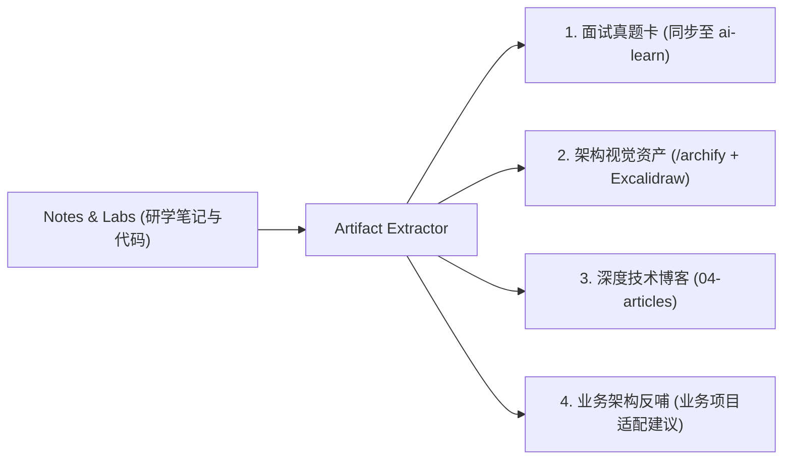

# Artifact Extractor - 研学资产提炼与分发引擎

## 🎯 核心使命

研学的最终目的不是死记硬背，而是**资产沉淀与多端复用（一鱼四吃）**。
本 Skill 负责在某个章节或整个框架学透后，将零散的笔记、调试记录与沙盒代码，自动重构为四类高价值标准化资产：

---

## 📦 五大输出规范

### 1. 面试真题卡（对齐 ai-learn 格式标准）
提炼生成符合 `ai-learn/01-interview-qa/` 标准的 Markdown 文档：
- 一句话定义（记忆锚点）
- 标准答案（技术规范表述）
- 口语化面试表述（开场破题 + 2~3分钟深度展开 + 30秒极简版）
- 记忆技巧 & 逻辑链路
- 结合项目的实战回答台词
- 面试官连环追问清单

输出目录：`04-outputs/interview-cards/<topic>.md`

### 2. 在线知识站与演播胶片（一键直通 GitHub Pages / github.io）
将研学精华无损输出到个人线上知识中枢：
- **Astro 知识库 (Site)**：生成符合 `knowledge-notes/content/` 规范的 Markdown 专栏文件（带统一 YAML frontmatter），存入 `04-outputs/site-docs/<topic>.md`，支持一键同步到本地 `knowledge-notes` 并通过 GitHub Actions 部署上线！
- **互动演播胶片 (Deck)**：生成符合 `knowledge-notes-deck` 规范的高交互演示页面或 Markdown，存入 `04-outputs/deck-slides/<topic>.md`。

### 3. 架构视觉资产
- **系统拓扑与核心调用时序**：提炼数据流与边界，调用 `/archify` 编译交互式无损矢量 HTML/SVG，存入 `assets/architecture/`。
- **白板心智模型**：调用 `excalidraw-gen` 输出霞鹜文楷手绘图，存入 `assets/excalidraw/`。

### 4. 多平台技术博客底稿
- 自动提取 `03-notes/` 中的直觉心智模型与技术事实，结合 `02-labs/` 中的真实代码和报错经验；
- 调用 `article-gen` 生成符合人类语言习惯（严格遵守 `humanizer-zh`）的通用母稿 `04-articles/drafts/<title>.md`；
- 适配为各大平台版本（掘金、知乎、CSDN、小红书）。

### 5. 业务项目反哺建议（Bridge to Production）
- 提炼该框架中最值得在自己的主业务工程中借鉴的 1~2 个设计模式；
- 指出潜在坑点、侵入性成本与落地路径，存入 `04-outputs/production-takeaways.md`。
