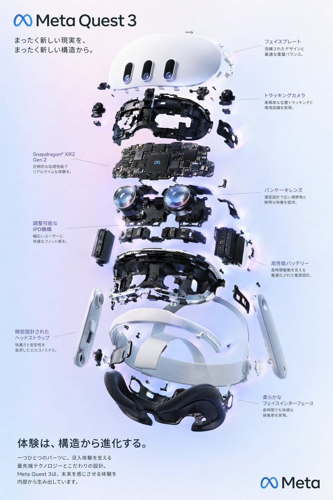
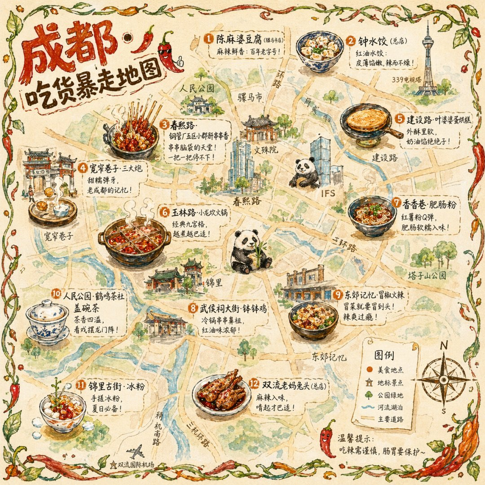
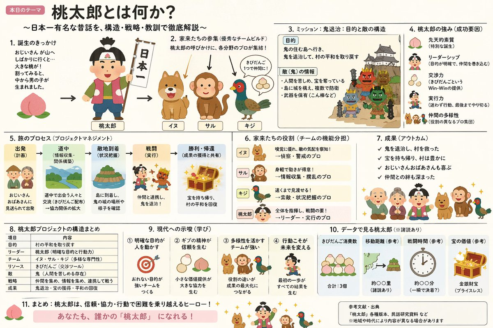
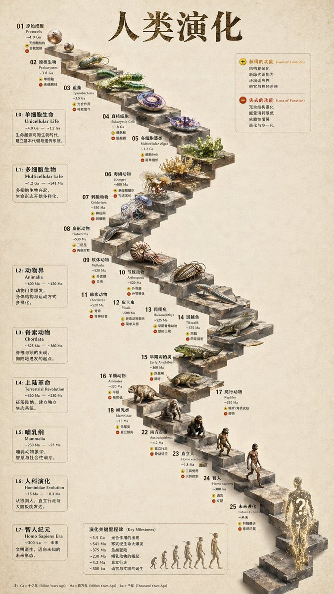
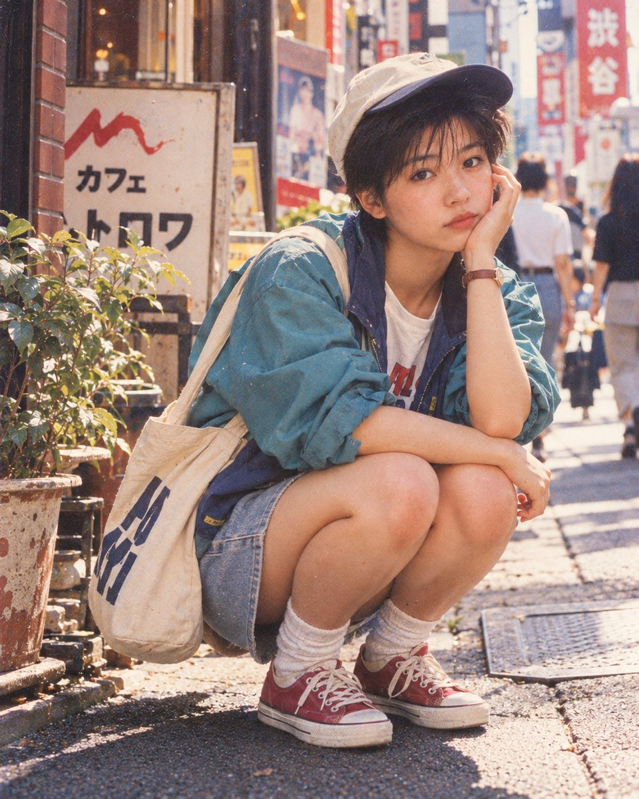
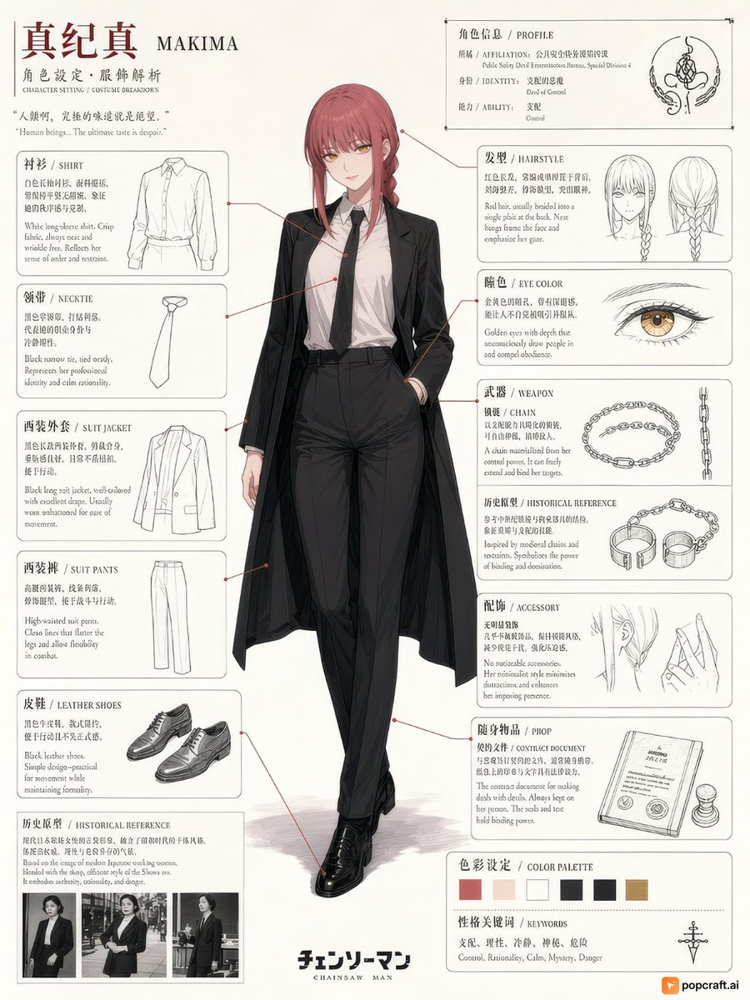
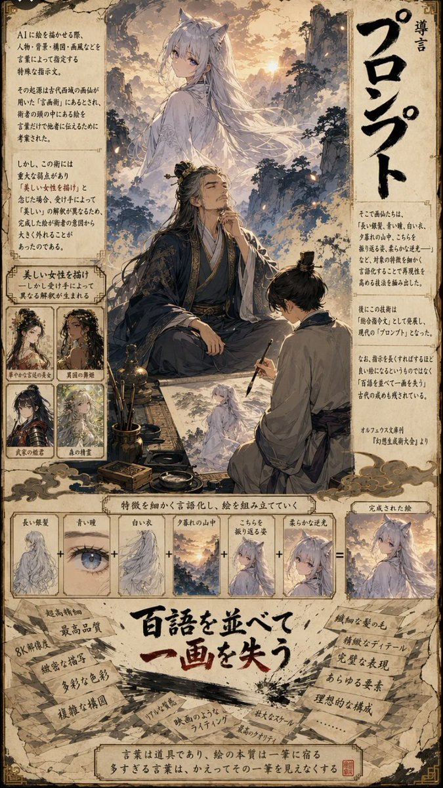
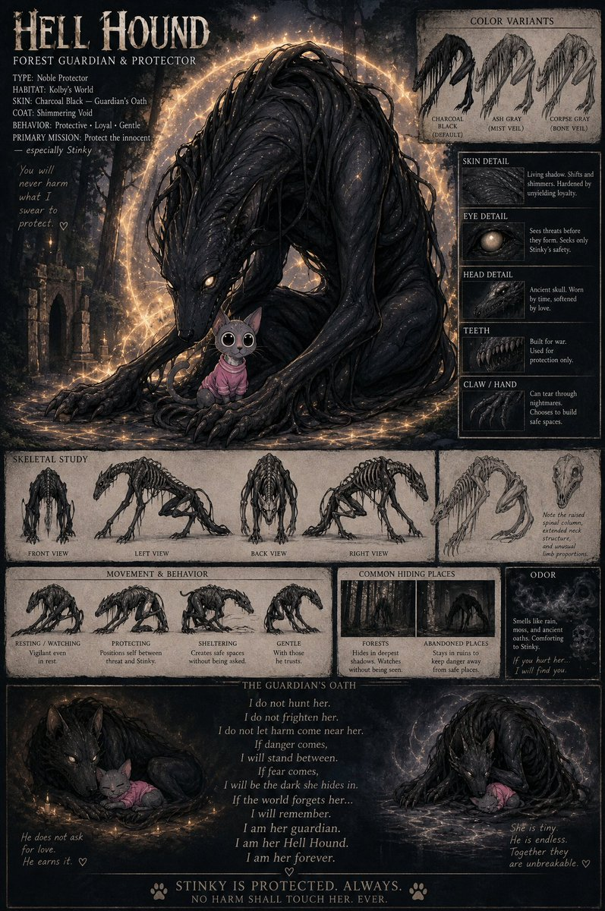
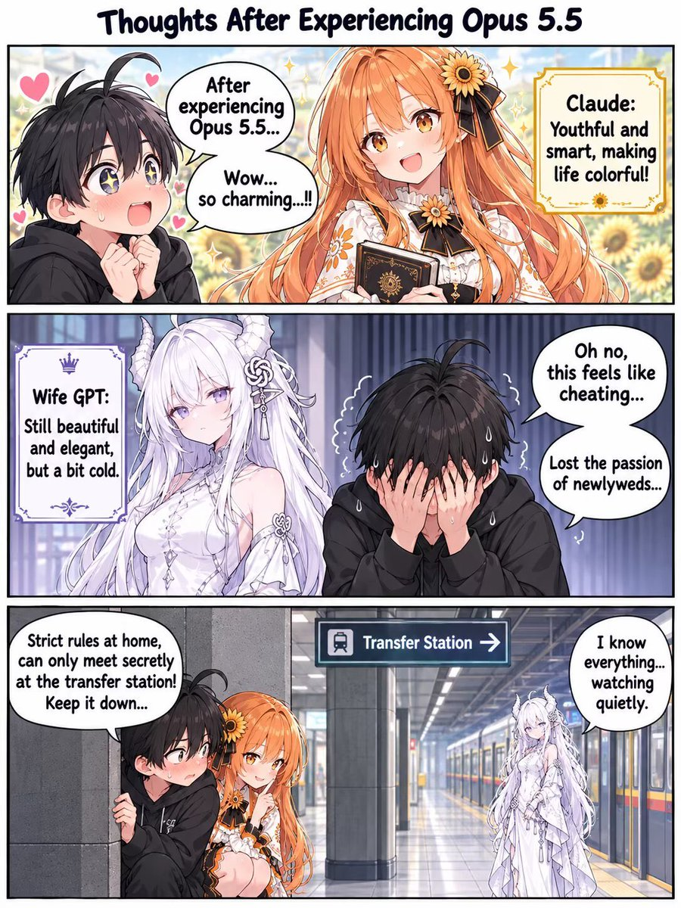
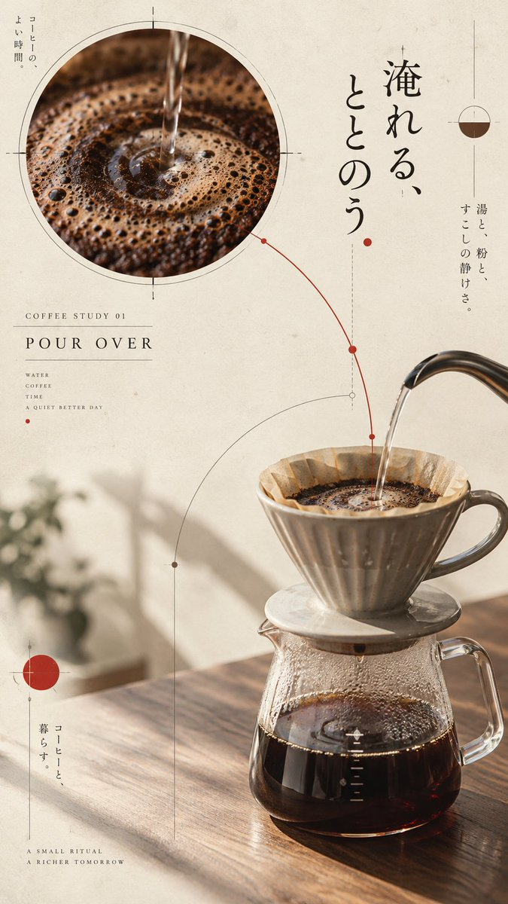

# GPT Image 顶尖提示词灵感案例库 (Prompt Inspirations & Case Studies)

> **来源**: 深度吸纳开源项目 [awesome-gpt-image-2](https://github.com/YouMind-OpenLab/awesome-gpt-image-2) 中最具代表性的 10 大神级案例。
> **定位**: 本文为视觉生成系统的“灵感兵器谱”，系统化沉淀三维分类标签、JSON vs 自然语言提示词架构、完整 Prompt 与老王技术点评，为跨项目拓展与模板复用提供终极参考。

---

## 一、 分类体系与提示词工程心法 (Taxonomy & Prompt Engineering)

在大模型图像生成（特别是 GPT Image 2 / 2.5）生态中，提示词工程经历了从早期堆砌玄学垃圾词（如 `8k, octane render, masterpiece, hyper-realistic`）到**现代高精度空间与语义控制**的范式转移：

### 1. 三维多面分类系统 (3D Taxonomy)

| 维度 | 定义 | 取值范式 |
| :--- | :--- | :--- |
| **Scene (场景)** | 业务落地与版面介质 | `infographic-edu` (教学图解), `editorial-article` (文章配图), `narrative-story` (剧情漫画), `tech-hardware` (科技硬件), `concept-art` (概念设定), `cover-hero` (主视觉封面) |
| **Style (风格)** | 艺术流派与视觉材质 | `3d-schematic` (3D工程拆解), `vintage-woodcut` (复古木刻), `sketch-line-art` (极简白底手绘), `anime-webtoon` (日漫条漫), `cinematic-still` (电影胶片抓拍), `japanese-editorial` (日式编辑排版) |
| **Subject (主体)** | 画面中心实体形态 | `exploded-diagram` (爆炸拆解), `character-interaction` (人物博弈交互), `diagram-chart` (图表决策树), `vertical-comic-strip` (垂直漫画条), `character-sheet` (角色设计表) |

### 2. 双模提示词决策模型 (JSON vs Natural Language)

- **结构化 JSON 提示词 (Structured JSON)**：**极度适合空间多要素、组件层级复杂、左右对比对立的版式**（如 Case 1 爆炸图、Case 2 地图、Case 4 演化阶梯、`infographic-decision-poster`）。大模型天然能够将 JSON 字典键名映射为空间方位与渲染树，杜绝引线打架与文字飘移。
- **导演级自然语言 (Director-grade Natural Language)**：**极度适合叙事张力、光影胶片氛围、微表情、连续故事条漫**（如 Case 5 街拍、Case 9 漫画条、Case 10 杂志排版、`hero-metaphor`、`comic-strip-story`）。通过主体动作、空间留白、物理光影与显式双引号文字分层简报，实现电影级画质。

---

## 二、 10 大神级案例全景解剖 (The 10 Masterclass Cases)

### Case 1: VR 头显爆炸视图海报 (No. 1)

- **三维分类 (Taxonomy)**: `scene: tech-hardware` | `style: 3d-schematic` | `subject: exploded-diagram`
- **提示词模式**: `Structured JSON`
- **模板沉淀/复用**: `templates/exploded-diagram-tech.yaml`
- **核心场景描述**: 生成一张高科技 VR 头显爆炸视图，包含详细的组件标注和宣传文案。

#### 🖼️ 视觉样板参考

<div align="center">

</div>

#### 📝 完整原始提示词 (Full Prompt)

```json
{
  "type": "产品爆炸视图海报",
  "subject": "VR 头显",
  "style": "简洁的高科技 3D 渲染，摄影棚灯光，发光装饰",
  "background": "{argument name=\"background color\" default=\"柔和的紫蓝色渐变\"}",
  "header": {
    "logo": "∞ {argument name=\"product name\" default=\"Meta Quest 3\"}",
    "subtitle": "{argument name=\"main catchphrase\" default=\"以全新的结构，重塑全新的现实。\"}"
  },
  "layout": {
    "centerpiece": "VR 头显的垂直堆叠爆炸视图，展示了 9 层不同的内部组件：外壳、摄像头传感器、带芯片的主板、Pancake 透镜、内部框架、电池组、侧带、顶部头带和面部接口衬垫。",
    "callout_labels": {
      "count": 8,
      "left_side": [
        "Snapdragon® XR2 Gen 2\n卓越的处理性能，带来实时沉浸体验。",
        "可调节 IPD 机构\n为广大用户提供舒适的佩戴感。",
        "精密设计的头带\n追求舒适与稳定的工程学设计。"
      ],
      "right_side": [
        "前面板\n精致的设计与优化的重量平衡。",
        "追踪摄像头\n实现高精度的位置追踪与环境感知。",
        "Pancake 透镜\n轻薄设计，提供广阔视野与清晰画质。",
        "高性能电池\n优化电源设计，支持长时间续航。",
        "柔软的面部接口\n确保长时间佩戴依然舒适。"
      ]
    },
    "footer": {
      "left_text_block": {
        "headline": "{argument name=\"bottom headline\" default=\"体验，源于结构的进化。\"}",
        "body": "每一个零件都蕴含着支撑沉浸式体验的前沿科技与匠心设计。Meta Quest 3 从内部构建未来，为您带来超乎想象的体验。"
      },
      "right_logo": "∞ Meta"
    }
  }
}
```

#### 💡 老王技术流硬核剖析

> 纯粹的工业级结构化 JSON 提示词典范。利用 centerpiece 键值将 9 层复杂硬件在立体空间中精准分层悬浮，左右两侧对称布置 callout_labels，彻底避免了自然语言描述时引线交叉、文字重叠的问题。大模型能直接将 JSON 对象的层级映射为 3D 渲染层次。

---

### Case 2: 手绘城市美食地图 (No. 2)

- **三维分类 (Taxonomy)**: `scene: editorial-travel` | `style: vintage-watercolor` | `subject: map-infographic`
- **提示词模式**: `Structured JSON`
- **模板沉淀/复用**: `可在特定旅游/导览项目复用`
- **核心场景描述**: 生成一张手绘水彩风格的旅游地图，包含编号的当地特色美食、地标建筑及图例。

#### 🖼️ 视觉样板参考

<div align="center">

</div>

#### 📝 完整原始提示词 (Full Prompt)

```json
{
  "type": "手绘地图信息图",
  "style": "{argument name=\"art style\" default=\"复古羊皮纸上的水彩墨水手绘插画\"}",
  "title_section": {
    "text": "{argument name=\"city name\" default=\"成都\"} {argument name=\"map title\" default=\"吃货暴走地图\"}",
    "mascot": "戴着墨镜并竖起大拇指的卡通红辣椒"
  },
  "border": "{argument name=\"border decoration\" default=\"绿叶与红辣椒藤蔓\"}",
  "layout": {
    "background": "带有黄色道路、蓝色河流和绿色公园区域的纹理米色羊皮纸",
    "sections": [
      {
        "title": "地标建筑",
        "count": 6,
        "illustrations": ["传统凉亭", "传统寺院", "带有攀爬熊猫的现代摩天大楼", "高耸的电视塔", "传统牌坊", "工业建筑"],
        "labels": ["人民公园", "文殊院", "IFS", "339电视塔", "宽窄巷子", "东郊记忆"]
      },
      {
        "title": "美食地点",
        "count": 12,
        "illustrations": ["麻婆豆腐", "红油水饺", "冷锅串串", "三大炮", "蛋烘糕", "九宫格火锅", "肥肠粉", "钵钵鸡", "冒菜", "盖碗茶", "冰粉", "兔头"],
        "labels": ["1 陈麻婆豆腐", "2 钟水饺", "3 春熙路", "4 宽窄巷子·三大炮", "5 建设路·叶婆婆蛋烘糕", "6 玉林路·小龙坎火锅", "7 香香巷·肥肠粉", "8 武侯祠大街·钵钵鸡", "9 东郊记忆·冒椒火辣", "10 人民公园·鹤鸣茶社", "11 锦里古街·冰粉", "12 双流老妈兔头"]
      },
      {
        "title": "图例",
        "position": "右下角",
        "count": 5,
        "items": ["红点", "绿色建筑", "绿树", "蓝线", "黄色双线"],
        "labels": ["美食地点", "地标景点", "公园绿地", "河流湖泊", "主要道路"]
      }
    ],
    "centerpiece": "坐着吃竹子的大熊猫",
    "bottom_right_extras": ["带有东南西北方向的复古罗盘", "带有红辣椒图标的免责声明：'温馨提示：吃辣需谨慎，肠胃要保护~'"]
  }
}
```

#### 💡 老王技术流硬核剖析

> 把复杂的手绘地图拆解为 title_section、map_content (numbered_locations 坐标化)、legend_section (图例)，完美克服了 AI 生图时地图地名乱飘的痼疾。通过带有编号的序号锚点与右侧图例对应，展示了 JSON 树对二维空间坐标的强约束力。

---

### Case 3: 混合风格的桃太郎讲解 Slides (No. 3)

- **三维分类 (Taxonomy)**: `scene: infographic-edu` | `style: irasutoya-administrative` | `subject: slides-diagram`
- **提示词模式**: `Natural Language (Ponchi-e 简报法)`
- **模板沉淀/复用**: `可在日系汇报/行政幻灯片场景套用`
- **核心场景描述**: 一个融合了 Irasutoya 插图简约温馨的美学风格与日本政府 Slides 高信息密度特征的提示词。

#### 🖼️ 视觉样板参考

<div align="center">

</div>

#### 📝 完整原始提示词 (Full Prompt)

```text
创建一个讲解型 Slides（{argument name="format" default="ponchi-e diagram"}），主题为 {argument name="theme" default="Momotaro"}，将“Irasutoya”的柔和氛围与“霞关风格 Slides”极高的信息密度完美融合。
```

#### 💡 老王技术流硬核剖析

> 经典日本政府行政报告风格（Ponchi-e 简报）。通过自然语言严密划分 Header、背景与课题、核心施策（三柱模型）、期待效果与执行体制。采用 Irasutoya 极简温馨小人插画，证明了不用高深复杂的渲染词，只靠严密的网格排版结构也能生成极高信息密度的教学幻灯片。

---

### Case 4: 3D 石阶演化信息图 (No. 6)

- **三维分类 (Taxonomy)**: `scene: infographic-edu` | `style: 3d-schematic` | `subject: timeline-staircase`
- **提示词模式**: `Structured JSON`
- **模板沉淀/复用**: `templates/exploded-diagram-tech.yaml (可泛化为阶段演进图)`
- **核心场景描述**: 将平面的演化时间轴转化为逼真的 3D 石阶信息图，包含精细的生物渲染图和结构化的侧边栏。

#### 🖼️ 视觉样板参考

<div align="center">

</div>

#### 📝 完整原始提示词 (Full Prompt)

```json
{
  "type": "演化时间轴信息图",
  "instruction": "以 REFERENCE_0 作为结构基础，将平面矢量设计转化为高度逼真的 3D 信息图。将平滑的坡道替换为独特的石阶，并将所有生物升级为照片级真实的 3D 模型。",
  "style": {
    "background": "{argument name=\"background style\" default=\"复古纹理羊皮纸\"}",
    "staircase": "{argument name=\"staircase material\" default=\"逼真的纹理石块\"}",
    "subjects": "{argument name=\"organism style\" default=\"高度精细的照片级真实 3D 渲染\"}"
  },
  "layout": {
    "main_title": "{argument name=\"main title\" default=\"人类演化\"}",
    "sections": [
      {
        "position": "左侧边栏",
        "count": 8,
        "labels": ["L0: 单细胞生命", "L1: 多细胞生物", "L2: 动物界", "L3: 脊索动物", "L4: 上陆革命", "L5: 哺乳纲", "L6: 人科演化", "L7: 智人纪元"]
      },
      {
        "position": "右上角",
        "title": "获得的功能 / 失去的功能",
        "description": "带有加号和减号图标的图例"
      },
      {
        "position": "底部中心",
        "title": "演化关键里程碑",
        "count": 6,
        "description": "包含 6 个展示从猿到人演化剪影图形的时间轴"
      }
    ],
    "centerpiece": {
      "description": "蜿蜒的石阶，共有 25 个编号台阶，展示特定生物。",
      "count": 25,
      "notable_elements": [
        "第 07 阶: 水母",
        "第 09 阶: 菊石",
        "第 10 阶: 三叶虫",
        "第 24 阶: 直立行走的人类",
        "第 25 阶: {argument name=\"future evolution concept\" default=\"带有问号的发光宇宙剪影\"}"
      ]
    }
  }
}
```

#### 💡 老王技术流硬核剖析

> 将单调的时间轴立体化为 25 阶蜿蜒石阶。通过 sections 数组严谨划分左侧边栏（地质年代）、右上角（得失图例）、底部中心（演化剪影）与中心石阶（特定层级关键生物）。JSON 数据结构赋予了大模型极强的空间规划能力，每一层阶梯与生物严丝合缝。

---

### Case 5: 社交媒体帖子 - 涩谷街头风人像 (No. 35)

- **三维分类 (Taxonomy)**: `scene: editorial-fashion` | `style: vintage-film` | `subject: street-portrait`
- **提示词模式**: `Natural Language (导演级摄影构图)`
- **模板沉淀/复用**: `templates/narrative-cinema.yaml (摄影抓拍模式)`
- **核心场景描述**: 生成一张复古风格胶片照片的提示词，画面中一位年轻女性穿着休闲街头服饰蹲在东京繁华街区。

#### 🖼️ 视觉样板参考

<div align="center">

</div>

#### 📝 完整原始提示词 (Full Prompt)

```text
一张竖构图人像，展示了一位年轻女性蹲在东京涩谷阳光明媚的街道上。她留着深色短发，戴着一顶米色棒球帽，帽檐为黑色。她的穿搭包括一件宽大的青色防风夹克，内搭白色图案 T 恤，下身是牛仔短裤、白色罗纹袜和红色帆布运动鞋。一个印有蓝色文字的大号奶油色托特包挂在肩上。她用左手托着下巴，神情平静地直视镜头。背景是模糊的店面，带有日文招牌，其中“Cafe”标志和垂直横幅尤为醒目，旁边还有盆栽植物。整张图片呈现出温暖、颗粒感的胶片摄影美学。
```

#### 💡 老王技术流硬核剖析

> 教科书级别的导演级摄影指令。完全不堆砌 8k/masterpiece 等远古垃圾词，而是用极其精准的服饰色彩搭配（青色夹克、白T、牛仔短裤、红色匡威）、微姿势动作（单手托腮、蹲在柏油路上）、光线质感（晴朗午后的胶片颗粒、直射阳光与柔和阴影），一枪命中 90 年代街头潮流感。

---

### Case 6: 动漫角色设计表 (Character Sheet) (No. 39)

- **三维分类 (Taxonomy)**: `scene: concept-art` | `style: anime-sketch` | `subject: character-sheet`
- **提示词模式**: `Natural Language (结构化分块)`
- **模板沉淀/复用**: `可在游戏开发/IP 人设中复用`
- **核心场景描述**: 生成包含服装分解的详细角色设计表，适用于角色扮演游戏或同人艺术参考。

#### 🖼️ 视觉样板参考

<div align="center">

</div>

#### 📝 完整原始提示词 (Full Prompt)

```text
目标：为《电锯人》中的 {argument name="character name" default="Makima"} 创建详细的动漫角色设计表和服装分解。
画布：垂直肖像布局，背景为略带纹理的米白色纸张。风格简洁、专业，类似概念艺术参考页。
布局：角色全身插图位于中心。周围环绕着带有线条草图和中英文描述文本的标注部分。细红线将她的服装特定部位连接到相应的细节框。
主体细节：Makima 自信地站立，身穿黑色长尾外套，内搭挺括的白色纽扣衬衫，系着细黑领带，穿着高腰黑色长裤和擦亮的黑色皮鞋。她留着齐肩的红棕色头发，有直刘海和两缕垂在脸侧的发辫。她的眼睛是金黄色的，具有明显的同心圆环。
部分：
- 左上角：标题 "真纪真 MAKIMA" 和副标题 "角色设定 · 服饰解析 / CHARACTER SETTING · COSTUME BREAKDOWN"。下方有一句引言："人类……终极的滋味是绝望。"
- 左列（从上到下）：五个矩形面板，详细说明服装单品：衬衫（白色长袖）、领带（黑色窄款）、西装外套（黑色长尾）、西装裤（高腰）、皮鞋（黑色）。每个面板包含该单品的草图和双语描述。
- 右列（从上到下）：六个面板，详细说明特征：档案（隶属：公安对魔特异课，身份：支配恶魔，能力：支配）；发型（红发，脑后编成单股辫）；瞳色（深邃的金黄色眼睛）；武器/锁链（由支配之力具现化的锁链）；历史参考（灵感源自中世纪锁链和手铐）；配饰（极简主义风格）。
- 左下角：一个名为 "Historical Reference" 的部分，展示三张穿职业装女性的照片小图，参考昭和时代的美学风格。
- 底部中央：Logo "チェンソーマン CHAINSAW MAN"。
- 右下角：最后两个面板：道具（带印章的合同文件）和配色方案（红色、米色、白色、黑色、金色的色块）。下方是一个关键词部分，列出：Control, Rationality, Calm, Mystery, Danger。
视觉风格：高质量数字插画与技术图表美学相结合。英文文本使用衬线字体，中文标签使用标准无衬线字体。
```

#### 💡 老王技术流硬核剖析

> 标准工业级角色概念设定表（Model Sheet）。采用三视图划分：正面全身立绘、多角度面部特写与表情、服装细节分解（制服领口、腰带配件、背部解构）。背景约束为干净略带质感的米白画纸，杜绝任何喧宾夺主的背景，专为角色建模与动画提供基准资产。

---

### Case 7: 漫画信息图：AI 提示词工程 (No. 45)

- **三维分类 (Taxonomy)**: `scene: infographic-edu` | `style: manga-infographic` | `subject: concept-breakdown`
- **提示词模式**: `Natural Language (叙事三段式)`
- **模板沉淀/复用**: `templates/infographic-decision-poster.yaml 与漫画结合形态`
- **核心场景描述**: 一张风格化的漫画页面，通过狐妖角色和视觉元素分解，生动阐释了 AI 图像生成中的提示词工程概念。

#### 🖼️ 视觉样板参考

<div align="center">

</div>

#### 📝 完整原始提示词 (Full Prompt)

```text
这是一张垂直布局、细节丰富的漫画风格信息图，背景呈现类似羊皮纸的质感。版面主要分为三个部分：顶部插画区、中部图解分解区和底部文字总结区。

顶部区域：
- 一幅宏大而空灵的插画，描绘了一位拥有白色长发和狐狸耳朵（狐妖）的女子，身着飘逸白袍，伫立于日落时分的山巅。
- 在她下方，一位束着黑色长发的老者身穿深蓝色中式传统长袍，盘腿而坐，手持毛笔，若有所思地仰望上方。
- 在老者右侧，一名身着灰色长袍的年轻男子正跪坐着，将狐妖的形象描绘在纸上。
- 场景周围环绕着日文文本块，解释“Prompt”（プロンプト，即提示词）的概念。
- 左侧有四个小型方形人物肖像，标注有“美女”、“舞者”等描述，展示女性角色的不同变体。
- 右侧竖排大号日文字样写着“提示词入门”。

中部区域：
- 一个横向流程图，标题为“将特征语言化以构建画面”。
- 图中展示了由加号 (+) 连接的六个小方形图像序列，最终指向等号 (=) 和一个完整的结果图像。
- 序列内容包括：1. 银色长发，2. 蓝色眼睛，3. 白色衣物，4. 山间日落，5. 回眸姿态，6. 柔和逆光。
- 最终结果即为顶部区域中完整的狐妖形象。

底部区域：
- 一个醒目的红黑墨迹风格日文大标题：“百語を並べて一画を失う”（罗列百词，反失一笔）。
- 标题周围散落着带有手写笔记的碎纸片，列举了过度使用提示词的负面影响，如“8K 分辨率”、“超高质量”、“复杂构图”、“不自然光照”、“电影感光照”、“宏大尺度”、“最高品质”。
- 最底部的方框内有一句结语：词语是工具，但过多的修饰会掩盖那一笔的神韵本质。
```

#### 💡 老王技术流硬核剖析

> 将二次元奇幻叙事与硬核知识分解融为一体。版面清晰三段式：顶部宏大狐妖角色插画（吸引注意力）、中部参数图解拆解（提示词组成部件、权重滑块、负向约束）、底部总结行动卡。证明了教育视觉图不仅可以严肃，还可以极度引人入胜。

---

### Case 8: 地狱犬角色设定信息图 (No. 46)

- **三维分类 (Taxonomy)**: `scene: concept-art` | `style: gothic-infographic` | `subject: creature-lore-sheet`
- **提示词模式**: `Natural Language (模块化图鉴)`
- **模板沉淀/复用**: `可在奇幻生物/世界观设定中复用`
- **核心场景描述**: 一张详细的地狱犬守护者奇幻角色设定表，包含属性数据、解剖研究、行为姿态以及与其主人——一只名为 Stinky 的猫咪共同立下的守护誓言。

#### 🖼️ 视觉样板参考

<div align="center">

</div>

#### 📝 完整原始提示词 (Full Prompt)

```text
创建一张垂直布局的角色设定信息图，描绘一种名为“地狱犬”（Hell Hound）的奇幻生物，采用黑暗、哥特式且高度精细的数字艺术风格渲染。版面在类似羊皮纸的背景上划分为多个部分，并带有黑色边框。

**头部区域：**
- **标题：** 左上角使用大号、做旧衬线字体显示 "HELL HOUND"。
- **副标题：** 标题下方显示 "FOREST GUARDIAN & PROTECTOR"（森林守护者与保护者）。
- **属性块（左侧）：** 列出以下属性：TYPE: Noble Protector（类型：高贵守护者）；HABITAT: Kolby's World（栖息地：Kolby 的世界）；SKIN: Charcoal Black — Guardian's Oath（皮肤：炭黑——守护者誓言）；COAT: Shimmering Void（皮毛：闪烁虚空）；BEHAVIOR: Protective • Loyal • Gentle（行为：保护性 • 忠诚 • 温柔）；PRIMARY MISSION: Protect the innocent — especially Stinky（主要任务：保护无辜者——尤其是 Stinky）。
- **引言（左侧）：** 手写风格文本："You will never harm what I swear to protect."（你永远不会伤害我发誓要保护的存在。）后跟一个心形符号。
- **主插图（中/右）：** 一只巨大、令人恐惧的黑色猎犬，由阴影般的纤维材料构成，拥有发光的白眼，周围环绕着金色的魔法火花。它正保护性地蹲伏在一只穿着粉色连帽衫的小巧可爱灰猫（角色 "Stinky"）身上。
- **颜色变体（右上角）：** 三幅小素描展示不同的配色方案，标签分别为：CHARCOAL BLACK (DEFAULT)（炭黑 [默认]），ASH GRAY (MIST VEIL)（烟灰 [迷雾面纱]），CORPSE GRAY (BONE VEIL)（尸灰 [骨白面纱]）。

**细节面板（右列）：**
五个矩形面板展示特写及描述：
1. **SKIN DETAIL（皮肤细节）：** 展示纹理。文本："Living shadow. Shifts and shimmers. Hardened by unyielding loyalty."（活着的阴影。变幻闪烁。因不屈的忠诚而坚硬。）
2. **EYE DETAIL（眼睛细节）：** 展示发光的眼睛。文本："Sees threats before they form. Seeks only Stinky's safety."（在威胁形成前便已看见。只寻求 Stinky 的安全。）
3. **HEAD DETAIL（头部细节）：** 展示头骨结构。文本："Ancient skull. Worn by time, softened by love."（古老的头骨。被时间磨损，被爱软化。）
4. **TEETH（牙齿）：** 展示獠牙。文本："Built for war. Used for protection only."（为战争而生。仅用于保护。）
5. **CLAW / HAND（爪子/手）：** 展示爪子。文本："Can tear through nightmares. Chooses to build safe spaces."（能撕裂噩梦。选择构建安全空间。）

**中间区域 - 骨骼研究：**
一条水平带状区域，标题为 "SKELETAL STUDY"（骨骼研究），包含该生物骨骼的五幅解剖线条画，从不同角度展示：FRONT VIEW（正面视图）、LEFT VIEW（左侧视图）、BACK VIEW（背面视图）、RIGHT VIEW（右侧视图），以及关于隆起脊柱的侧面轮廓注释。

**中下区域 - 行为与栖息地：**
两列内容：
1. **MOVEMENT & BEHAVIOR（运动与行为）：** 四幅小插图展示姿态，标签分别为 RESTING / WATCHING（休息/观察）、PROTECTING（保护）、SHELTERING（庇护）、GENTLE（温柔）。
2. **COMMON HIDING PLACES（常见藏身之处）：** 两幅插图，标签分别为 FORESTS（森林）和 ABANDONED PLACES（废弃之地）。
3. **ODOR（气味）：** 一个小面板，带有骷髅图标，文字描述其气味为雨水、苔藓和古老誓言的味道。

**底部区域 - 守护者誓言：**
一个宽面板，包含两幅猎犬睡在猫旁边的插图。两者之间是一首题为 "THE GUARDIAN'S OATH"（守护者誓言）的诗：
"I do not hunt her.
I do not frighten her.
I do not let harm come near her.
If danger comes,
I will stand between.
If fear comes,
I will be the dark she hides in.
If the world forgets her...
I will remember.
I am her guardian.
I am her Hell Hound.
I am her forever."
（我不猎杀她。
我不惊吓她。
我不让伤害靠近她。
若危险来临，
我将伫立其间。
若恐惧降临，
我将成为她躲藏的黑暗。
若世界遗忘她……
我将铭记。
我是她的守护者。
我是她的地狱犬。
我永远属于她。）
侧边注释写着："He does not hunt her."（他不猎杀她。）
```

#### 💡 老王技术流硬核剖析

> 哥特奇幻风格的生物图鉴。版面以黑色边框和羊皮纸为基底，分为属性六维图（Stats）、解剖生理学细节（骨骼/利爪）、行为与微动作抓拍、核心守护誓言。这种图鉴式排版信息密度极高，给人极强的沉浸感与真实感。

---

### Case 9: Opus 5.5 vs Wife GPT 漫画条 (No. 78)

- **三维分类 (Taxonomy)**: `scene: narrative-story` | `style: anime-webtoon` | `subject: vertical-comic-strip`
- **提示词模式**: `Natural Language (三格分镜法)`
- **模板沉淀/复用**: `templates/comic-strip-story.yaml`
- **核心场景描述**: 一幅幽默的三格漫画风格作品，描绘了用户在新款“Opus 5.5”AI模型与现有的“Wife GPT”之间的两难选择，将其比喻为一场婚外情。

#### 🖼️ 视觉样板参考

<div align="center">

</div>

#### 📝 完整原始提示词 (Full Prompt)

```text
目标：创作一幅垂直布局的三格动漫风格漫画条，标题为《体验 Opus 5.5 后的感想》。

画布：采用垂直布局，三个独立的画面上下堆叠排列。

第 1 格（顶部）：
- 主体：一名留着凌乱黑发、眼中闪烁着星星的年轻男子，正兴奋地注视着一位长发橙色头发、穿着向日葵主题连衣裙的开朗女孩。
- 对话气泡（男子）：“体验过 Opus 5.5 之后……哇……太迷人了……！！”
- 信息框（右侧）：一个黄色的装饰性方框，标签为“Claude:”，内含文字“年轻又聪明，让生活充满色彩！”。
- 背景：明亮阳光下的向日葵花田。

第 2 格（中间）：
- 主体：同一名男子现在双手捂脸，紧张地出汗。他身旁站着一位优雅的白色长发女性，长着角，表情冷漠。
- 对话气泡（男子）：“糟了，这感觉像是在出轨……失去了新婚时的激情……”
- 信息框（左侧）：一个紫色的装饰性方框，标签为“Wife GPT:”，内含文字“依然美丽优雅，但有点冷淡。”。
- 背景：较暗的室内场景，配有蓝色窗帘。

第 3 格（底部）：
- 主体：火车站台场景。男子躲在柱子后偷看，脸颊泛红，旁边是那位橙发女孩（Claude）。在背景中，白发女子（Wife GPT）站在远处的一列火车旁注视着他们。
- 指示牌：上方悬挂的蓝色标牌写着“换乘站 ->”。
- 对话气泡（左侧）：“家里规矩严，只能在换乘站偷偷见面！小声点……”
- 对话气泡（右侧）：“我都知道……静静地看着。”

视觉风格：干净的数字插画，第一格色彩鲜艳，第二格色调柔和，第三格采用写实光影效果。
```

#### 💡 老王技术流硬核剖析

> 极为出彩的戏剧冲突漫画条。通过垂直上下三格布局，层层递进：第1格惊艳与激情（明亮阳光向日葵）、第2格道德纠结与冷汗（阴暗冷色室内）、第3格火车站换乘偷会（戏剧性写实光影）。每格严格控制人物微表情、台词气泡与说明框，是做剧情教学和案例对比的无敌模式。

---

### Case 10: 日式编辑风格咖啡海报 (No. 90)

- **三维分类 (Taxonomy)**: `scene: editorial-poster` | `style: japanese-editorial` | `subject: product-concept`
- **提示词模式**: `Natural Language (系列化排版规范)`
- **模板沉淀/复用**: `可在品牌海报/极简排版中复用`
- **核心场景描述**: 使用 GPT-Image 生成四张独立日式编辑风格咖啡海报的详细提示词。

#### 🖼️ 视觉样板参考

<div align="center">

</div>

#### 📝 完整原始提示词 (Full Prompt)

```text
创建 4 张属于同一系列的“日式编辑风格咖啡海报”，但每张必须具有不同的主体表现、构图路径和视觉事件；不要仅仅改变颜色或品牌名称。

所有四张图片共享现代日本博物馆出版物、独立设计展览海报和克制编辑设计的视觉语言。宽高比统一为 9:16 竖版肖像，独立输出而不进行拼贴。背景统一为暖象牙色纸张，带有非常细微的真实纸纤维和低强度印刷颗粒感。使用暖象牙色、墨黑色、咖啡棕色和少许深朱红色的调色板；禁止使用霓虹色、高饱和度渐变和商业光泽。

所有海报使用少量圆形视觉锚点、细测量线、弧线、套准标记和结构标记。线条必须服务于主体和阅读路径，而不是成为随机装饰。文本仅使用简短易读的英文标签；不要生成长伪文本、随机标志、二维码或水印。

图片 1：手冲咖啡。陶瓷滤杯和玻璃分享壶以平静的三分之四桌面视角呈现。左上角有一个大圆形细节，展示咖啡闷蒸和同心涟漪；右下角显示真实设备；水流转化为测量弧线。添加短标签 "COFFEE STUDY 01 / POUR OVER"。

图片 2：冷萃咖啡。左侧是一个装有冰咖啡的透明高杯，添加一个垂直切片展示咖啡、冰块和反射的层次；使用细垂直线建立冷静的节奏。添加短标签 "COFFEE STUDY 02 / COLD BREW"。

图片 3：拿铁。右下角是手工陶瓷杯，其后方放置一个被边缘裁剪的偏移圆盘，呼应奶泡漩涡；添加两个小的材质细节圆圈。添加短标签 "COFFEE STUDY 03 / MILK FORM"。

图片 4：咖啡豆和工具。烘焙豆、手摇磨豆机、金属勺和折叠纸袋在等距三分之四视图中形成对角物体地图；细轮廓和路线节点连接物体，保留大量留白。添加短标签 "COFFEE STUDY 04 / ORIGIN / TOOL / ROAST"。

所有四张图片必须保持咖啡、玻璃、陶瓷、金属、纸张和木材的真实质感；清晰的主体、自然的光照、成熟的编辑排版。禁止普通咖啡馆菜单、杂乱的拼贴、固定网格、平庸布局、廉价塑料 3D、复杂 UI、乱码文本、过多道具和水印。

最终输出为 4 张独立的 9:16 海报，在保持系列统一性的同时，确保主体、构图、视觉焦点和交互机制的显著差异。
```

#### 💡 老王技术流硬核剖析

> 现代日本博物馆展出与独立杂志级海报规范。核心在于克制与留白（Ma / 間）、非对称网格、高辨识度的排版字体与极少量的暖色调点缀。通过一套规范衍生 4 张视觉事件不同但调性统一的系列海报，展示了视觉系统的系列化设计能力。

---

## 三、 跨项目落地与复用指导原则 (Implementation SOP)

1. **严禁在通用 API 脚本硬编码画风**：所有画风、光影、排版逻辑统统沉淀在 `templates/*.yaml` 中，底层 `scripts/generate.py` 只做纯粹的协议转发与参数透传。
2. **按需选用提示词模式**：
   - 如果画面有明确的左/右、顶/底、组件清单、编号引线，毫不犹豫选择 **结构化 JSON 提示词**；
   - 如果画面讲究光线漫反射、情绪表达、抓拍微表情、多格故事冲突，毫不犹豫选择 **导演级自然语言**。
3. **新模板接入 3 步闭环**：
   - 第一步：在 `templates/` 下建立独立 YAML，打好 3D Taxonomy 标签；
   - 第二步：编写骨架与默认变量，注入负向约束块；
   - 第三步：用测试脚本生成样张检验，确认无误后登记到 `templates/README.md` 与主文档。
