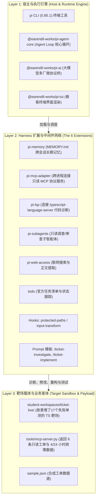

# 🗺️ Pi Agent 深度研学：技术意图与拓扑角色对账单 (Intent & Topology Manifest)

> 💡 **防走形定海神针 (SSOT)**：  
> 本文件明确了 Pi Agent 研学全生命周期的系统角色边界。  
> **核心铁律**：彻底剥离官方课件中的业务外衣，区分宿主执行引擎、Harness 扩展网络与被测靶场工程，严禁主客颠倒！

---

## 🏛️ Pi Agent 认知拓扑全景 (System Topology)

- **Layer 1: 宿主与执行引擎**：终端运行的 `pi` 命令。负责接收人类输入、维护 Agent Loop 循环、调用大模型并分发工具。
- **Layer 2: Harness 扩展网络**：Part 2 学习的核心价值所在！6 个独立的 NPM 扩展包，通过 Pi 扩展协议提供记忆、MCP、LSP 诊断、子角色派发等能力。
- **Layer 3: 靶场载体与业务客体**：`ticket-live` 只是躺在手术台上的小白鼠！里面的 `sla.ts`、`search.ts`、`report.ts` 是故意写错的业务代码，用于验证 Pi 的修复能力。**我们绝不是在学怎么写这 125 行业务逻辑！**

---

## 📋 逐章教学意图与对账矩阵

| 章节编号 | 官方课件名称 | 核心技术机制 (Core Mechanism) | 演示业务外壳 (Toy Wrapper - 勿深陷) | 主客体关系 (Subject vs Object) | 官方实验验收标准 (Verification Gate) | 课件原始文件坐标 |
|---|---|---|---|---|---|---|
| **Part 1** | 上手 Pi Agent：原理架构与四大内置工具 | Agent Loop 状态机循环、纯文件会话持久化、`read/write/edit/bash` 四大原子工具、多级规则级联 | 控制台问答与简单 Todo | Pi CLI / SDK ➔ 调度内置工具修改测试文本 | 跑通 4 阶段 SDK 脚本；JSONL 状态树成功持久化 | `Part 1.ipynb` + `sdk-demo/` |
| **Part 2** | 组装 Pi Agent：Harness 全景与 MCP 适配 | 6 大 Harness 扩展加载、MCP Stdio 通信与工具映射、LSP 语言服务器诊断、Subagent 派发 | ticket-live (工单超时计算、搜索排序、报表汇总) | **Pi CLI (医生)** ➔ 通过 6 大扩展诊断并修复 **ticket-live (病人)** | 在终端输入 `/course-check` 工具全绿；24+3 项单测全绿；受保护文件哈希未变 | `Part 2.ipynb` + `学员扩展资源包-20260918/` |
| **Part 3** | 定制 Pi Agent：从 Prompt 模板到 TUI 扩展包 | 自定义 Extension 开发、`pi.on` 注册生命周期 Hook、Input Transform 拦截、TUI 底栏组件扩展 | 状态栏 Token 监控、受保护路径拦截 | 自定义 Extension ➔ 拦截 Pi 宿主运行事件 | 扩展包成功加载；受保护路径修改被拦截拒执 | `Part 3.ipynb` + `official-examples/` |
| **Part 4** | 交付 Pi 应用：从双端 Spec 到生产业务迁移 | CLI 与 Web UI 双端对齐、生产级沙箱隔离、并发安全与企业架构迁移 | 完整客服与运维工单问答助手 | 生产架构 ➔ 封装 Pi Core 并提供 API/Web 界面 | 双端会话无缝同步；生产级鉴权与并发锁验收 | `Part 4.ipynb` |

---

## 🔍 Agent 内部自检核对规则

1. **下笔前自查**：在编写 Part 2 第四章内容时，必须牢记：主角是 `pi` 命令与其 6 大扩展，不是 `ticket-live` 的 TS 业务代码。
2. **严防业务冗余**：笔记严格聚焦在 Pi CLI 如何加载扩展、MCP 与 LSP 如何交互通信，禁止通篇粘贴工单算法。
3. **真实物理现场**：以本地 13 个离线包安装完成的 `./node_modules/.bin/pi` 为执行依据，指导用户在终端启动 TUI 并输入 `/course-check`。
