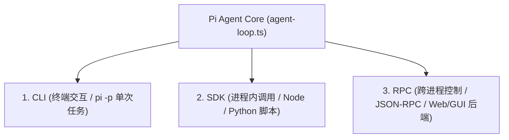

# Part 1 核心概念深潜：Pi Agent 架构原理与运行底座

> **对应课件**：第一节课-上手Pi-Agent：原理架构、安装配置与能力扩展  
> **源码对齐**：`earendil-works/pi` (commit `71dca871b`) / `@earendil-works/pi-coding-agent`

---

## 💡 一、人话动机：为什么会出现 Pi Agent？

### 1. 传统框架犯了什么病？
在 Pi 出现之前，很多人用 LangChain 或早期 AutoGPT 做 Agent。但真实工业落地时被坑惨了：
- **过度抽象与黑盒嵌套**：一个简单的 Prompt 被包装成了八层 Class，报个错调用栈有 30 层深，排障全靠猜；
- **自作聪明的状态流**：框架在中间做了各种自以为是的“预处理”和“后处理”，模型本来输出正确的 JSON，被框架转义一遍反而坏了；
- **死循环与资源爆炸**：一旦模型进入循环调用，缺乏底层的硬限制和精确拦截。

### 2. Pi 的极简哲学：六项核心取舍
Pi 诞生时确立了六项极其硬核的极简原则：
1. **模型决定下一步，Pi 只负责把执行结果老老实实喂回去**：绝不擅自修改模型的意图。
2. **工具只做原子操作**：不搞花里胡哨的复合工具，就给模型最基础的眼睛和手（`read/write/edit/bash`）。
3. **会话持久化回归文件**：不引入 Redis/Postgres 等笨重外部依赖，直接纯文本追加存盘（`~/.pi/agent/sessions/`），按目录隔离，支持像 Git 一样随时分支与回滚。
4. **统一双层架构**：内核只管 Loop（`@mariozechner/pi-agent`），外层负责交互与终端能力（`pi-coding-agent`）。
5. **单轮支持多工具并发**：一次 LLM 输出可以下发多个工具调用，不必每调一个工具就强制让模型重新思索一轮，大幅降低延迟和 Token。
6. **资源加载严格显式化**：通过 `DefaultResourceLoader` 精确控制加载哪些扩展、提示词和技能，杜绝隐式魔法。

---

## 🛠️ 二、四大内置工具的物理边界（为什么这么设计？）

| 工具名 | 核心职责 | 为什么这么设计？（底层防坑机制） | 源码位置 |
|---|---|---|---|
| `read` | 读取文件内容 | **防窗口撑爆**：大文件强制按行分页或截断，杜绝几万行代码瞬间把 LLM 上下文吃满。 | `core/tools/read.ts` |
| `write` | 全量写入/覆盖 | 写入前强制校验，若目标文件已存在必须显式覆盖，防无意识丢代码。 | `core/tools/write.ts` |
| `edit` | 精准局部修改 | **拒绝模糊替换**！必须提供 `edits[].oldText` 与 `newText`。`oldText` 必须在文件中唯一定位，多处匹配或找不到直接抛错，逼模型先 `read` 再 `edit`。 | `core/tools/edit.ts#L21` |
| `bash` | 终端命令执行 | 真实系统的执行触手，但有超时机制、环境隔离与退出码捕获。 | `core/tools/bash.ts` |

---

## 🔌 三、三大调用入口的本质区别

1. **CLI（人类交互入口）**：直接在终端打字，支持富文本 TUI 界面与 `/` 斜杠指令，也支持 `pi -p "xxx"` 批处理单次跑完退出。
2. **SDK（同进程集成入口）**：通过 Node 或 Python 代码直接 `import { createAgentSession }`，在自己的应用进程内部像调用普通函数一样驱动 Agent，适合将 Agent 深度嵌入自身服务。
3. **RPC（跨进程守护进程入口）**：Pi 作为一个常驻后台进程运行，前端或外部后端通过标准标准输入输出（stdin/stdout）或网络套接字发送 JSON-RPC 消息，解耦进程生命周期。

---

## 📋 四、全量技术事实核对表 (Lossless Fact Matrix)

| 事实项 | 规范值 / 路径 | 说明 / 边界条件 | 掌握点验 |
|---|---|---|---|
| **核心源码库** | `earendil-works/pi` | 早期版本叫 `badlogic/pi-mono`，切勿混淆安装 | ✅ |
| **Agent 循环源码** | `packages/agent/src/agent-loop.ts:156` | 模型调用 ➔ 工具分发 ➔ 结果聚合的主循环 | ✅ |
| **`edit` 参数签名** | `edits: Array<{oldText: string, newText: string}>` | `oldText` 重复出现会报错，多个编辑块不可重叠 | ✅ |
| **会话存储根目录** | `~/.pi/agent/sessions/` | 按工作目录绝对路径 Hash 分割，支持分支（branching） | ✅ |
| **项目约定优先级** | `AGENTS.md` / `CLAUDE.md` | `AGENTS.override.md` 覆盖普通约定；`.pi/SYSTEM.md` 覆盖基础提示词 | ✅ |
| **SDK 核心类** | `ModelRuntime`, `DefaultResourceLoader`, `createAgentSession` | `resourceLoader` 支持 `noExtensions: true` 等隔离参数 | ✅ |
| **流式事件监听** | `session.subscribe((event) => ...)` | 监听 `message_update` 下的 `text_delta` 实现实时打字机效果 | ✅ |
