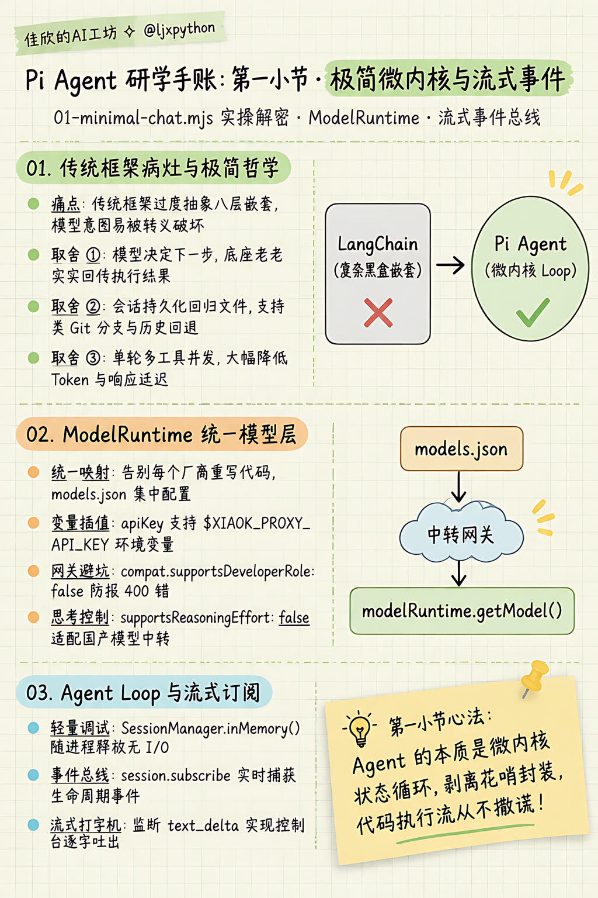
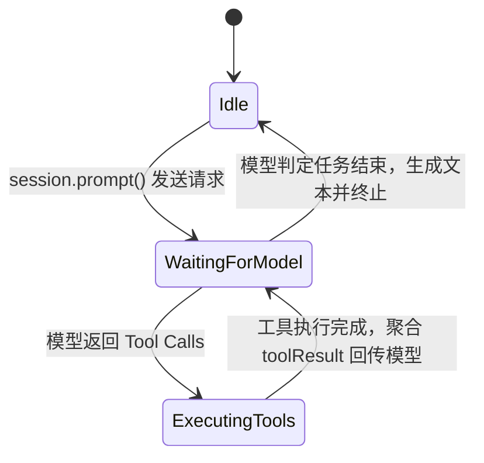
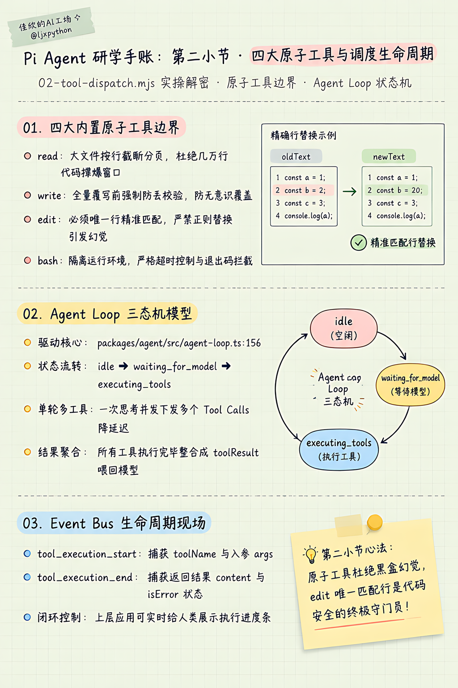
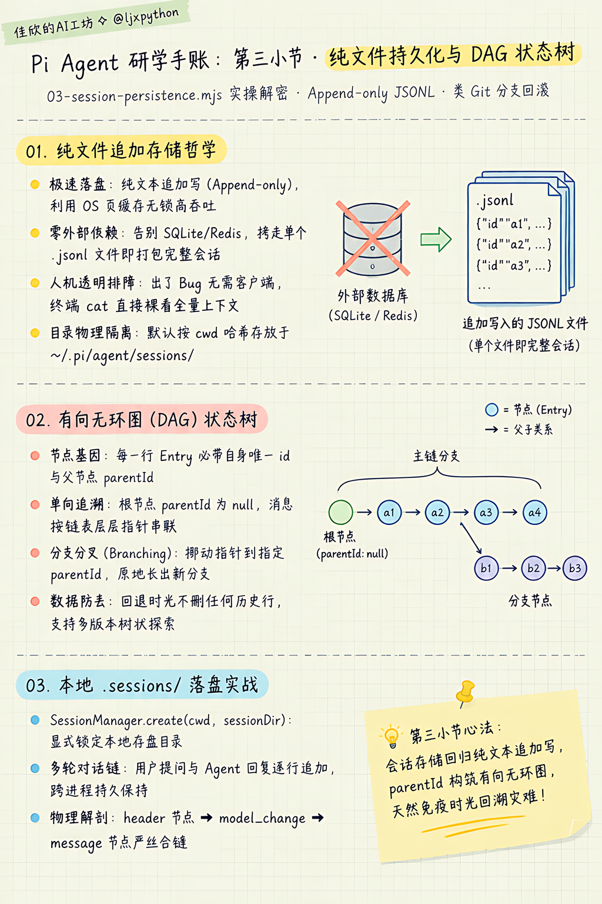
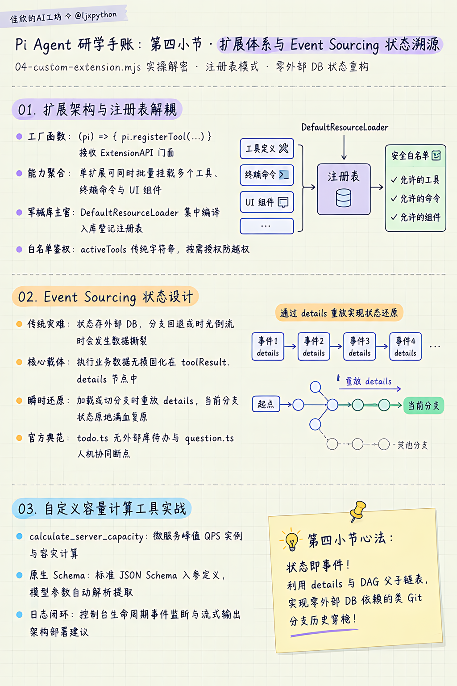
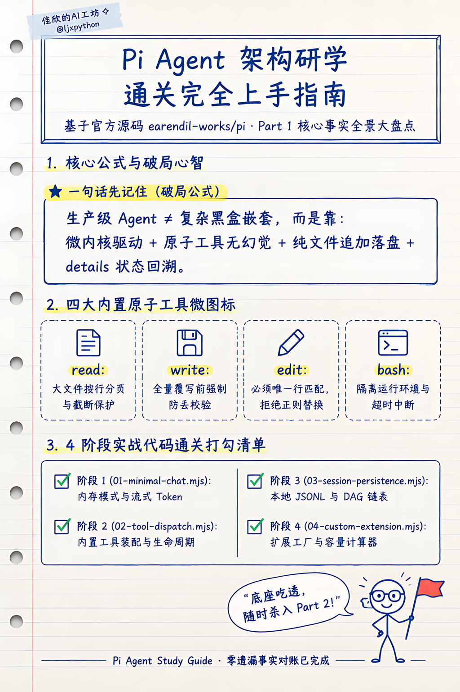

# Part 1 核心概念深潜：Pi Agent 架构原理与渐进式实战研学

> **对应课件**：第一节课-上手Pi-Agent：原理架构、安装配置与能力扩展  
> **源码对齐**：`earendil-works/pi` (commit `71dca871b`) / `@earendil-works/pi-coding-agent`  
> **配套实战沙盒目录**：[`02-labs/milestones/part1-basics/sdk-demo/`](../../02-labs/milestones/part1-basics/sdk-demo/)

---

## 🗺️ 全景导航：知识点与 Labs 代码演进映射矩阵

本研学体系彻底贯彻 **「渐进式里程碑演进原则」**。文档中的每一个理论知识点，均在沙盒中有一对一的代码实现与运行验证。读笔记时，可随时点击链接直达源码！

| 研学阶段 | 核心知识点与架构机制 | 解决的工程痛点 | 对应 Labs 沙盒代码 | 验证命令 | 关键检验现场 |
|---|---|---|---|---|---|
| **阶段 1：极简内核** | • `ModelRuntime` 统一模型层<br>• `SessionManager.inMemory()` 内存会话<br>• Agent Loop 流式事件订阅 | 摆脱 LangChain 笨重嵌套，用最小代码实现与大模型的流式交互 | [`01-minimal-chat.mjs`](../../02-labs/milestones/part1-basics/sdk-demo/01-minimal-chat.mjs) | `npm run demo:01` | 控制台逐字打印 `text_delta` 流式回复，无工具空转 |
| **阶段 2：原子工具** | • 四大原子工具边界（`read`/`write`/`edit`/`bash`）<br>• Agent Loop 三态机<br>• 工具生命周期事件捕获 | 传统复合工具黑盒幻觉高；通过原子化工具让模型自主决策每一步 | [`02-tool-dispatch.mjs`](../../02-labs/milestones/part1-basics/sdk-demo/02-tool-dispatch.mjs) | `npm run demo:02` | 控制台捕获 `tool_execution_start` 和 `tool_execution_end`，模型读本地文件 |
| **阶段 3：会话持久化** | • 纯文本追加写（Append-only JSONL）<br>• 目录级会话物理隔离<br>• Git-like `id`/`parentId` 树形 DAG | 告别 SQLite/Redis 等外部数据库；天然支持会话时光倒流与分支切换 | [`03-session-persistence.mjs`](../../02-labs/milestones/part1-basics/sdk-demo/03-session-persistence.mjs) | `npm run demo:03` | 本地 `.sessions/*.jsonl` 文件生成，多轮对话上下文链式记忆 |
| **阶段 4：扩展体系** | • Extension 扩展工厂机制<br>• `DefaultResourceLoader` 中央注册表<br>• Event Sourcing（事件溯源）状态设计 | 传统 Tool 散装难管；外部状态在分支回滚时断层；实现零外部 DB 状态重构 | [`04-custom-extension.mjs`](../../02-labs/milestones/part1-basics/sdk-demo/04-custom-extension.mjs) | `npm run demo:04` | 自定义 `calculate_server_capacity` 调度，`toolResult.details` 无损入库 |

---

## 💡 一、Pi Agent 的诞生动机与六项极简哲学

### 1. 传统框架犯了什么病？
在 Pi 出现之前，很多人用 LangChain 或早期 AutoGPT 做 Agent。但在真实工业落地时被坑惨了：
- **过度抽象与黑盒嵌套**：一个简单的 Prompt 被包装成了八层 Class，报个错调用栈有 30 层深，排障全靠猜；
- **自作聪明的状态流**：框架在中间做了各种自以为是的“预处理”和“后处理”，模型本来输出正确的 JSON，被框架转义一遍反而坏了；
- **死循环与资源爆炸**：一旦模型进入循环调用，缺乏底层的硬限制和精确拦截。

### 2. Pi 的极简哲学：六项核心取舍
Pi 诞生时确立了六项极其硬核的极简原则：
1. **模型决定下一步，Pi 只负责把执行结果老老实实喂回去**：绝不擅自修改模型的意图。
2. **工具只做原子操作**：不搞花里胡哨的复合工具，就给模型最基础的眼睛和手（`read/write/edit/bash`）。
3. **会话持久化回归文件**：不引入 Redis/Postgres 等笨重外部依赖，直接纯文本追加存盘（`~/.pi/agent/sessions/`），按目录隔离，支持像 Git 一样随时分支与回滚。
4. **统一双层架构**：内核只管 Loop（`@mariozechner/pi-agent`），外层负责交互与终端能力（`pi-coding-agent`）。
5. **单轮支持多工具并发**：一次 LLM 输出可以下发多个工具调用，不必每调一个工具就强制让模型重新思索一轮，大幅降低延迟和 Token。
6. **资源加载严格显式化**：通过 `DefaultResourceLoader` 精确控制加载哪些扩展、提示词和技能，杜绝隐式魔法。

---

## 🧩 二、第一阶段：微内核极简调用与流式事件响应

### 1. 核心知识点精讲

#### (1) `ModelRuntime`：统一模型层抽象
- **传统做法**：直接调用官方 OpenAI SDK 或第三方 HTTP 库，模型切换时需要重写大量适配代码。
- **Pi 的解法**：`ModelRuntime` 维护了一个全局的模型注册表，通过读取项目根目录或全局的 `models.json`，自动完成 Provider、BaseURL、API Key 环境变量插值（如 `$XIAOK_PROXY_API_KEY`）以及兼容性参数（如 `compat.supportsDeveloperRole: false`）的统一映射。

#### (2) `SessionManager.inMemory()`：会话管理的最简原型
- 在不需要存盘的单次脚本、单元测试或临时诊断场景中，使用 `SessionManager.inMemory()` 在内存中维护对话上下文；会话结束随进程直接释放，无任何磁盘或网络 I/O 开销。

#### (3) Agent Loop 的流式事件模型
- Pi 不采用传统的一问一答阻塞返回，而是通过事件总线进行实时广播。
- 会话对象 `session.subscribe((event) => { ... })` 会向外推送细粒度事件。对于文本流式输出，关注：
  - `event.type === "message_update"`
  - `event.assistantMessageEvent?.type === "text_delta"`
  通过 `process.stdout.write(event.assistantMessageEvent.delta)` 即可实现极客范十足的终端打字机流式效果。

---

### 2. 实战沙盒对应与代码拆解

- 📂 **沙盒源码位置**：[`02-labs/milestones/part1-basics/sdk-demo/01-minimal-chat.mjs`](../../02-labs/milestones/part1-basics/sdk-demo/01-minimal-chat.mjs)
- 🚀 **运行命令**：
  ```bash
  cd 02-labs/milestones/part1-basics/sdk-demo
  npm run demo:01
  ```

#### 关键源码逐行解析
```javascript
// 1. 初始化模型运行时并获取中转模型
const modelRuntime = await ModelRuntime.create();
const model = modelRuntime.getModel("xiaok", "deepseek-v4.1-flash");

// 2. 构造轻量资源加载器（关闭无关扩展，保持纯粹）
const resourceLoader = new DefaultResourceLoader({
  cwd: process.cwd(),
  agentDir: getAgentDir(),
  noExtensions: true,
  noSkills: true,
  noPromptTemplates: true,
  noThemes: true,
});
await resourceLoader.reload();

// 3. 构建最简会话：内存模式，无工具装配
const sessionManager = SessionManager.inMemory();
const { session } = await createAgentSession({
  modelRuntime,
  model,
  resourceLoader,
  sessionManager,
  tools: [], // 纯文本对话，不开放任何外部工具
});

// 4. 订阅事件总线：捕获流式 Token
session.subscribe((event) => {
  if (event.type === "message_update" && event.assistantMessageEvent?.type === "text_delta") {
    process.stdout.write(event.assistantMessageEvent.delta);
  }
});

// 5. 驱动 Agent 思考与回答
await session.prompt("你好");
```

#### 🖥️ 终端真实输出现场
```text
> demo:01
> node 01-minimal-chat.mjs

⚙️  [阶段 1] 正在初始化 Pi Agent ModelRuntime...
🎯 接入模型: xiaok / deepseek-v4.1-flash
🛠️  激活工具: [无工具]
你：你好
Agent：
你好。最近怎么样？
想聊什么——搭东西、写点东西，还是就这么待着？
✅ 会话已安全销毁，退出程序。
```

### 🎨 第 1 小节手账卡（极简微内核与流式事件）



---

## 🛠️ 三、第二阶段：内置原子工具装配与生命周期调度

### 1. 核心知识点精讲

#### (1) 四大内置工具的物理边界与设计哲学
Pi 坚决拒绝封装“一键重构项目”这种粗粒度、黑盒式的超级复合工具，而是提供与操作系统底层交互的四个基础原子工具：

| 工具名 | 核心职责 | 为什么这么设计？（底层防坑机制） | 源码位置 |
|---|---|---|---|
| `read` | 读取文件内容 | **防窗口撑爆**：大文件强制按行分页或截断，杜绝几万行代码瞬间把 LLM 上下文吃满。 | `core/tools/read.ts` |
| `write` | 全量写入/覆盖 | 写入前强制校验，若目标文件已存在必须显式覆盖，防无意识丢代码。 | `core/tools/write.ts` |
| `edit` | 精准局部修改 | **拒绝模糊替换**！必须提供 `edits[].oldText` 与 `newText`。`oldText` 必须在文件中唯一定位，多处匹配或找不到直接抛错，逼模型先 `read` 再 `edit`。 | `core/tools/edit.ts#L21` |
| `bash` | 终端命令执行 | 真实系统的执行触手，但有超时机制、环境隔离与退出码捕获。 | `core/tools/bash.ts` |

> [!TIP]
> **老王划重点（`edit` 为什么要求 `oldText` 唯一？）**：
> 很多 AI 编程工具之所以把代码改得稀巴烂，就是因为采用了正则替换或宽松模糊匹配。Pi 的 `edit` 工具底层规定：如果在原文件中找到了 2 处及以上相同的 `oldText`，工具直接抛出错误终止执行！这倒逼模型必须先调用 `read` 工具，看清楚上下文的前后几行，携带足够的定位行信息后再调用 `edit`，彻底杜绝误伤代码！

#### (2) Agent Loop 三态机流转
Pi 的底层调度核心（`agent-loop.ts`）由一个严谨的状态机驱动：


#### (3) 生命周期事件截获
在工具调度过程中，Event Bus 会触发以下关键事件：
- `tool_execution_start`：包含 `toolName`、`toolCallId` 以及模型生成的实参 `args`；
- `tool_execution_end`：包含工具执行的输出内容 `result` 与错误状态 `isError`。

---

### 2. 实战沙盒对应与代码拆解

- 📂 **沙盒源码位置**：[`02-labs/milestones/part1-basics/sdk-demo/02-tool-dispatch.mjs`](../../02-labs/milestones/part1-basics/sdk-demo/02-tool-dispatch.mjs)
- 🚀 **运行命令**：
  ```bash
  cd 02-labs/milestones/part1-basics/sdk-demo
  npm run demo:02
  ```

#### 关键源码逐行解析
```javascript
// 1. 在会话中挂载内置的原子工具名称
const activeTools = ["read", "bash"];
const { session } = await createAgentSession({
  modelRuntime,
  model,
  resourceLoader,
  sessionManager,
  tools: activeTools, // 显式激活 read 和 bash
});

// 2. 监听工具生命周期现场
session.subscribe((event) => {
  if (event.type === "tool_execution_start") {
    console.log(`⚡ [事件: tool_execution_start] 模型触发工具: ${event.toolName}`);
    console.log(`   👉 调用参数:`, JSON.stringify(event.args, null, 2));
  } else if (event.type === "tool_execution_end") {
    console.log(`✅ [事件: tool_execution_end] 工具执行完毕: ${event.toolName}`);
  }
});

// 3. 发送需要依靠工具才能回答的复杂问题
await session.prompt(
  "请使用 read 工具查看当前目录下的 package.json 文件，提炼出项目的 name 和核心依赖 dependencies 告诉我。"
);
```

#### 🖥️ 终端真实输出现场
```text
> demo:02
> node 02-tool-dispatch.mjs

⚙️  [阶段 2] 正在初始化 Pi Agent ModelRuntime...
🔌 正在创建 Agent 会话并挂载内置原子工具: ['read', 'bash']...
🎯 接入提供商: xiaok | 模型: deepseek-v4.1-flash
🛠️  已激活工具: read, bash
==================================================
你：请使用 read 工具查看当前目录下的 package.json 文件，提炼出项目的 name 和核心依赖 dependencies 告诉我。
--------------------------------------------------
⚡ [事件: tool_execution_start] 模型触发工具调用！
   👉 工具名称: read
   👉 调用参数: {
  "path": "./package.json"
}
--------------------------------------------------
✅ [事件: tool_execution_end] 工具执行完毕并回传结果给模型！
   👉 工具名称: read
   👉 错误状态: 🟢 正常完成
   👉 返回内容摘要: {"content":[{"type":"text","text":"{\n  \"name\": \"pi-lesson-01-sdk-demo\",\n..."
--------------------------------------------------
🤖 Agent 收到工具数据，正在生成最终答复：
`package.json` 内容提炼：
**项目名**
- `pi-lesson-01-sdk-demo`（private，ESM 模块，Node >= 22.19.0）
**依赖（仅 1 个直接依赖）**
- `@earendil-works/pi-coding-agent`: `0.85.1`
**附带发现**：`scripts` 里按渐进式里程碑铁律挂了 4 个认知切片入口 —— `demo:01` minimal-chat → `demo:02` tool-dispatch → `demo:03` session-persistence → `demo:04` custom-extension。
✅ 会话已安全销毁，退出程序。
```

### 🎨 第 2 小节手账卡（四大原子工具与生命周期调度）



---

## 💾 四、第三阶段：纯文件持久化与 DAG 状态树解密

### 1. 核心知识点精讲

#### (1) 为什么坚决弃用 SQLite/Redis 转向纯文本 Append-only JSONL？
- **传统框架痛点**：为 Agent 配置 PostgreSQL、SQLite 或 Redis，依赖繁重，数据备份迁移成本高，且多进程并发读写容易出现锁冲突；
- **Pi 的工程设计**：每个会话就是一个纯文本 `.jsonl` 文件。
  - **追加写入（Append-only）**：只写文件末尾，操作系统页缓存（Page Cache）极度高效，零写锁冲突；
  - **人机可读**：出了 Bug 不需要装任何客户端，直接 `cat` 或在 VS Code 中点开就能看全量上下文；
  - **零外部服务依赖**：拷贝一个 `.jsonl` 文件就等于完整打包了一次开发会话。

#### (2) `SessionManager.create(cwd, sessionDir)` 的物理隔离机制
- 默认情况下，Pi 会根据当前项目工作区路径（`cwd`）进行哈希运算，存放在 `~/.pi/agent/sessions/`；
- 在 SDK 深度集成时，可通过传入第 2 个参数 `sessionDir`，强制指定持久化目录（例如本地的 `.sessions/`），实现完全可控的项目内审计。

#### (3) 类 Git 的 `id` / `parentId` 状态链表与分支（Branching）
- 每一个会话条目（Entry）不是无头无尾的平面记录，而是包含两个关键字段：
  - `id`：当前节点的唯一哈希 UUID；
  - `parentId`：父节点的 UUID（根节点为 `null`）。
- **这就是一棵天然的有向无环图（DAG）**！
  当用户执行分支切换命令（如 `/session` 回退到之前的某个提问点），底座根本不需要把文件截断删除，而只需从目标 `parentId` 向后派生出新的分支节点。

---

### 2. 实战沙盒对应与代码拆解

- 📂 **沙盒源码位置**：[`02-labs/milestones/part1-basics/sdk-demo/03-session-persistence.mjs`](../../02-labs/milestones/part1-basics/sdk-demo/03-session-persistence.mjs)
- 🚀 **运行命令**：
  ```bash
  cd 02-labs/milestones/part1-basics/sdk-demo
  npm run demo:03
  ```

#### 关键源码逐行解析
```javascript
// 1. 指定存盘目录并创建持久化管理器
const projectSessionDir = resolve(process.cwd(), ".sessions");
const sessionManager = SessionManager.create(process.cwd(), projectSessionDir);

// 2. 注入 sessionManager，创建持久化会话
const { session } = await createAgentSession({
  modelRuntime,
  model,
  resourceLoader,
  sessionManager,
  tools: ["read"],
});

// 3. 执行多轮对话，测试跨请求记忆
await session.prompt("你好，我叫老李，是个专门做高性能架构的极客。");
await session.prompt("你还记得我叫什么名字、是干什么的吗？");

// 4. 物理拆解生成的 .jsonl 会话文件
const sessionFile = sessionManager.getSessionFile();
const lines = readFileSync(sessionFile, "utf-8").trim().split("\n");
lines.forEach((line, index) => {
  const entry = JSON.parse(line);
  console.log(`Entry ${index + 1}: id=${entry.id}, parentId=${entry.parentId}, type=${entry.type}`);
});
```

#### 🖥️ 终端真实输出现场与物理文件拆解
```text
> demo:03
> node 03-session-persistence.mjs

⚙️  [阶段 3] 正在初始化 Pi Agent ModelRuntime...
💾 物理持久化会话已就绪！
   👉 会话 ID: 01a187da-49bd-73bf-a3c6-cc7969b00577
   👉 磁盘文件: .../sdk-demo/.sessions/2026-10-29T13-29-52-318Z_01a187da-49bd-73bf-a3c6-cc7969b00577.jsonl

--- 【第 1 轮对话：告知个人信息】 ---
你：你好，我叫老李，是个专门做高性能架构的极客。
Agent：老李。行，这名字我收着...

--- 【第 2 轮对话：测试上下文记忆】 ---
你：你还记得我叫什么名字、是干什么的吗？
Agent：记得——老李，做高性能架构的...

🔬 【底层会话文件现场解剖】读取 .jsonl 真实存盘内容：
📌 [第 1 行 Entry] 类型: session (协议版本 3, cwd 工作区)
📌 [第 4 行 Entry] 类型: message (id=f65f6b6c, parentId=fc142660, 角色: user)
📌 [第 5 行 Entry] 类型: message (id=0d78dfa3, parentId=f65f6b6c, 角色: assistant)
📌 [第 6 行 Entry] 类型: message (id=0358b79f, parentId=0d78dfa3, 角色: user)
📌 [第 7 行 Entry] 类型: message (id=af83c321, parentId=0358b79f, 角色: assistant)
```

### 🎨 第 3 小节手账卡（纯文件持久化与 DAG 状态树解密）



---

## 🔌 五、第四阶段：Extension 插件系统、自定义 Tool 与 Event Sourcing

### 1. 核心知识点精讲

#### (1) 为什么自定义 Tool 严禁裸写在 `tools` 数组，必须通过 Extension 注入？
- **普通框架（玩具思维）**：把工具当成一个裸函数直接往 `tools: [fn]` 里塞，无法为工具配置统一的生命周期与沙箱。
- **Pi Agent（工程化思维）**：**Extension（扩展）是一等公民**。
  - 通过 `DefaultResourceLoader({ extensionFactories: [myExtension] })` 进行集中注册；
  - 一个扩展不仅能注册 Tool，还能注册斜杠命令（`/clean`）、快捷键（Shortcuts）和自定义 UI 渲染器；
  - 扩展可以通过 `pi.on("session_start")` 监听会话生命周期。

#### (2) Extension 工厂函数与批量多工具注册
```javascript
// 这是一个扩展工厂函数，形参 pi 是框架注入的 ExtensionAPI 门面实例
const devopsExtension = (pi) => {
  // 可以调用多次 registerTool 批量注册工具！
  pi.registerTool({ name: "tool_a", ... });
  pi.registerTool({ name: "tool_b", ... });
};
```

#### (3) 为什么 `activeTools = ["read", "calculate_server_capacity"]` 只传字符串？
这是纯粹的 **「注册表模式 (Registry Pattern) 与名实分离」**：
1. **权能解耦与最小权限原则**：军械库（`resourceLoader`）中可以预先注册 100 个工具（包括删库、转账等高危操作），但在具体的会话中，上层只传递字符串白名单，精准授权；
2. **安全沙箱拦截**：当模型返回 `tool_call: "xxx"` 时，底座第一步校验该字符串是否在本次会话的 `activeTools` 白名单中；若不在白名单，当场拒绝，杜绝越权调用。

#### (4) 终极杀手锏：`toolResult.details` 与 Event Sourcing（事件溯源）
> [!IMPORTANT]
> **老王的架构思考：状态为什么绝不能存在外部数据库？**
> 很多开发者喜欢把 Agent 业务状态存入本地 SQLite 或全局变量中。但一旦用户执行 `/session` 分支切换或时光倒流（Rollback），外部数据库与会话历史发生脱节断裂！
> 
> **Pi 的优雅解法 —— 事件溯源（Event Sourcing）**：
> - 工具执行的原始结构化数据塞入 `return { content: [...], details: {...} }`；
> - 底座自动将 `details` 原样持久化在 `.sessions/*.jsonl` 的 `toolResult` 节点中；
> - **状态重构**：当发生 `session_start`（加载会话）或 `session_tree`（分支切换）事件时，Extension 只需要遍历当前分支链表（`ctx.sessionManager.getBranch()`），按顺序回放一遍所有的 `toolResult.details`，当前分支下的真实内存状态便能瞬时原地复原！零外部数据库依赖，天然免疫分支切换 Bug！

#### (5) 官方两大经典扩展拆解
- **`todo.ts`（零外部 DB 的待办事项扩展）**：
  依赖 `toolResult.details` 记录 `{ action, todos, nextId }`，监听 `session_start` 和 `session_tree` 重新推导当前树枝上的待办列表。
- **`question.ts`（Human-in-the-Loop 人机协同断点）**：
  当模型决策存在重大歧义时，主动调用 `question` 工具；扩展挂起当前执行流，在终端呼出带单选/多选的 TUI 组件，用户选择后将答案作为 `toolResult` 返还给模型。

---

### 2. 实战沙盒对应与代码拆解

- 📂 **沙盒源码位置**：[`02-labs/milestones/part1-basics/sdk-demo/04-custom-extension.mjs`](../../02-labs/milestones/part1-basics/sdk-demo/04-custom-extension.mjs)
- 🚀 **运行命令**：
  ```bash
  cd 02-labs/milestones/part1-basics/sdk-demo
  npm run demo:04
  ```

#### 关键源码逐行解析
```javascript
// 1. 定义 Extension 工厂，注册微服务容量估算工具
const customCapacityExtension = (pi) => {
  pi.registerTool({
    name: "calculate_server_capacity",
    label: "微服务容量规划计算器",
    description: "根据预期峰值 QPS、单机安全承载容量和容灾系数，计算需部署的实例数。",
    parameters: {
      type: "object",
      properties: {
        serviceName: { type: "string", description: "微服务名称" },
        targetQps: { type: "number", description: "目标峰值 QPS" },
        singleInstanceQps: { type: "number", description: "单机安全 QPS" },
        redundancyRatio: { type: "number", description: "容灾冗余系数" },
      },
      required: ["serviceName", "targetQps", "singleInstanceQps"],
    },
    async execute(toolCallId, params) {
      const ratio = params.redundancyRatio || 1.2;
      const base = Math.ceil(params.targetQps / params.singleInstanceQps);
      const safe = Math.ceil(base * ratio);

      // 💡 核心细节：details 会原样持久化到 .jsonl 中
      const details = { ...params, base, safe, calculatedAt: new Date().toISOString() };

      return {
        content: [{ type: "text", text: `建议部署: ${safe} 台` }],
        details,
      };
    },
  });
};

// 2. 装配资源加载器并注入扩展工厂
const resourceLoader = new DefaultResourceLoader({
  cwd: process.cwd(),
  agentDir: getAgentDir(),
  extensionFactories: [customCapacityExtension],
});
await resourceLoader.reload();

// 3. 激活工具：混合内置工具与自定义扩展工具
const { session } = await createAgentSession({
  modelRuntime,
  model,
  resourceLoader,
  sessionManager,
  tools: ["read", "calculate_server_capacity"],
});

// 4. 发送复杂业务提问
await session.prompt(
  "老王，我们双十一支付网关 (pay-gateway) 预估全天峰值 QPS 为 36000，单机安全 QPS 为 4000，冗余系数 1.3，请帮我算一下需要几台实例？给出架构部署建议。"
);
```

#### 🖥️ 终端真实输出现场与 `details` 落盘佐证
```text
> demo:04
> node 04-custom-extension.mjs

⚙️  [阶段 4] 正在初始化 Pi Agent ModelRuntime...
🚀 Pi Agent 4 阶段会话构建完毕！
   激活工具: [read, calculate_server_capacity]
   持久化目录: .../sdk-demo/.sessions

⚡ [Lifecycle: tool_execution_start]
   工具名: calculate_server_capacity (CallId: call_00_olBoZ17jD6m0y8bk48BX1545)

🛠️  [Extension 现场] 捕获到模型调度工具 calculate_server_capacity！
   入参详情: {
     "serviceName": "pay-gateway",
     "targetQps": 36000,
     "singleInstanceQps": 4000,
     "redundancyRatio": 1.3
   }

✅ [Lifecycle: tool_execution_end]
   工具名: calculate_server_capacity

🤖 Agent 回复：
生产配置 12 个 Pod（3 个可用区各 4 台）。
建议：提前 2 小时定时预热拉平脉冲、入口 Sentinel 削峰、DB 连接池控制在 60% 以下防雪崩...

🔬 【.jsonl 物理文件中的 Entry 5 真实落地证明】：
{
  "id": "11031f7c",
  "type": "message",
  "message": {
    "role": "toolResult",
    "toolName": "calculate_server_capacity",
    "details": {
      "serviceName": "pay-gateway",
      "targetQps": 36000,
      "singleInstanceQps": 4000,
      "redundancyRatio": 1.3,
      "baseInstances": 9,
      "safeInstances": 12,
      "calculatedAt": "2026-10-29T12:00:50.147Z"
    }
  }
}
```

---

### 🎨 第 4 小节手账卡（扩展体系与 Event Sourcing 状态溯源）



---

---

## 💡 六、进阶避坑指南与深度答疑（FAQ）

### Q1：中转网关兼容性配置细节（`models.json`）
在接入非官方 OpenAI（如 DeepSeek、OneAPI、小克中转网关）时，必须注意兼容性字段：
```json
{
  "providers": {
    "xiaok": {
      "baseUrl": "https://xiaok.lol/v1",
      "apiKey": "$XIAOK_PROXY_API_KEY",
      "compat": {
        "supportsDeveloperRole": false,
        "supportsReasoningEffort": false
      }
    }
  }
}
```
- `compat.supportsDeveloperRole: false`：中转网关不识别 OpenAI 最新的 `developer` 角色，设为 `false` 可让 Pi 将系统提示词降级为标准的 `system` 角色，防报 400 错误。
- `compat.supportsReasoningEffort: false`：关闭思考力度参数，防止代理网关转发报错。

### Q2：`npm install --ignore-scripts` 为什么是工业级安全红线？
- `--ignore-scripts`：禁止第三方 npm 包在安装阶段私自运行 `preinstall/postinstall` 脚本，杜绝恶意供应链投毒代码在开发机提权。

### Q3：LangChain 有文档 MCP，Pi 的 Codemode 为什么更先进？
- **LangChain MCP 痛点**：挂载 10 个 MCP 时，几百个 JSON Schema 会把 LLM 上下文直接撑爆（Context Rot）。
- **Pi 的 Codemode (`@earendil-works/pi-codemode`)**：
  模型在沙盒内写一小段 JavaScript 脚本来动态编排和过滤 MCP 工具的输出，最后只把精简结果返回给对话上下文，省 Token 且防污染。

### Q4：现代 JavaScript / ESM 语法核心速查表
| 语法特性 | 实际代码示例 | 为什么要这么写？（比传统 JS 强在哪） |
|---|---|---|
| **ESM 原生模块** | `import { ModelRuntime } from "..."` | 现代标准，静态分析编译，支持 Tree-shaking 剔除死代码。 |
| **顶层 await** | `const rt = await ModelRuntime.create();` | 告别 `(async () => { ... })()` 包皮自执行函数，文件最外层直接异步等待。 |
| **属性简写** | `{ modelRuntime, model }` | 变量名与属性名同名时无需重复写 `key: value`。 |
| **箭头函数** | `session.subscribe((event) => { ... })` | 语法精炼，且**不篡改 `this` 作用域绑定**，规避上下文迷失 bug。 |
| **原生读环境变量** | `process.loadEnvFile(path)` | Node.js 22 内置能力，告别笨重第三方 `dotenv` 库。 |

---

## 🏆 Part 1 全量实战通关打卡手册（风格 3：极客活页打卡手册）

> 恭喜搞定 Part 1！四大渐进式代码全部跑通，核心技术事实 100% 验收对账完毕：



