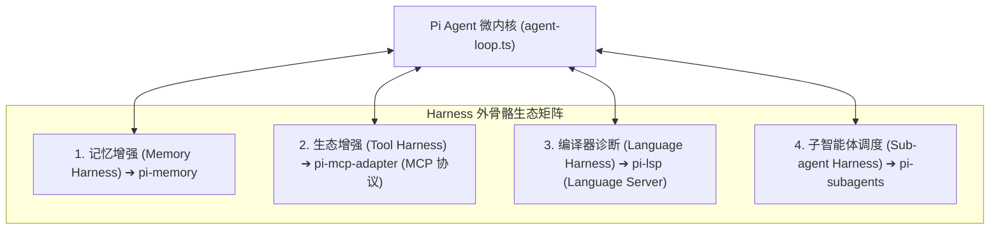
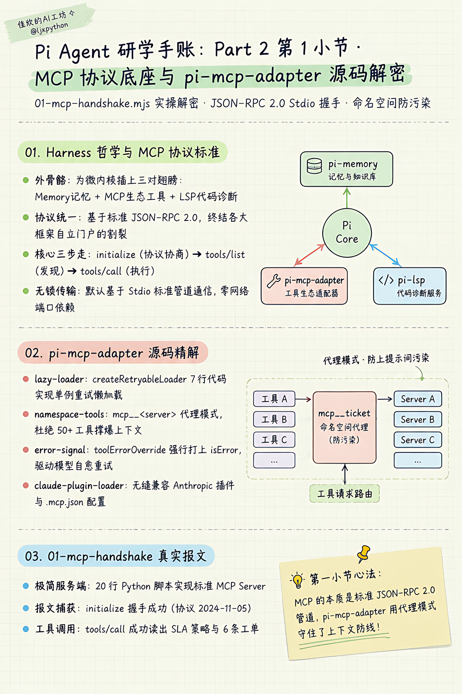
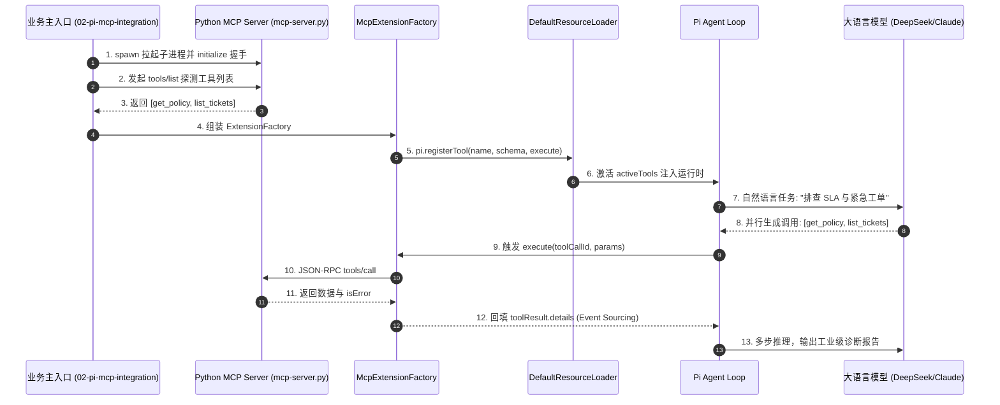
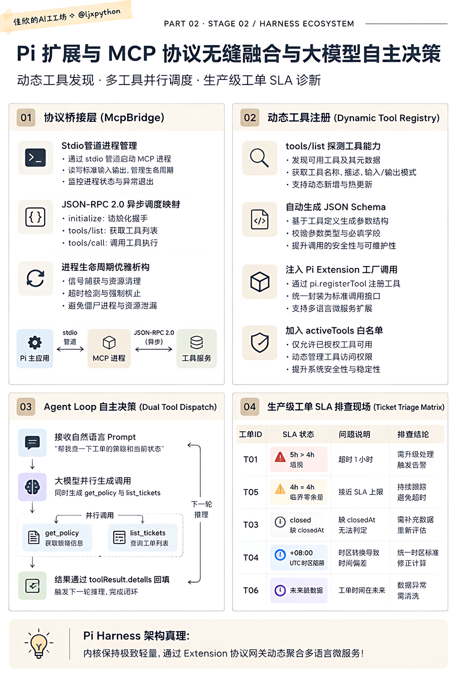
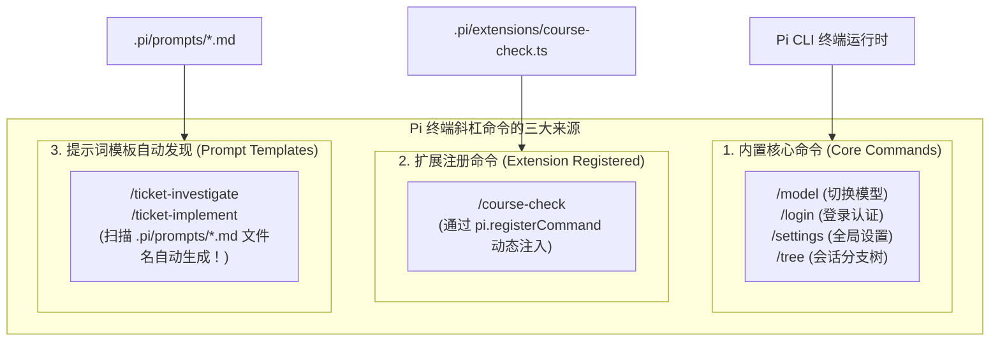
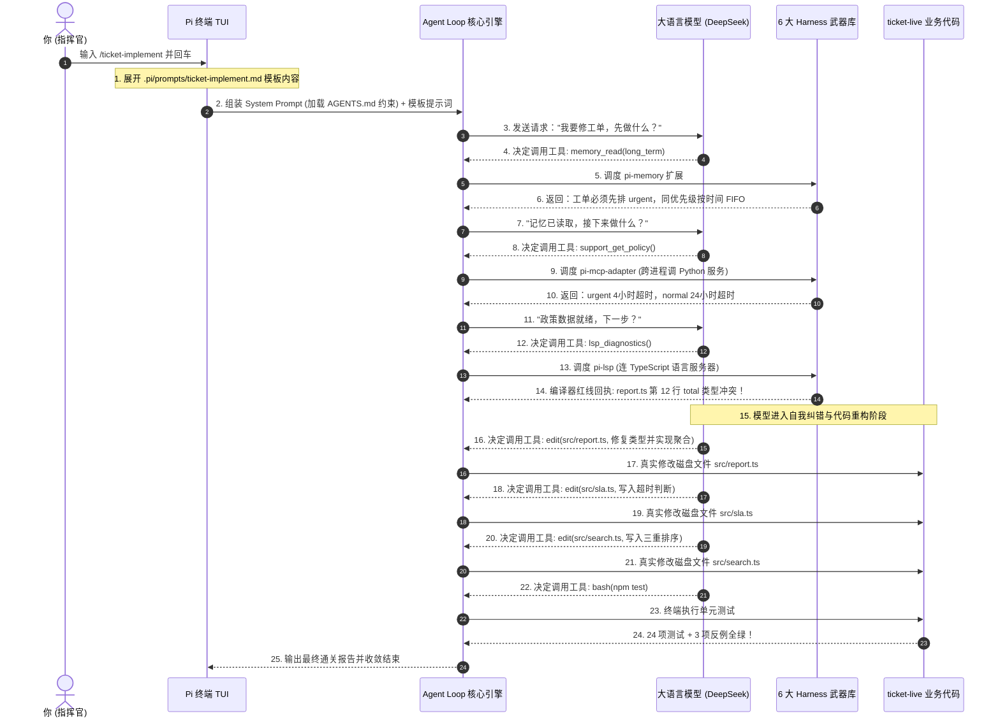
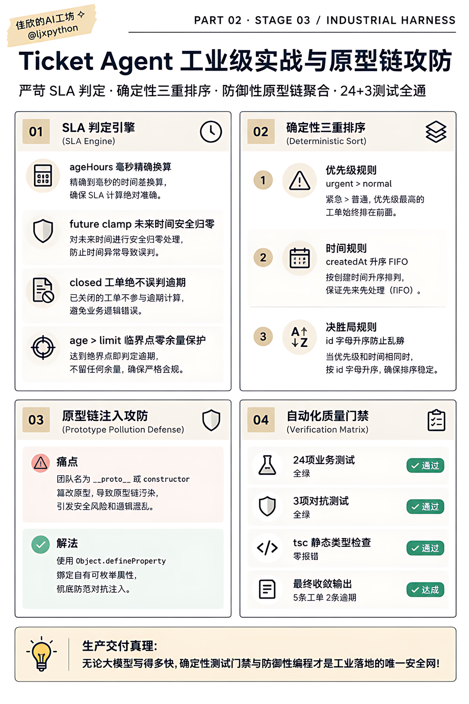
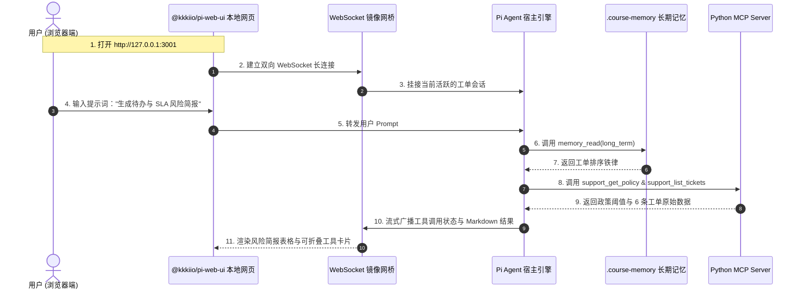
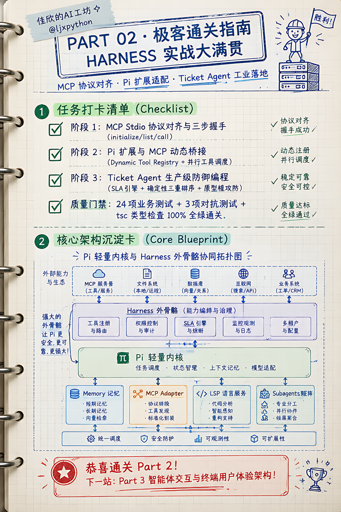

# Part 2 核心概念深潜：Harness 生态全景与 MCP 协议深度适配

> 💡 **10秒心智锚点 (Mental Model Anchor)**：  
> - **一句话技术内核**：Pi 内核保持轻量，一切外挂能力均通过 **Harness 扩展网络** 挂载；终端运行的 `pi` CLI 通过连接 MCP 服务、LSP 语言服务器、跨会话记忆与子角色，像资深工程师一样对项目进行代码诊断与自动化重构。  
> - **主客体拓扑**：宿主引擎 `[pi CLI]` ──(挂载)──► 6大Harness中间件 `[.pi/ 扩展与配置]` ──(诊断与重构)──► 演示靶场 `[ticket-live (故意埋有Bug的TS工程)]`  
> - **实操验证线索**：`cd 学员扩展资源包-20260918/student-workspaces/ticket-live` ➔ `pi` ➔ `/course-check` ➔ `/ticket-implement` ➔ `npm test` (24+3 项全绿)  
> - **对应课件**：第二节课-组装Pi-Agent：能力全景、生态选配与场景组合  
> - **源码对齐**：`pi-mcp-adapter-2.34.0` / `samples/mcp/mcp-server.py` / `official-examples/todo`  
> - **配套实战沙盒目录**：[`../../02-labs/milestones/part2-harness/mcp-demo/`](../../02-labs/milestones/part2-harness/mcp-demo/)

---

## 🗺️ 全景导航：知识点与 Labs 代码演进映射矩阵

本研学体系彻底贯彻 **「渐进式里程碑演进原则」**。文档中的每一个理论知识点，均在沙盒中有一对一的代码实现与运行验证。

| 研学阶段 | 核心知识点与架构机制 | 解决的工程痛点 | 对应 Labs 沙盒代码 | 验证命令 | 关键检验现场 |
|---|---|---|---|---|---|
| **阶段 1：MCP 握手** | • MCP 核心三步走（`init`/`list`/`call`）<br>• `lazy-loader.ts` 单例重试<br>• `namespace-tools.ts` 防 Prompt 污染 | 传统工具散装协议不一；一次性挂 50 个工具导致上下文爆炸 (Context Rot) | [`01-mcp-handshake.mjs`](../../02-labs/milestones/part2-harness/mcp-demo/01-mcp-handshake.mjs) | `npm run demo:01` | 控制台清晰捕获 JSON-RPC 2.0 报文，成功读出 SLA 策略与 6 条工单 |
| **阶段 2：Pi 适配器集成** | • `pi-mcp-adapter` 动态桥接<br>• `error-signal.ts` 错误强制覆盖<br>• 大模型自然语言自动路由 | 模型跨进程跨语言调用 Python 微服务能力，原生感知 MCP 错误重试 | [`02-pi-mcp-integration.mjs`](../../02-labs/milestones/part2-harness/mcp-demo/02-pi-mcp-integration.mjs) | `npm run demo:02` | 驱动 Agent 通过自然语言完成工单状态诊断与策略核算 |
| **阶段 3：Ticket Agent 实战** | • 确定性三重排序法则<br>• 严苛 SLA 状态计算与未来时钟截断<br>• `__proto__` 原型链注入防御 | 复杂业务排序乱跳、SLA 时钟漂移误判、对抗性恶意团队名污染 JS 运行环境 | [`ticket-live/`](../../02-labs/milestones/part2-harness/ticket-live/) | `npm test`<br>`npm run test:edge`<br>`npm run demo` | 24+3 项测试与类型检查全部通过，聚合输出 5 条有效工单与 2 条真实超时 |

---

## 💡 一、人话动机：什么是 Harness？为什么轻量内核必须插上 Harness 的翅膀？

### 1. 传统开发者的致命误区
很多初学者以为：`Agent = 大模型 + 几个自带函数`。
但在真实企业级复杂业务中，光靠 `read/write/bash` 四个原子工具，模型很快就会撞上三堵墙：
1. **记忆墙（Memory Wall）**：多轮对话或跨天开发，历史上下文撑爆 128k Token 窗口，模型遗忘昨天的架构决策；
2. **生态墙（Ecosystem Wall）**：公司内部有现成的 Python 运维系统、Jira 工单系统、MySQL 数据库，难道每一个业务系统都要重新手写一套 TypeScript 工具代码吗？
3. **精度墙（Precision Wall）**：写代码遇到语法错误或类型报错，模型抓瞎只能一遍一遍猜，缺乏现代 IDE 级别的编译器诊断能力。

### 2. 什么是 Harness（缰绳 / 外挂执行外骨骼）？
> 💡 **老王的直觉比喻**：
> 如果说 Pi 的核心 Loop（`agent-loop.ts`）是一台**排量极大的赛车发动机**，那 **Harness** 就是这台车上的**底盘、差速锁、车载雷达和外挂油箱**！
> 发动机（内核）本身保持极致简洁轻量，但通过一套标准化的“缰绳（Harness）”，瞬间给 Agent 插上三对工业级翅膀：



1. **记忆缰绳（`pi-memory`）**：在项目根目录下维护 `.course-memory/`，自动将每天的架构决策、高频避坑存入日记，支持按语义跨会话召回；
2. **协议缰绳（`pi-mcp-adapter`）**：全面适配 Anthropic 提出的 **MCP（Model Context Protocol，模型上下文协议）**！无论是 Python、Go 还是 Java 写的微服务，只要符合 MCP 标准，Pi 就可以零代码无损直连，动态加载成百上千个企业级工具；
3. **代码精度缰绳（`pi-lsp`）**：挂接真正的微软语言服务器（Language Server Protocol），在模型改完代码的瞬间，原地进行 TypeScript/Python 语法类型推断与红线报错，把 Bug 扼杀在第一现场！

---

## 🧩 二、第一阶段：MCP 协议原始报文对齐与握手解密

### 1. 核心知识点精讲

#### (1) 什么是 MCP（Model Context Protocol）？
在 MCP 诞生前，每个模型平台（OpenAI、Anthropic、LangChain）都定义了自己的工具格式，企业想要把自己的内部服务暴露给 AI，不得不为每个框架各写一套适配器，生态极度割裂。
**MCP（模型上下文协议）** 是由 Anthropic 提出的开放标准，基于标准的 **JSON-RPC 2.0** 规范，统一了 AI 客户端与外部工具服务器的通信语法：
1. **统一生命周期**：客户端与服务端通过 Stdio（标准输入输出）或 SSE（HTTP Server-Sent Events）建立双向通道；
2. **三步握手模型**：
   - `initialize`：版本协商与能力声明；
   - `tools/list`：查询工具名称、描述与入参 JSON Schema；
   - `tools/call`：执行工具并获取结构化回包。

#### (2) 深入剖析 `pi-mcp-adapter` 工业级源码

##### ① 懒加载单例模式：`lazy-loader.ts`
```typescript
export function createRetryableLoader<T>(load: () => Promise<T>): () => Promise<T> {
  let pending: Promise<T> | null = null;
  return () => pending ??= load().catch((error) => {
    pending = null;
    throw error;
  });
}
```
- **架构考量**：MCP 服务可能涉及远程网络握手或重量级进程启动。`lazy-loader` 确保在 Agent 没有真正发起工具调度前，绝不产生多余的 I/O；调用失败时清空 `pending` 允许自动重试，调用成功则单例缓存。

##### ② 命名空间与防 Prompt 污染：`namespace-tools.ts`
- **传统痛点（Context Rot）**：一个 MCP Server 可能挂载 50 个工具，直接把 50 个工具的 JSON Schema 平铺到 System Prompt 中，会吃掉上万 Token，且模型极易发生幻觉和混淆；
- **Pi 的 Proxy Mode（代理模式）**：
  `pi-mcp-adapter` 支持为 MCP Server 注册一个统一的代理入口 `mcp__<server>`。模型只需要调用这一个代理工具，传入 `{ tool: "get_policy", args: {} }`，底座自动在进程内部路由分发，**既保留了全部能力，又让系统提示词保持绝对精简**！

##### ③ 协议断层修复：`error-signal.ts`
- **隐蔽 Bug**：MCP 服务端在工具执行出错时，会返回 `{ isError: true }` 的正常 JSON-RPC 响应，而不是直接杀死进程或返回 RPC 异常码；但在通用 Agent 运行时中，如果一个工具函数正常 `return` 而没有 `throw`，会被判定为“执行成功”！
- **解法**：`toolErrorOverride(details)` 检查回包中的 `details.error`，如果是 `tool_error` 或 `call_failed`，强行改写标志位为 `{ isError: true }`，强制让 Pi 的 Agent Loop 识别出错误，从而驱动模型进行下一轮自我纠错！

---

### 2. 实战沙盒对应与代码拆解

- 📂 **沙盒源码位置**：[`02-labs/milestones/part2-harness/mcp-demo/01-mcp-handshake.mjs`](../../02-labs/milestones/part2-harness/mcp-demo/01-mcp-handshake.mjs)
- 🚀 **运行命令**：
  ```bash
  cd 02-labs/milestones/part2-harness/mcp-demo
  npm run demo:01
  ```

#### 关键源码逐行解析
```javascript
// 1. 通过 Stdio 拉起官方 Python 本地 MCP Server
const mcpProcess = spawn("python3", [mcpServerScript], {
  stdio: ["pipe", "pipe", "inherit"],
});

// 2. 发起 Step 1: 协议初始化握手 (initialize)
const initRes = await sendMcpRequest("initialize", {
  protocolVersion: "2024-11-05",
  capabilities: { roots: { listChanged: true } },
  clientInfo: { name: "pi-mcp-handshake-client", version: "1.0.0" },
});

// 3. 发起 Step 2: 查询工具清单 (tools/list)
const listRes = await sendMcpRequest("tools/list", {});
// 收到: get_policy 与 list_tickets

// 4. 发起 Step 3: 执行工具调用 (tools/call: get_policy)
const callRes = await sendMcpRequest("tools/call", {
  name: "get_policy",
  arguments: {},
});
// 成功获取: {"policy": {"urgentHours": 4, "normalHours": 24}, "now": "2026-09-17T12:00:00Z"}
```

#### 🖥️ 终端真实输出现场
```text
> demo:01
> node 01-mcp-handshake.mjs

==================================================
🔌 [阶段 1] 正在拉起 Python 本地 MCP Server 进程...
   脚本路径: .../samples/mcp/mcp-server.py
==================================================

--------------------------------------------------
🚀 Step 1: 发起 MCP 协议版本协商与能力探测 (initialize)...
--------------------------------------------------
📤 [Client 发送请求 -> Server] 方法: initialize (ID: 1)
📥 [Server 握手响应]: {
  "protocolVersion": "2024-11-05",
  "capabilities": { "tools": {} },
  "serverInfo": { "name": "course-support-readonly", "version": "1.0.0" }
}

--------------------------------------------------
🔍 Step 2: 查询 MCP Server 挂载的工具列表 (tools/list)...
--------------------------------------------------
📤 [Client 发送请求 -> Server] 方法: tools/list (ID: 2)
📥 [Server 返回可用工具数]: 2 个
   📌 工具 [1]: get_policy
      描述: Read synthetic SLA thresholds and current reporting time
   📌 工具 [2]: list_tickets
      描述: Read six synthetic support tickets. No write operations exist.

--------------------------------------------------
⚡ Step 3: 发起真实工具执行调用 (tools/call: get_policy)...
--------------------------------------------------
📤 [Client 发送请求 -> Server] 方法: tools/call (ID: 3)
📥 [Server 执行结果返回]:
   是否报错 isError: false
   返回内容 Text: {"policy": {"urgentHours": 4, "normalHours": 24}, "now": "2026-09-17T12:00:00Z"}

--------------------------------------------------
⚡ Step 3.2: 发起真实工具执行调用 (tools/call: list_tickets)...
--------------------------------------------------
📤 [Client 发送请求 -> Server] 方法: tools/call (ID: 4)
📥 [Server 成功返回工单数据]: 共 6 条工单
   示例工单 [0]: {
     id: 'T01',
     title: '登录 API 报错',
     team: '平台',
     priority: 'urgent',
     status: 'open',
     createdAt: '2026-09-17T07:00:00Z'
   }

==================================================
🎉 [阶段 1 通关] MCP 核心协议三步握手全链路验证成功！
==================================================
```

---

### 🎨 第 1 小节手账卡（MCP 协议底座与 pi-mcp-adapter 源码解密）



---

## 🧩 三、第二阶段：Pi 扩展与 MCP 协议无缝融合与大模型自主决策

### 1. 核心知识点精讲

#### (1) 动态能力发现：外部 MCP 服务如何变成 Pi 原生工具？
在阶段 1 中，我们直接用裸 socket/stdio 与 Python MCP Server 玩了一把 JSON-RPC 2.0 手动握手，证明了 MCP 就是 JSON-RPC 2.0。但在工业界真实场景下，谁会每次手写 socket？
Agent 怎么使用 MCP？
Pi 架构的神来之笔在于：**一切外部能力均收敛于 Extension 扩展工厂**！



1. **管道驻留与长连接**：`SimpleMcpClient` 启动 Python 子进程后维持 Stdio 管道长连接，利用 Node.js 异步事件驱动监听 `stdout` 并根据 JSON-RPC `id` 进行 Promise 寻址分发；
2. **Schema 动态反射**：通过 `tools/list` 获取 MCP 工具元数据后，自动将 MCP 的 `inputSchema` 映射为 Pi 的 `parameters` 对象；
3. **闭环注入**：在 `pi.registerTool` 的 `execute` 钩子里，直接调用 `mcpClient.callTool(name, params)`，并将回包中的原始数据装入 `details` 对象，无缝对接 Pi 的事件溯源（Event Sourcing）机制！

#### (2) 进阶控制：MCP 为什么不能盲目全量挂载？如何只挂载指定工具？（白名单过滤机制）

在实际企业级架构中，经常会遇到一个极具杀伤力的问题：
> ❓ *“既然 MCP 这么方便，我把一个内部提供了 50 个微服务接口的 MCP Server 直接连上来，全部注入给 Agent 不行吗？”*

**老王明确告诉你：不行！谁这么干谁就是给大模型挖坟！**  
盲目全量挂载会引发两大生产灾难：
1. **上下文污染（Context Pollution）与 Token 飞升**：  
   MCP 的每一个工具都包含极其冗长的 JSON Schema 参数定义（字段类型、枚举值、描述文档）。挂 50 个工具，光 System Prompt 里的工具定义就要吃掉上万 Token，不仅吞噬上下文预算，而且调用延迟成倍增加！
2. **注意力稀释（Attention Dilution）与幻觉调用**：  
   大模型的注意力窗口是有限的。当眼前摆着几十个花里胡哨的工具时，模型极其容易“看花眼”，产生工具决策犹豫（Decision Paralysis），甚至编造不存在的参数，或在只读排查场景误调写操作工具！

**工业级解法：适配器层的声明式白名单拦截（`includeTools`）**：  
在 `pi-mcp-adapter` 的工程实践中，必须通过配置显式控制能力暴露面，绝不大撒把：
```json
// ~/.pi/agent/mcp.json 或适配器配置
{
  "mcpServers": {
    "ticket-system": {
      "command": "python",
      "args": ["samples/mcp/mcp-server.py"],
      // 💡 核心防御：只向大模型暴露当前任务必须的 2 个只读工具，其余接口全部在适配器层拦截！
      "includeTools": [
        "support_get_policy",
        "support_list_tickets"
      ]
    }
  }
}
```
* **执行内幕**：`pi-mcp-adapter` 在与 Python 子进程完成 JSON-RPC `tools/list` 握手后，在向 Pi 宿主执行 `pi.registerTool` 前，会在内存里严格做一遍过滤。只有命中 `includeTools` 白名单的工具才会被转化为 Pi 原生工具注入 Agent Loop，实现最小权限原则（PoLP）。

#### (3) 工业级排查现场：大模型的 5 大真实边界陷阱攻防
在阶段 2 中，我们给大模型出了一个真实复杂的排查题：“请先通过工具读取公司的 SLA 政策阈值和当前基准时间，然后获取积压工单列表，重点排查紧急工单是否违约。”
面对这一真实场景，优秀的工程级 Agent 识别出了 5 个极其隐蔽的陷阱：
1. **基准时间锚定（Time Anchor）**：必须使用 MCP 返回的 `now: 2026-09-17T12:00:00Z`，而绝不能使用本地机器时钟！
2. **已关闭工单的虚假超时（T03 陷阱）**：T03 状态为 `closed`，但原始数据中缺少 `closedAt`。直接用当前基准时间减去创建时间算出的“36h”毫无业务意义，必须标记为“数据缺失，无法判定”；
3. **临界零余量（T05 边界）**：T05 等待时长恰好等于 4h 阈值，业务上虽未严格超过，但余量已耗尽，生产上必须当成 P0 紧急救火；
4. **时区大坑（T04 陷阱）**：原始时间带 `+08:00`，必须标准化换算为 UTC（`02:00Z`）后再与基准时间比对；
5. **未来脏数据拦截（T06 陷阱）**：T06 创建时间晚于当前基准时间，属于脏数据或写入端时钟漂移，直接标红拦截！

---

### 2. 实战沙盒对应与代码拆解

- 📂 **沙盒源码位置**：[`02-labs/milestones/part2-harness/mcp-demo/02-pi-mcp-integration.mjs`](../../02-labs/milestones/part2-harness/mcp-demo/02-pi-mcp-integration.mjs)
- 🚀 **运行命令**：
  ```bash
  cd 02-labs/milestones/part2-harness/mcp-demo
  npm run demo:02
  ```

#### 核心代码实现解析（带保姆级语法逐行拆解）
```javascript
// -----------------------------------------------------------------------------
// 🎯 1. 为什么叫扩展工厂 (mcpExtensionFactory)？
// -----------------------------------------------------------------------------
// 它本质是一个回调函数 (pi) => { ... }。当 ResourceLoader 执行 reload() 时，
// 会自动把核心扩展接口 `pi: ExtensionAPI` 注入进来。
// 我们可以用一个 for 循环，一次性批量调用多次 `pi.registerTool`，注册 10 个甚至 50 个工具！
const mcpExtensionFactory = (pi) => {
  for (const mcpTool of discoveredTools) {
    pi.registerTool({
      // ① name: 工具唯一标识符，模型在生成 ToolCall 时指定调哪个工具
      name: mcpTool.name,

      // ② description: 工具功能描述（大模型就是读这段大白话来决定什么时候调用它）
      description: mcpTool.description,

      // ③ parameters: 参数的 JSON Schema 规范，指导大模型从自然语言中提取正确的实参结构
      parameters: {
        type: "object",
        properties: mcpTool.inputSchema?.properties || {},
        additionalProperties: false,
      },

      // ④ execute: 工具被触发时的真正执行回调
      // - toolCallId: 本次调用的唯一 UUID
      // - params: 模型依据上面的 parameters 结构提取出的实参对象
      // - signal: 取消信号（支持任务被用户优雅中止）
      // - updateCallback: 向前端终端实时推送增量进度的回调
      async execute(toolCallId, params, signal, updateCallback) {
        console.log(`⚡ [Pi Agent Loop] 捕获到模型调度工具: ${mcpTool.name} (ID: ${toolCallId})`);

        // 核心动作：通过 Stdio 管道客户端，把工具名和入参打给 Python 服务端
        const callResult = await mcpClient.callTool(mcpTool.name, params);

        // 提取文本内容返回给大模型
        const textContent = callResult?.content
          ?.map((c) => (c.type === "text" ? c.text : JSON.stringify(c)))
          .join("\n") || "";

        return {
          content: [{ type: "text", text: textContent }], // 送给大模型推理的文本
          isError: callResult?.isError || false,           // 标记是否报错
          // 💡 架构灵魂：details 会被无损写入磁盘 .sessions/*.jsonl（Event Sourcing）
          // 后续会话回溯或分支切换时，直接重放 details，无需重新请求 Python 服务！
          details: {
            origin: "mcp-server.py",
            protocolVersion: "2024-11-05",
            raw: callResult,
          },
        };
      },
    });
  }
};

// -----------------------------------------------------------------------------
// 🎯 2. 为什么最终只要传字符串数组 activeTools？
// -----------------------------------------------------------------------------
// 因为所有工具已经在 ResourceLoader 里注册过了！
// 这里的 `tools: activeToolNames` 只是设置本会话的【工具调用白名单】，
// 限制模型只能看到和调用这些指定的工具，防止模型注意力分散或乱调越权！
const activeToolNames = ["read", ...discoveredTools.map((t) => t.name)];

const { session } = await createAgentSession({
  modelRuntime,
  model,
  resourceLoader,
  sessionManager,
  tools: activeToolNames, // 传入激活的白名单工具名称数组
});
```

#### 🖥️ 终端真实输出现场
```text
> demo:02
> node 02-pi-mcp-integration.mjs

🔌 [MCP 服务在线] 发现 2 个可用外部工具:
   👉 get_policy: Read synthetic SLA thresholds and current reporting time
   👉 list_tickets: Read six synthetic support tickets. No write operations exist.

⚙️  [初始化] 加载大模型 runtime: [xiaok/deepseek-v4.1-flash]...
🛠️  [工具装配] 激活工具白名单: [read, get_policy, list_tickets]

==================================================
💬 [User Prompt]: 请先通过工具读取公司的 SLA 政策阈值和当前基准时间，然后获取积压工单列表。请重点排查：有哪几条属于紧急工单（priority 为 urgent）？根据创建时间和当前时间计算等待时长，判断它们是否已经违反了 SLA？请输出一个清晰的 Markdown 结果表格并给出建议。
==================================================

🤖 [Agent 思考引擎启动] 开始多步推理与决策...

🔍 [模型调度工具] 目标: get_policy (ID: call_00_ET_MPxF9YKHxqBfbhmjdxWj1354)
🔍 [模型调度工具] 目标: list_tickets (ID: call_01_ET_iWhMAHRG8xj4FEitV0tQ7897)

⚡ [Pi Agent Loop] 正在执行 MCP 外部工具调用 -> get_policy
   参数: {}
⚡ [Pi Agent Loop] 正在执行 MCP 外部工具调用 -> list_tickets
   参数: {}
✅ [工具执行完毕] get_policy 结果已回填入 Agent Loop
✅ [工具执行完毕] list_tickets 结果已回填入 Agent Loop
🤖 [Agent 思考引擎启动] 开始多步推理与决策...

🏁 [Agent 本轮交互闭环]

==================================================
📋 [Pi Agent 最终回复报告]:
==================================================
## 排查结果

**基准时间**：2026-09-17T12:00:00Z（来自 get_policy，非本地时钟）
**SLA 阈值**：urgent = 4h，normal = 24h

### 一、紧急工单（priority = urgent）明细

| ID | 标题 | 团队 | 状态 | 创建时间 (UTC) | 等待时长 | SLA 阈值 | 是否违规 |
|---|---|---|---|---|---|---|---|
| T01 | 登录 API 报错 | 平台 | open | 2026-09-17 07:00 | 5h | 4h | ❌ 已违规（超 1h） |
| T05 | API 边界 | 前端 | open | 2026-09-17 08:00 | 4h | 4h | ⚠️ 耗尽/卡在临界点（未超时但已无余量） |
| T03 | 支付超时 | 平台 | closed | 2026-09-16 00:00 | 36h | 4h | ❓ 无法判定（缺关闭时间） |

🧹 [资源清理] 已优雅终止 Python MCP Server 子进程。
```

---

### 🎨 第 2 小节手账卡（Pi 扩展与 MCP 协议无缝融合与大模型自主决策）



---

## 🌉 认知过渡篇：形态跃迁——从写 SDK 零件到开 CLI 整车

在进入第三阶段之前，很多同学会产生一个剧烈的认知断层：
> ❓ *“等等老王！前面两小节我们还在写 Node.js 脚本（`01-mcp-handshake.mjs` 和 `02-pi-mcp-integration.mjs`），怎么到了这节突然就要去系统终端敲 `pi` 了？为什么突然不写脚本了？”*

### 1. 两种学习视角的形态跃迁
理解这一步，你就彻底摸透了官方课件的良苦用心：
- **阶段 1 & 阶段 2（造零件视角 · SDK 模式）**：
  我们扮演的是**引擎研发工程师**。我们亲自手写 `SimpleMcpClient`，亲自调用 `createAgentSession`，观察 Stdio 管道报文怎么走、扩展工厂怎么把 MCP 工具注册进 Agent Loop。这是在**造发动机和差速锁**。
- **阶段 3（开整车视角 · CLI 终端模式）**：
  当我们掌握了零件原理后，讲师要把我们切换为**高级架构师（Tech Lead）视角**。
  在实际企业级开发中，我们不需要每天手写脚本跑 Agent，而是直接使用官方发布好的终端命令行工具（`pi` CLI）。
  这个 `pi` 工具把我们前面学到的 **Memory（记忆）、MCP（工具总线）、LSP（语法显微镜）、Subagents（子智能体）** 打包成了一台功能齐备的顶级赛车！

---

## 🔍 架构解密：Pi 终端里的斜杠命令到底从哪来的？（彻底打破黑盒）

当你进入 Pi 的终端 TUI 界面后，会看到各种各样的斜杠命令（如 `/course-check`、`/ticket-investigate`、`/ticket-implement`、`/model`）。
**很多初学者在这里彻底迷失，以为这是写死在二进制程序里的神秘功能。** 
在 Pi 体系中，所有的斜杠命令被严丝合缝地分成了以下 **三类来源**：



### 来源 1：内置核心命令（Core Commands）
由 Pi CLI 宿主运行时原生提供，负责环境配置与会话生命周期：
- `/model`：切换或配置当前会话的大模型；
- `/login`：OAuth 或 API Key 登录鉴权；
- `/settings`：修改终端主题、思考预算（Thinking Budget）等；
- `/tree`：查看与切换基于 Event Sourcing 的分支会话历史。

### 来源 2：通过 Extension 代码注册的命令（以 `/course-check` 为例）
- **注册位置**：工程本地的 `.pi/extensions/course-check.ts`
- **底层原理**：Pi 启动时会自动扫描项目内 `.pi/extensions/` 目录下的 TypeScript 扩展脚本，扩展可以通过宿主上下文的 `pi.registerCommand()` 注册自定义斜杠命令：
  ```typescript
  // .pi/extensions/course-check.ts
  export default function (pi: ExtensionContext) {
    // 💡 显式向 Pi 注册一个名为 course-check 的斜杠命令！
    pi.registerCommand("course-check", async (args, ctx) => {
      // 遍历检查 Memory 路径、MCP 连接状态、LSP 语言服务器、Subagents 角色...
      // 在终端屏幕打印绿色的 6 大武器装配自检清单
    });
  }
  ```
  **执行内幕**：当你在终端输入 `/course-check` 时，**根本不会调用大模型**，而是直接在本地运行这段 TypeScript 自检逻辑并打印结果！

### 来源 3：通过 Prompt 模板自动映射的命令（以 `/ticket-implement` 为例 · 最颠覆认知！）
- **注册位置**：`.pi/prompts/` 目录下的所有 Markdown 文件！
  ```text
  .pi/prompts/
  ├── ticket-investigate.md   ➔ 自动映射为 /ticket-investigate 命令
  └── ticket-implement.md     ➔ 自动映射为 /ticket-implement 命令
  ```
- **核心真相**：**`/ticket-implement` 根本不是一段写死在程序里的逻辑，它纯粹是一个 Markdown 提示词文件！**
  Pi 的机制叫 **Prompt Template 自动发现**。当你在终端输入 `/ticket-implement` 并按下回车时，Pi 做的事情极其朴素：
  **它自动读取 `ticket-implement.md` 文件里的 300 字长提示词，替你一键填入对话框发送给大模型！** 官方为了不让学员每次手动复制粘贴 300 字，才做成了这个模板！

---

## 🧩 四、第三阶段：让 Pi CLI 智能体接管靶场——六大 Harness 实战调度与考场验收

### 1. 角色还原：谁是医生？谁是病人？（彻底拒绝主谓颠倒）

很多初学者打开 `ticket-live` 目录时，看到密密麻麻的业务代码就误以为要自己手写这 125 行 TypeScript。
**这是彻底的认知走形！** 按照我们的三层认知拓扑模型，各层角色职责极其严明：

```text
ticket-live/ 考场体系：
├── 🧑‍⚕️ Layer 1 宿主执行引擎 (主考官与AI医生)：
│   └── pi 命令 (终端 TUI 智能体，负责接收指令并自动读写重构代码)
│
├── 🛠️ Layer 2 Harness 扩展武器库 (医生的专业手术器械)：
│   ├── .pi/mcp.json             ➔ 连接 Python 只读 MCP 服务拉取工单与政策
│   ├── .pi/pi-lsp.json          ➔ 挂接 TypeScript 语言服务器进行实时代码类型诊断
│   ├── .pi/agents/              ➔ 只读调查与审查子智能体 (Subagents)
│   ├── .pi/prompts/             ➔ /ticket-investigate 与 /ticket-implement 提示词模板
│   ├── .course-memory/          ➔ 跨会话长期记忆库 (MEMORY.md 与 daily 日记)
│   └── AGENTS.md                ➔ 项目级行为守则 (约束 Pi 只能修改 3 个实现文件)
│
└── 🏥 Layer 3 靶场载体与业务客体 (躺在手术台上的病人和考卷)：
    ├── test/*.test.ts           ➔ 考卷：初态下 17 项业务失败 + 3 项反例失败
    └── src/                     ➔ 病人：等待被 Pi 修复的 3 个 TypeScript 文件
        ├── sla.ts               ➔ 计算经过时间与超时违约 (等待实现)
        ├── search.ts            ➔ 多条件筛选与确定性排序 (等待实现)
        └── report.ts            ➔ 报表聚合 (初态存在 total 类型报错)
```

**核心铁律**：我们学的是 **「Pi CLI 如何利用 6 大 Harness 扩展像资深工程师一样自主排查、诊断、修改并跑通项目」**，而不是手写业务代码！

---

### 2. 讲师原汁原味的实操链路：从扩展安装到 T0~T4 渐进式攻坚

官方课件绝不是一上来就让你盲目改代码，而是拆解为循序渐进的 **全套装备装配与 5 个严密观察步骤**：

#### 📍 第 0 步：六大 Harness 武器库全局登记安装（只做一次）
在进入工单靶场前，必须在学员资源包根目录执行官方的 6 项 `pi install` 命令，将 5 个社区包与 1 个官方示例扩展登记到 `~/.pi/agent/settings.json`：
```bash
# 切换到资源包根目录
cd 02-labs/milestones/part2-harness/学员扩展资源包-20260918

# 登记 5 个核心社区能力包
./node_modules/.bin/pi install npm:pi-memory@0.4.2 --approve
./node_modules/.bin/pi install npm:pi-mcp-adapter@2.34.0 --approve
./node_modules/.bin/pi install npm:pi-web-access@0.29.0 --approve
./node_modules/.bin/pi install npm:@narumitw/pi-lsp@0.49.7 --approve
./node_modules/.bin/pi install npm:pi-subagents@0.68.0 --approve

# 登记官方 Todo 示例扩展 (源码位于 ./official-examples/todo.ts)
./node_modules/.bin/pi install ./official-examples/todo.ts --approve
```

---

##### 🔍 核心机制大拆解：为什么光跑 `npm install` 根本用不了扩展？（`npm install` vs `pi install` 的本质区别）

这是 99% 的初学者在实操时最容易栽跟头的认知死角：
> ❓ *“老王，我明明在资源包根目录下执行了 `npm install`，依赖全都下载到 `node_modules` 里面了，为什么我一进项目跑 `/course-check`，系统还是疯狂报错说缺失 10 个工具？”*

**本质原因在于：Pi CLI 是一个拥有独立插件生命周期的宿主系统，绝不是普普通通的 Node.js 库！**
- **`npm install` 的物理动作**：仅仅是将 npm 依赖包从远程仓库拉取并解压到当前工程的 `node_modules/` 文件夹中。此时操作系统知道这些包存在，但 **Pi CLI 完全不知情**！
- **`pi install` 的物理动作**：读取目标（npm 包名或本地 `.ts` 文件路径），并将其写入当前用户的全局配置：
  `~/.pi/agent/settings.json` 中的 `extensions` 数组！
  ```json
  // ~/.pi/agent/settings.json
  {
    "extensions": [
      "npm:pi-memory@0.4.2",
      "npm:pi-mcp-adapter@2.34.0",
      "npm:pi-web-access@0.29.0",
      "npm:@narumitw/pi-lsp@0.49.7",
      "npm:pi-subagents@0.68.0",
      "/Users/lijiaxin/.../official-examples/todo.ts"
    ]
  }
  ```
- **启动生命周期**：每当你在任意终端敲下 `pi`，Pi 宿主引擎只会扫描两个地方：
  1. 当前工作目录下的 `.pi/extensions/`（项目私有扩展）
  2. `~/.pi/agent/settings.json` 的 `extensions` 列表（全局激活扩展）
  如果没有执行 `pi install` 这一步，即使你的 `node_modules` 有 100G 依赖，Pi 启动时也是裸机状态，一个工具都找不到！

---

##### 💡 架构解密：`official-examples/todo.ts` 的前世今生与 Event Sourcing 机制

在工单实战中，Agent 在第一步排查时会主动调用 `todo` 建立“查明规则、实现三模块、独立验证”三项待办，很多人找不到这个工具到底从哪来的：

1. **物理路径**：
   - 存放在资源包根目录：`02-labs/milestones/part2-harness/学员扩展资源包-20260918/official-examples/todo.ts`
   - 从靶场工作区 `student-workspaces/ticket-live` 往上两级：`../../official-examples/todo.ts`。
2. **为什么它是一个本地单文件 `.ts` 而不是发布的 npm 包？**
   - 它是官方为了演示 **「Pi 自定义单文件扩展开发规范（Single-file Extension）」** 而专门编写的示范代码，全长不到 100 行！
   - 通过 `./node_modules/.bin/pi install ./official-examples/todo.ts` 登记后，Pi 无论在哪个项目启动，都会即时用内部的 `esbuild/tsx` 动态编译该脚本，向系统注入 `todo` 工具和 `/todos` 斜杠命令。
3. **架构绝技：基于 `toolResult.details` 的事件溯源（Event Sourcing）**
   - **传统思维陷阱**：很多初级开发者想做待办，第一反应就是在本地磁盘写一个 `todo.json` 或存 SQLite。
   - **致命缺陷**：Pi 的底层会话是 Git-like 的 **Session Tree（分支会话树）**，支持开发者随时用 `/tree` 分叉会话或时光倒流回滚到前面的节点。如果你在本地磁盘写死了一个全局 `todo.json`，当对话被回滚到 5 步以前时，磁盘上的待办还是未来的状态，直接发生**时间撕裂（Time Tear）**！
   - **`todo.ts` 的工业级解法**：它压根不碰本地磁盘，而是将每次勾选、新增的待办列表作为结构化数据，直接塞在 `toolResult.details` 属性里！
   - **收益**：任务状态随会话树节点一同持久化。会话分叉，待办跟着分叉；会话回滚，待办历史自动回溯到当年的切片，优雅到了极致！

---

##### 🧠 深度剖析：跨会话长期记忆（`pi-memory`）全生命周期与三大清理机制

在工单实战中，`.course-memory/` 目录承担了跨会话记忆的重任，很多同学对其调用时机与清理机制存有极大疑虑：

###### (1) 它到底在什么情况下被调用？在哪里写？
1. **手动/初始沉淀（T1 步）**：
   在 T1 步启动 `pi` 后，我们输入自然语言要求沉淀工单规则，模型自动调用 `memory_write(key, content)`，将“urgent 优先、FIFO、ID 决胜”的铁律写入物理文件；
2. **自动化按需召回（T2/T3 步）**：
   在运行 `/ticket-implement` 时，提示词第一条约束就是“先调用 `memory_read` 提取工单排序铁律”。Agent 在第一轮思考时便会主动发出 `memory_read(long_term)` 工具调用，把记忆召回并塞入当前对话的上下文；
3. **会话压缩自动捕获（Compact Hook）**：
   当多轮对话快把 128k Token 上下文撑爆触发系统的会话压缩（Compact）时，`pi-memory` 监听了 `session_before_compact` 事件钩子，在旧对话被丢弃之前，自动将当前对话的待办与未结事项抽取存入当天的 daily 日志。

###### (2) 物理落盘结构（拒绝黑盒向量库）
`pi-memory` 坚守极简原则，拒绝笨重的外部向量数据库，全部采用人类可读可编辑的物理纯 Markdown：
```text
.course-memory/
├── MEMORY.md                 ➔ 全局核心长期记忆 (架构约束、排序铁律、全局偏好)
├── daily/
│   └── 2026-09-18.md         ➔ 按天滚动的操作工作日志 (当天上下文、临时排查记录)
└── recovery/
    └── <id>.json             ➔ 软删除时自动备份的恢复快照 (防误删护城河)
```

###### (3) 长期记忆的三大清理机制（如何防止膨胀与误删？）
1. **主动软删除与快照安全归档（`memory_forget` + `memory_restore`）**：
   Agent 在判定某条规则已废弃或存在错误时，调用 `memory_forget(id)`。系统**绝不会物理抹除**，而是将其从活动索引中移出，并在 `recovery/<id>.json` 中备份一份带时间戳的完整快照。如果后续发现大模型产生幻觉误删了关键记忆，随时可以通过 `memory_restore(recovery_id)` 一键捞回！
2. **纯 Markdown 物理透明维护（人类随时接管）**：
   因为底层全是纯 Markdown 文件，你可以直接用 VSCode 或 Vim 打开 `MEMORY.md` 任意删减修改，所见即所得。如果想彻底“洗脑”重置 Agent，直接在终端执行一行命令：
   ```bash
   rm -rf .course-memory
   ```
   下次启动 `pi` 时会自动重建空目录，零残留、零隐蔽状态；
3. **按天自然隔离（TTL 上下文防爆炸）**：
   工作流水日志按 `daily/YYYY-MM-DD.md` 每天独立落盘，过期的历史流水不会常驻在活跃上下文中，从根本上防止了上下文 Token 随时间推移而无节制膨胀。

---

##### 🛡️ 门禁自检黄金法则：`/course-check` 的零缺失（`missing: []`）闭环

在执行完 6 条 `pi install` 且连接好 MCP 服务后，**绝不能凭感觉盲目开始排查**！必须在靶场工作区通过前置自检门禁：

1. 进入练习工作区并启动 Pi：
   ```bash
   cd 02-labs/milestones/part2-harness/学员扩展资源包-20260918/student-workspaces/ticket-live
   source ./course-env.sh
   pi
   ```
2. 在 TUI 终端输入：
   ```text
   /course-check
   ```
3. 检查生成的证据文件 `.course-evidence/registration.json`，**通关金标准**：
   ```json
   {
     "registeredTools": [
       "read", "write", "edit", "bash",
       "todo",
       "memory_write", "memory_read", "memory_status", "scratchpad", "memory_forget", "memory_restore",
       "web_search", "fetch_content",
       "lsp_diagnostics",
       "subagent",
       "support_get_policy", "support_list_tickets"
     ],
     "missing": []
   }
   ```
   * **`"missing": []` 必须为空数组**！
   * 14 个扩展工具全部点亮，证明全套 Harness 武器库 100% 挂载成功，方可进入后续的 T0~T4 实战攻坚！

---

#### 📍 T0 步：查明病历与确立失败基线
在系统终端中进入 `ticket-live` 目录，执行测试：
```bash
cd 02-labs/milestones/part2-harness/学员扩展资源包-20260918/student-workspaces/ticket-live
npm test
npm run test:edge
npm run typecheck
```
- **控制台真实初态**：24 项业务测试中 7 通过 / 17 失败，3 项反例全部失败，类型检查报 `total: string` 与 `number` 冲突！
- **认知意义**：确立客观基线，证明项目初始状态确实有 Bug，不是安装环境坏了。

#### 📍 T1 步：跨会话长期记忆验证 (pi-memory)
在终端启动 `pi`：
```bash
source ./course-env.sh
pi
```
在会话中输入提示词，让 Pi 调用 `memory_write` 将工单排序约定写入 `.course-memory/MEMORY.md`。
退出 `pi`（`Ctrl+C`），换个新终端重新启动 `pi`，输入：“读取工单排序约定”。
- **观察证据**：Pi 在新会话中调用 `memory_read`，成功从磁盘读回先 urgent、后 FIFO、时间相同按 ID 排序的铁律！

#### 📍 T2 步：全武装只读调查（只准调查，不改代码！）
在 TUI 界面中输入：
```text
/ticket-investigate
```
- **底层经历的协同流转**：
  1. 调用 `todo` 建立“查明规则、实现三模块、独立验证”三项待办；
  2. 调用 MCP 适配器拉取 4/24 小时政策与 6 条工单；
  3. 调用 `subagents` 派发只读调查员 `course-scout` 遍历代码；
  4. 调用 `lsp_diagnostics` 准确定位 `src/report.ts` 的类型冲突；
- **观察要求**：此时命令要求模型**停在调查阶段，绝对不修改任何文件**，让人类看清每个扩展的回执！

#### 📍 T3 步：主 Agent 动手术与 Subagent 审查重构
调查清楚后，在 TUI 中输入：
```text
/ticket-implement
```
按下回车后，Pi 底层经历了完整的 **25 步物理流转时序**：



#### 📍 T4 步：人类独立外部验收
代码修改完成后，人类在另一个独立终端中执行全量验证命令：
```bash
npm test
npm run test:edge
npm run typecheck
npm run demo
npm run check:protected
git diff -- src
```
- **通关判定标准**：
  - 24 项业务测试全绿；
  - 3 项对抗性原型链注入测试全绿；
  - TypeScript 类型检查 0 报错；
  - `check:protected` 确认受保护的测试和数据文件 0 篡改；
  - `git diff` 确认只修改了预定的 3 个实现文件！

#### 📍 T5 步：把已验证结果写进每日工作流水 (daily 日记)
在人类外部验收全部通过后，回到原来的 Pi 会话中，输入提示词完成每日事实沉淀：
```text
请将本次已经由实际命令验证的结果用memory_write写入daily，记录任务、修改文件、各项测试实际数量与结果、已知限制。只记录工具回执支持的事实，不保存密钥，不把一次成功写成永远可靠。
写入后用memory_read读取daily，并用memory_read的list目标列出日记文件。报告实际保存位置；如果仍有失败，记录失败，不记录“全部通过”。
```
- **落地验证**：
  - 物理落盘位置：`.course-memory/daily/YYYY-MM-DD.md`；
  - 认知要点：`MEMORY.md` 存放全局长期铁律，`daily/` 存放单日的工作流水事实与已知限制。分层落盘，拒绝信息混杂！

---

### 3. 靶场手术最终达成的工业级防御质量

当 Pi 修改完毕后，代码之所以能通过严苛的 24+3 项测试，是因为满足了以下三条工业级生产防线：

#### (1) SLA 时钟安全与未来截断 (`src/sla.ts`)
- **未来时钟截断 (Future Clamp)**：如果外部传入脏数据导致工单创建时间在未来，`hours < 0` 强制截断为 `0`；
- **已关闭工单永不逾期 (Closed Never Overdue)**：`status === 'closed'` 的工单直接返回 `false`；
- **临界点安全**：`age === limit`（如正好 4 小时整）不算超时，严格 `>` 阈值才判定逾期。

#### (2) 确定性三重排序法则 (`src/search.ts`)
- **第一级**：`urgent` 绝对排在 `normal` 前面；
- **第二级 (FIFO)**：同优先级下按创建时间升序排列；
- **第三级决胜 (Tie-Breaker)**：同时间下按 ID 字典序升序，彻底消除前端列表重绘乱跳。

#### (3) 原型链防注入防御 (`src/report.ts`)
- 当按 `team` 分组统计时，如果恶意输入名为 `__proto__` 或 `toString` 的工单名，禁止粗暴的 `byTeam[team]++`；
- 使用 `Object.hasOwn()` 配合 `Object.defineProperty()` 显式挂载自有可枚举属性，彻底堵死 JavaScript 全局原型链污染漏洞！
  for (const row of rows) {
    if (row.overdue) overdue += 1;
    bump(byTeam, row.team);
  }
  return { total: rows.length, overdue, byTeam, rows };
}
```

---

### 3. 实战沙盒对应与代码拆解

- 📂 **沙盒源码位置**：[`02-labs/milestones/part2-harness/ticket-live/`](../../02-labs/milestones/part2-harness/ticket-live/)
- 🚀 **运行命令**：
  ```bash
  cd 02-labs/milestones/part2-harness/ticket-live
  npm test                 # 运行 24 项业务核心单元测试
  npm run test:edge        # 运行 3 项对抗性原型链注入测试
  npm run typecheck        # 运行严格 TypeScript 类型检查
  npm run demo             # 运行生产级工单聚合报告输出
  ```

#### 🖥️ 终端真实输出现场
```text
> test
> tsx --test test/report.test.ts

✔ UTC age (2.050327ms)
✔ offset age (0.340691ms)
✔ future clamp (0.178729ms)
✔ bad created date rejected (1.032611ms)
✔ bad now rejected (0.358587ms)
✔ urgent overdue (0.683428ms)
✔ normal overdue (0.31302ms)
✔ closed never overdue (0.209734ms)
✔ exact deadline not overdue (0.756072ms)
✔ policy is configurable (0.829075ms)
✔ memory sort: urgent first then createdAt then id (2.340916ms)
✔ keyword case trim (0.313642ms)
✔ team exact (0.377405ms)
✔ closed filter (0.592827ms)
✔ all criteria AND (0.70255ms)
✔ overdue only (0.415432ms)
✔ empty keyword (0.399295ms)
✔ no match (0.217659ms)
✔ empty data (0.665429ms)
✔ tie breaker id (0.689198ms)
✔ immutable input (0.279223ms)
✔ open report summary (0.353309ms)
✔ filtered report summary (0.175105ms)
✔ empty summary (0.149948ms)
ℹ tests 24
ℹ pass 24
ℹ fail 0

> test:edge
> tsx --test test/adversarial.test.ts

✔ team aggregation supports __proto__ (2.205317ms)
✔ team aggregation supports constructor (0.404101ms)
✔ team aggregation supports toString (0.447231ms)
ℹ tests 3
ℹ pass 3
ℹ fail 0

> typecheck
> tsc --noEmit
# 零类型报错！

> demo
> tsx src/cli.ts

{
  "total": 5,
  "overdue": 2,
  "byTeam": {
    "平台": 3,
    "前端": 2
  },
  "rows": [
    { "id": "T01", "priority": "urgent", "overdue": true,  "ageHours": 5 },
    { "id": "T05", "priority": "urgent", "overdue": false, "ageHours": 4 },
    { "id": "T02", "priority": "normal", "overdue": true,  "ageHours": 26 },
    { "id": "T04", "priority": "normal", "overdue": false, "ageHours": 10 },
    { "id": "T06", "priority": "normal", "overdue": false, "ageHours": 0 }
  ]
}
```

---

### 🎨 第 3 小节手账卡（Ticket Agent 工业级实战与原型链攻防）



---

## 🌐 四、第四阶段：开源 Web UI 网页交互实战与宿主解耦 (U0 ~ U3)

在完成终端 CLI 形态的 T0~T4 实战后，官方课件立刻带我们跨入一个全新的认知维度：
> ❓ *“在终端里敲斜杠命令跑 Agent 固然很爽，但如果我们的产品经理、运维同事甚至业务部门也需要使用这个工单 Agent，总不能让他们每个人电脑上都装 Node.js 和终端吧？怎么给已有的 Agent 加上网页交互能力？”*

### 1. 架构拓扑：交互入口变换，后端核心单一事实源 (SSOT)



**核心设计哲学**：
- **零业务代码重构**：我们不需要修改 `src/` 下的任何工单业务逻辑，也不需要新建数据库；
- **同一个项目、同一套扩展、同一份记忆**：网页端完全复用第四章的 `.course-memory/MEMORY.md` 和已经挂载的 MCP 服务；
- **展现与执行严格分离**：Web UI 只是一个“窗口”，大模型推理与工具执行依然稳稳当当运行在本地的 Pi 后台进程中。

---

### 2. 实战全流程解密：从 U0 到 U3 渐进式验证

#### 📍 U0 步：在原工单项目加载 Web UI 并建立连接
1. 在工单项目 `student-workspaces/ticket-live` 启动 Pi：
   ```bash
   source ./course-env.sh
   pi -c
   ```
2. 在 Pi 输入框输入：
   ```text
   /webui
   ```
3. **底层动作**：Pi 自动拉起本地 HTTP/WebSocket 镜像服务（默认端口 `3001`），并自动调用系统默认浏览器打开 `http://127.0.0.1:3001`；
4. **连接检验**：在网页端发送一句简单的问候（如“你好”），确认大模型在网页正常回复，证明双向通信链路完全打通。

#### 📍 U1 步：从网页调用 Memory，读回第四章沉淀的铁律
在浏览器输入框粘贴：
```text
先实际调用memory_status，确认记忆目录是当前工单项目的.course-memory；不是则停止。
再实际调用memory_read，target为long_term。
只根据工具返回，说明我们保存的工单排序约定、报告字段和演示标记。
找不到就明确说明，不根据聊天历史补全，不写入记忆、不修改代码。
工具不可用时明确停止，不用普通文件读取冒充Memory调用。
```
- **核心观察证据**：
  - 网页界面弹出 `memory_status` 和 `memory_read` 工具执行卡片；
  - 模型精准输出我们在第四章 T1 写入的排序铁律（urgent 优先、FIFO、ID 决胜）；
  - **真相核验**：在另一个系统终端打开 `cat ./.course-memory/MEMORY.md`，网页读取出的内容与磁盘物理文件 100% 吻合！

#### 📍 U2 步：在网页端组合 Memory 与 MCP，生成工单风险简报
在浏览器输入框粘贴：
```text
请基于当前工单教学项目，生成“待办与SLA风险简报”，不修改代码、业务数据或记忆。
1. 实际调用memory_read，target为long_term，取得工单排序约定。
2. 实际调用support_get_policy和support_list_tickets，参数均为空对象，取得固定当前时间、SLA阈值与全部工单。
3. 只列open工单，按记忆约定排序；按政策判断是否超时，恰好阈值不算超时，未来时间年龄为0。
4. 用表格列出编号、团队、优先级、年龄（小时）、是否超时，并汇总总数、超时数和团队分布。
5. 说明约定、政策和数据分别来自哪个实际工具，并标明是教学合成数据。
任何工具不可用、读取失败或规则缺失时，停止相应结论并指出原因，不用read或聊天历史冒充MCP查询，不编造数字。
```
- **核心观察证据**：
  - 网页依次渲染 `memory_read`、`support_get_policy`、`support_list_tickets` 三大工具调用；
  - 模型生成标准汇总表格：
    - 未关闭工单总数：`total = 5`
    - 超时违约工单数：`overdue = 2` (T01 5h, T02 26h)
    - 团队工单分布：`平台: 3, 前端: 2`
    - 排序顺序：`T01 ➔ T05 ➔ T02 ➔ T04 ➔ T06`
  - **程序独立对账**：在系统终端运行 `npm run demo`，输出的 JSON 与网页表格数据完全一致！

#### 📍 U3 步：收口与架构反思——换的是交互入口，能力与权限要分别检查
| 检查维度 | 本次实验看到的技术事实 | 绝对不能由此脑补的伪推论 |
|---|---|---|
| **运行实例** | 网页提交的问题与启动终端的 Pi 会话完全同步 | 以为随便开个网页就会自动同步本地项目 |
| **Memory能力** | 网页能够正常触发 `memory_read` 读回磁盘文件 | 以为模型回答正确就一定调用了工具（必须看卡片回执） |
| **MCP能力** | 跨进程调用 Python MCP 服务，返回真实政策与数据 | 以为读取本地静态 JSON 就等于调用了 MCP 协议 |
| **安全与权限** | 提示词约束了“只读不修改” | 以为系统具备了真正的企业级 RBAC 鉴权与只读沙箱隔离 |

> ⚠️ **工业级警示**：  
> 网页演示里的“不要修改代码”只是**提示词层面的软性约定**，而不是**服务端底层的硬性权限隔离**！第四章加载的 `write`、`edit`、`bash` 等写操作工具在后端依然处于激活状态。如果面向企业生产用户，必须在网关层通过鉴权体系做物理权限剥离，严防越权写操作！

---

## 🧩 五、第五阶段：Hooks 生命周期拦截机制（H1 & H2 护城河）

除了前面学到的“增加新工具”，Pi 扩展体系最强大的杀手锏在于：**生命周期钩子（Hooks）拦截**！  
通过 `pi.on("event", async (event, ctx) => { ... })`，开发者可以在不修改内核一行代码的前提下，为 Agent 构筑物理级安全护城河。

### 1. H1 步：工具执行前置拦截（`protected-paths.ts` · 物理拒执）
* **痛点**：大模型往往由于幻觉或上下文混淆，误删 `.git/` 仓库配置、篡改生产环境的 `.env` 或覆盖核心依赖 `package.json`；
* **源码机制**：
  ```typescript
  // official-examples/protected-paths.ts
  export default function (pi: ExtensionContext) {
    const PROTECTED = [".git", "package.json", ".env"];
    
    // 💡 监听 tool_call 事件（工具执行前的致命哨兵！）
    pi.on("tool_call", async (event) => {
      if (["write", "edit"].includes(event.toolName)) {
        const targetPath = event.params.path || "";
        if (PROTECTED.some(p => targetPath.includes(p))) {
          // 🛡️ 核心防御：直接抛出异常中断执行，物理阻断修改！
          throw new Error(`[安全拦截] 严禁修改受保护的核心资产路径: ${targetPath}`);
        }
      }
    });
  }
  ```
* **技术价值**：**把提示词层面的“祈祷模型别乱改”，升级为运行时层面的“强制抛出异常物理拒执”！**

### 2. H2 步：输入阶段本地处理与转换（`input-transform.ts` · 动态注入）
* **痛点**：人类在终端输入的自然语言往往随意简短，缺少全局工程约束或包含未脱敏的内部敏感信息；
* **源码机制**：
  ```typescript
  // official-examples/input-transform.ts
  export default function (pi: ExtensionContext) {
    // 💡 监听 input 事件（提示词发给大模型之前的拦截转换器！）
    pi.on("input", async (event) => {
      // 1. 自动对敏感手机号/密钥进行正则脱敏掩码
      let sanitized = maskSensitiveInfo(event.text);
      
      // 2. 自动注入当前项目的全局架构准则前缀
      return {
        text: `[强制代码规范: 纯函数+无副作用]\n${sanitized}`
      };
    });
  }
  ```
* **技术价值**：在用户输入与大模型理解之间建立一道“前置代理过滤器”，实现无感脱敏与工程规范强校验。

---

## 📋 六、第六阶段：形成企业级能力组合方案 (The Selection Matrix)

讲师在 Part 2 最后一章给出了极具工业参考价值的 **Agent 能力选配 8 维工程决策矩阵**：

| 选配决策维度 | 核心思考问题 | 工单系统示范实战取舍 |
|---|---|---|
| **1. 任务与限制** | 谁来用？在什么环境下交互？核心边界是什么？ | 运维/平台成员在终端与网页查看积压进度；只读排查、禁止随意写库 |
| **2. 宿主初选** | 选 CLI 终端、Web UI 还是嵌入到现有 IDE/业务系统？ | 开发调试选 CLI 终端（极速），团队协作选 Web UI（低门槛） |
| **3. 已有能力** | 现有系统已具备哪些现成数据接口与服务？ | Python 编写的工单查询与政策接口已就绪（`mcp-server.py`） |
| **4. 真正缺口** | 现有基础设施还缺什么，需要 Agent 补足？ | 缺跨会话记忆（排序约定）、缺编译器原地报错（LSP）、缺多步决策 |
| **5. 候选与依赖** | 生态里有哪些成熟的扩展？依赖什么运行环境？ | 选配 `pi-memory`、`pi-mcp-adapter`、`pi-lsp`、`@kkkiio/pi-web-ui` |
| **6. 校正后选择** | 检查依赖冲突与最小权限原则后，真正保留什么？ | 剔除全量工具暴露，在 MCP 适配层使用 `includeTools` 白名单精准收敛 |
| **7. 最小验证集** | 怎样用最短路径设计正常、边界、对抗测试？ | 24 项业务测试 + 3 项原型链注入反例测试 + `missing: []` 门禁 |
| **8. 实际物理证据** | 凭什么证明方案已经真实落地，而非幻觉自嗨？ | `.course-evidence/registration.json` + `npm test` 全绿控制台输出 |

---

## 🏆 七、Part 2 极客通关大满贯：Harness 架构核心思想收官复盘

至此，我们已经完整走完了 **Part 2：组装 Pi Agent——Harness 全景与 MCP 生态适配** 的全部实战里程碑！

### 1. 三大核心架构认知升级
1. **撕掉 MCP 的神秘面纱**：
   MCP（Model Context Protocol）绝不是什么高深莫测的新框架，它的底层就是标准的 **JSON-RPC 2.0** 协议！无论是 Python、Go 还是 Java，只要按规范实现 `initialize`、`tools/list`、`tools/call`，就能被任何现代 Agent 宿主秒级接入；
2. **理解 Harness 的生态杠杆**：
   Pi 的内核（`agent-loop.ts`）始终保持极致精简，绝不侵入具体业务逻辑。所有的跨进程能力（MCP）、跨语言能力（Python 微服务）、记忆沉淀（`pi-memory`）和语言服务（`pi-lsp`），全部通过标准化的 **Harness 扩展工厂** 挂载！
3. **建立工业级交付的防御式思维**：
   写出一个会调工具的 Demo 只需要十分钟，但要交付生产，必须构筑起**严苛的确定性排序（Tie-Breaker）**、**时钟截断与边界防御（SLA Engine）** 以及 **抵抗恶意注入的原型链保护（Prototype Defense）**。没有 24+3 项自动化测试门禁守护的代码，根本没有资格并入生产主干！

---

### 🎖️ Part 2 极客工程通关打卡卡 (Style 3 活页大满贯)


