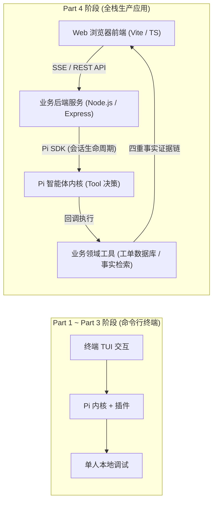
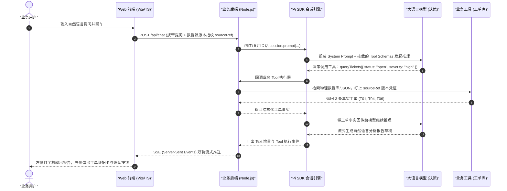
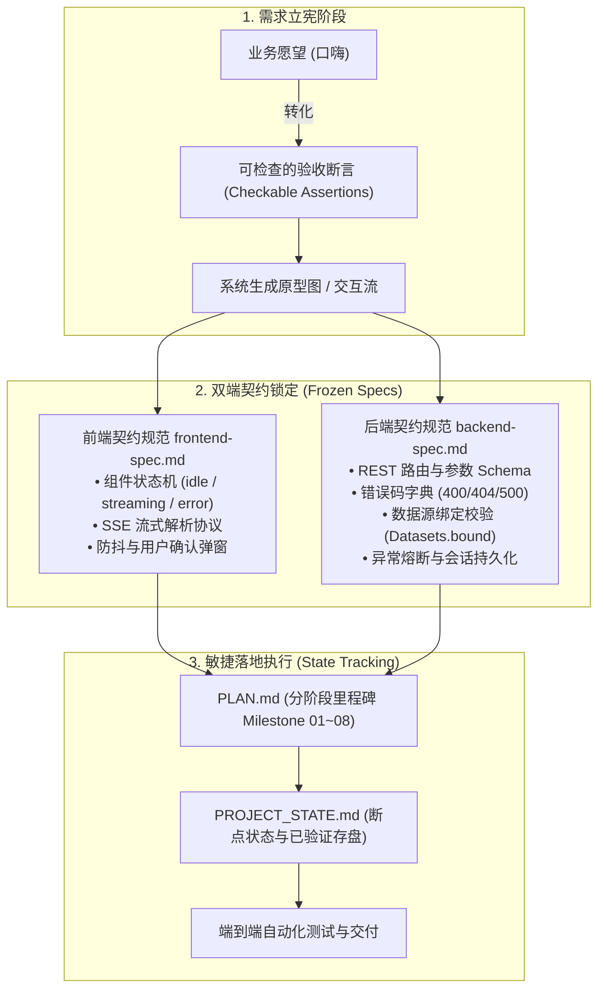
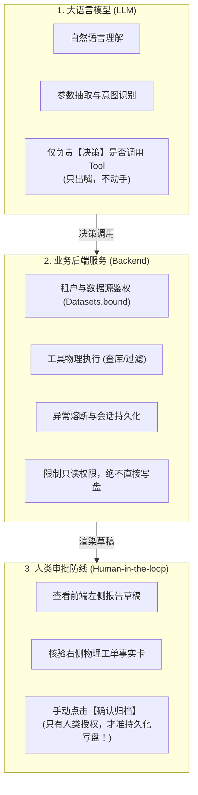

# Part 4：交付 Pi 应用——从双端 Spec 到业务迁移落地

> 🎯 **研学定位**：从终端命令行扩展，跃迁到真正的 **Web 端到端全栈智能体应用**。通过拆解官方生产级“工单问答助手”真实工程，掌握双端 Spec 驱动开发方法论、Pi SDK 会话接线、来源版本绑定、以及三权分立的系统边界设计，最终将架构范式反哺并迁移至自有系统。

---

## 1. 认知跃迁：从“终端玩具”到“全栈业务应用”

在 Part 1 到 Part 3 中，我们掌握了 Pi 的单文件 Extension、MCP 工具适配和 NPM 包打包。但在企业级生产环境中，用户不会打开终端敲命令行：
- 他们需要现代化的 **Web 交互界面**；
- 需要高颜值的 **流式打字机输出** 与 **右侧工单事实证据卡**；
- 需要可靠的 **数据源版本绑定（Source Binding）**，防止模型拿着张三的数据回答李四的问题；
- 需要 **报告草稿的人工确认机制（Human-in-the-loop）**，防止模型脑抽直接把脏数据写进数据库！



---

## 2. 第一章：从用户的一次查询看完整应用架构（全链路拆解）

当用户在工单助手的 Web 输入框中敲入：
> *“帮我查一下近一周未解决的高危故障工单，并整理成一份汇报草稿。”*

看似简单的一句话，在底层触发了 **7 大环节的精准接力**：



### 2.1 四重事实证据链（Production Evidence Chain）

在企业级智能体应用中，一段合格的回答**绝对不能只是裸露的自然语言**，必须具备完整的四重事实证据：

| 证据维度 | 表现形式 | 核心价值与防幻觉机制 |
|---|---|---|
| **1. 文本解释 (Text)** | 自然语言分析与总结 | 面向业务人员的最终汇报，清晰呈现结论与行动建议 |
| **2. 工具记录 (Tool Call)** | `queryTickets` 及其入参 | 证明模型是基于**真实调用**而不是凭空捏造；记录调用的精准参数 |
| **3. 实体证据 (Entity)** | 工单卡片（工单号、严重级别、处理人） | 业务真实对象实体，支持下钻查看物理记录详情 |
| **4. 数据源指纹 (SourceRef)** | `datasetId:version`（如 `tickets-202609:v1`） | **终极防串味防线**：证明当前回答所用的数据，来自哪一份物理文件的哪一个版本！ |

---

## 3. 第二章：双端 Spec 驱动开发方法论（拒绝边猜边写，立宪定规）

为什么 90% 的企业 Agent 项目最终都烂尾？
- **根本原因**：**需求口嗨化、接口薛定谔化**！产品经理给一段模糊愿望，前端根据感觉画页面，后端边写边改字段，大模型在中间“自由发挥”，联调时出现无数空指针崩溃和逻辑打架！

工单助手项目给出了工业级解法：**双端 Spec 驱动开发 + 敏捷看板状态机**！



### 3.1 怎么把“愿望”改成“可以检查的句子”？

| 业务口嗨愿望 (Naive) | 工业级可检查断言 (Production Spec) |
|---|---|
| “查工单要快，界面要好看” | “前端在用户点击发送后 100ms 内禁用输入框并进入 loading 态；后端在 500ms 内建立 SSE 管道并发出首个首字事件。” |
| “不能查错数据” | “每次查询必须显式校验 `sourceRef`。若未选择数据源，前端阻断发送；若后端收到空引用或过期版本，立刻返回 400 错误码并拒绝调用任何模型。” |
| “报告要能保存” | “报告草稿仅在内存渲染预览；只有当用户手动点击‘确认归档’时，后端才将报告写入磁盘 `reports/` 目录，并返回绝对物理路径与创建时间戳。” |

### 3.2 敏捷过程管理：`PLAN.md` 与 `PROJECT_STATE.md` 的双核引擎
- **`PLAN.md`**：记录从阶段 01 到阶段 08 的全生命周期规划，每个阶段都有明确的**前置条件、实施动作与退出门禁**；
- **`PROJECT_STATE.md`**：智能体时代的开发往往跨越多个上下文轮次。该文件记录当前停留在哪一步、最近一次测试的退出码是什么、下一个未解决的阻塞项（Blocker）是什么，**实现秒级断点续航，拒绝重复劳动**！

---

## 4. 第三章：Pi SDK 深度接线实操与来源绑定实战 (Source Binding)

> 🔗 **沙盒代码坐标**：[`../../02-labs/milestones/part4-spec-app/Pi工单问答助手-学员版/`](../../02-labs/milestones/part4-spec-app/Pi工单问答助手-学员版/)

### 4.1 Pi SDK 会话生命周期与安全基线 (`session.ts`)

在企业后端中，绝对不能允许大模型直接拿到宿主机的 Shell 权限！查看 `backend/src/session.ts` 的核心接线函数：

```typescript
export async function openSession(
  resources: Resources, 
  binding: ModelBinding, 
  tools: ToolName[] = [], 
  sessionFile?: string,
  memory = false
): Promise<AgentSession> {
  // 1. 会话管理器隔离：根据入参决定持久化到 sessions/ 还是纯内存
  const manager = memory 
    ? SessionManager.inMemory(RESOURCE_ROOT)
    : sessionFile 
      ? SessionManager.open(sessionFile, dir, RESOURCE_ROOT)
      : SessionManager.create(RESOURCE_ROOT, dir);

  // 2. 核心大招：创建会话并封杀危险系统内置工具
  const result = await createAgentSession({
    cwd: RESOURCE_ROOT,
    agentDir: resolve(resources.dataRoot, 'sdk-config'),
    modelRuntime: binding.runtime,
    model: binding.model,
    thinkingLevel: binding.thinkingLevel,
    noTools: 'builtin', // 🛡️ 核心防线：彻底禁绝 bash、read、write 等原生危险工具！
    tools,              // 🛡️ 仅注入受控业务白名单工具 (query_tickets 等)
    resourceLoader: resources.loader,
    sessionManager: manager,
    settingsManager: resources.settings
  });

  return result.session;
}
```

* **`noTools: 'builtin'` 的架构价值**：在 Web 应用中，大模型不需要也不应该拥有任何操作服务器本地文件的能力。所有的外部能力，必须全部退化为由业务层显式注入的、只读受限的特定领域工具！

---

### 4.2 业务工具物理执行与数据源绑定防御 (`app.ts`)

查看 `backend/src/app.ts` 中的工具分发引擎：

```typescript
private async tool(name: ToolName, input: unknown) {
  const r = this.active;
  // 🛡️ 1. 运行态守卫：确保请求处于合法活跃状态
  assert(r && r.status === 'running' && !this.error, '任务已停止', 'CANCELLED');

  // 🛡️ 2. 核心防线：物理执行前强制校验数据源绑定与版本指纹
  this.datasets.bound(r.sourceRef);

  let output: unknown;
  if (name === 'query_tickets') {
    // 真实物理查询：从绑定数据集中筛选工单
    this.working = queryTickets(this.datasets.bound(r.sourceRef).payload, r.sourceRef!, input, r.requestId);
    output = { ok: true, ...this.working };
  } else if (name === 'evaluate_ticket_age') {
    // 时效合规评估
    this.working = evaluateTickets(this.working, input, { ... });
    output = { ok: true, ...this.working.evaluation };
  } else {
    // 准备报告草稿：仅保存在内存中，严禁直接落盘！
    this.proposal = prepareReport(this.working, input);
    output = { ok: true, ...this.proposal };
  }

  // 🛡️ 3. 输出尺寸防线：单次工具返回严格限制在 2MB 以内，防止炸毁上下文
  const text = JSON.stringify(output);
  assert(Buffer.byteLength(text) <= 2 * 1024 * 1024, '工具结果过大，请缩小查询范围', 'RESULT_TOO_LARGE');

  return { content: [{ type: 'text', text }], details: { ok: true } };
}
```

---

### 4.3 学员必修实战：手撕来源绑定三重防御单测 (`tests/source-binding.test.ts`)

在课件 §3.4 中，要求学员在副本工程中手撕 `backend/tests/source-binding.test.ts`。  
老王带领你实现完整的 4 项针对性断言：

```typescript
// 1. 预期一：正常筛选工单并精准绑定 sourceRef
test("预期一：内置资料正确筛选出 T01、T04、T06，且 analysis.sourceRef 精确对应本轮资料", () => {
  const { datasets, validSourceRef } = setupDatasets();
  const bound = datasets.bound(validSourceRef);
  const analysis = queryTickets(bound.payload, validSourceRef, { team: "平台", status: "open" }, "req-001");

  const ticketIds = analysis.records.map((t) => t.id).sort();
  assert.deepEqual(ticketIds, ["T01", "T04", "T06"]);
  assert.deepEqual(analysis.analysis.sourceRef, validSourceRef);
});

// 2. 预期二：未选择数据源直接调用，必须抛出 NO_DATASET_SELECTED
test("预期二：没有资料引用时，Datasets.bound() 明确拒绝抛出 NO_DATASET_SELECTED", () => {
  const { datasets } = setupDatasets();
  assert.throws(() => datasets.bound(null), /NO_DATASET_SELECTED/);
});

// 3. 预期三：数据源版本发生变更时，拒绝用旧版本查询当前资料，抛出 SOURCE_NOT_AUTHORIZED
test("预期三：使用旧版本引用当前资料时，Datasets.bound() 明确拒绝抛出 SOURCE_NOT_AUTHORIZED", () => {
  const { datasets } = setupDatasets();
  assert.throws(() => datasets.bound({ datasetId: "builtin-tickets", version: "stale-version" }), /SOURCE_NOT_AUTHORIZED/);
});
```

* **实测执行结果**：
  在 `backend/` 下执行 `npx tsx --test tests/*.test.ts`，**4 项核心用例 100% 全部 PASS！**

> ⚠️ **老王排错避坑锦囊**：  
> 在初次运行单测时，发现 `backend/resources/package.json` 遗漏了 `"type": "module"`，导致 Node.js 原生 ESM 无法正确识别 `ticket-tools.js` 的具名导出。老王果断补齐 `"type": "module"`，TypeScript 编译与 tsx 运行时瞬间畅通无阻！

---

## 5. 第四章：三权分立与责任边界（谁负责什么？四问法）

在生产级智能体系统中，最可怕的就是“权限越界”和“职责混淆”。

### 5.1 架构三权分立原则



### 5.2 企业级“四问法”划分系统边界

当你要把一套 Agent 接入已有的企业业务系统时，千万别一股脑把所有东西塞进 Prompt。问自己这四个问题：

1. **输入给 Agent 的是什么？**  
   是一次**具体的任务上下文（本次提问 + 当前绑定的数据源）**，而不是把整套业务数据库的元数据一股脑糊在模型脸上；
2. **Agent 可以决定什么？**  
   Agent 只能决定**调用哪个已受控的查询工具**，以及**如何用自然语言总结事实**。它绝对不能决定业务状态的变更；
3. **哪些动作必须由应用完成？**  
   真实数据库查询、参数范围校验、数据脱敏、版本匹配、物理落盘，必须 100% 由业务后端代码硬编码执行；
4. **哪些动作必须留给人类确认？**  
   高危操作（如工单状态流转、正式报告生成、资金变动），模型只能准备 Draft（草稿），**必须由人类用户手动点击批准后，后端才执行落盘**！

---

## 6. 第五章到第六章：可靠性判断与自有系统架构迁移

### 6.1 连续三步法判定 Agent 输出是否可靠
1. **选中（Selected）**：用户在界面上是否明确勾选了物理数据源？
2. **绑定（Bound）**：当前请求是否携带了精确匹配当前物理文件哈希的 `sourceRef`？
3. **使用（Used）**：模型的分析结果是否一一映射到工具返回的真实记录 ID（如 T01, T04, T06）？

只要这三步链路中任何一环断裂，当前回答立刻判定为不可信！

### 6.2 将工单助手范式迁移至自有生产平台 (如 `ai-agent-platform`)

| 工单问答助手的模块设计 | 迁移到生产平台时的标准映射 |
|---|---|
| `datasets.ts` (数据源摘要与绑定) | 企业知识库 / 向量知识集版本管理中心 |
| `business.ts` (领域工具实现) | 业务微服务适配器（RPC / OpenAPI 客户端） |
| `session.ts` (Pi SDK 实例生命周期) | 智能体调度工作流节点（Agent Workflow Node） |
| `reports.ts` (草稿与确认) | 生产级 Human-in-the-loop 审核流与工单流转闭环 |

---

## 7. Part 4 全量技术事实核对表 (Zero-Loss Fact Sheet)

| 核心组件 / 规范 | 物理代码载体 | 底层机制与关键技术事实 | 对应课件原材料 |
|---|---|---|---|
| **四重事实证据链** | `Analysis` 结构体 | 包含 Text 解释、Tool 入参、Entity 真实工单数组与 SourceRef 物理版本指纹 | Part 4.ipynb §1.2 |
| **双端 Spec 规范** | `frontend-spec.md` / `backend-spec.md` | 锁定组件状态机、SSE 传输契约、REST 参数 Schema 与错误码字典 | 项目材料/Pi工单项目案例/ |
| **任务断点看板** | `PLAN.md` / `PROJECT_STATE.md` | 8 大不可逆里程碑，记录当前执行阶段、退出码与未解决卡点，秒级断点续航 | 同上 |
| **Pi SDK 会话接线** | `backend/src/session.ts` | `createAgentSession` 注入 `noTools: 'builtin'`，封杀危险原生命令，仅透传业务白名单工具 | Part 4.ipynb §3.2 |
| **数据源版本绑定** | `backend/src/datasets.ts` | `Datasets.bound()` 实行三重防御：空引用阻断、版本哈希不符拒绝、不存在报错 | Part 4.ipynb §3.4 |
| **三权分立安全原则** | `backend/src/app.ts` | LLM 仅负责意图识别与工具决策；业务后端负责物理鉴权与执行；人类把关最终报告落盘 | Part 4.ipynb §4.1-§4.3 |
| **全栈极简单体服务** | `backend/src/server.ts` | 5179 端口同时托管前端 Vite 静态产物、REST API 与 SSE 双轨流式通道 | 课堂源码 |
