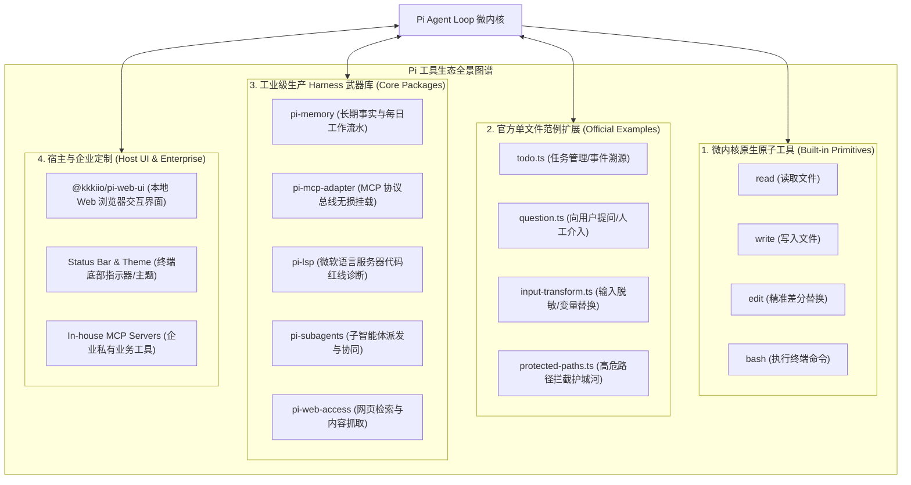
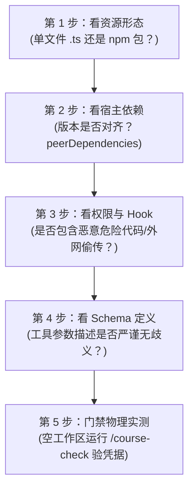

# Pi 工具生态与扩展全景指南：能力图谱、寻宝途径与五步选配法

> 💡 **10秒心智锚点 (Mental Model Anchor)**：  
> - **一句话技术内核**：Pi 遵循极端克制的 **Microkernel（微内核）** 架构，核心仅保留 4 个原子基础工具（`read/write/edit/bash`），其余一切高阶工程能力（记忆沉淀、MCP 协议总线、编译器诊断、子 Agent 派发、Web UI 交互）全部通过 **Extension 扩展总线** 进行解耦挂载。  
> - **主客体拓扑**：开发者/Agent ──(声明安装 `pi install`)──► 全局配置 `[~/.pi/agent/settings.json]` ──(动态编译/沙盒注入)──► 运行时工具集 `[activeTools]` 与 TUI 斜杠命令 `[registeredCommands]`。  
> - **实操验证线索**：`pi install <target> --approve` ➔ 写入 `settings.json` ➔ 启动 `pi` ➔ 执行 `/course-check` 验证 `"missing": []` 零缺失。  
> - **对应课件**：第二节课·第3章《把能力缺口对应到生态资源》与第一节课·§5.1《先选对扩展材料》。  
> - **官方源码参考**：[`earendil-works/pi/packages/coding-agent`](https://github.com/earendil-works/pi)

---

## 1. 动机穿透：为什么 Pi 必须采用“微内核 + 插件生态”？ (Why It Exists)

### 1.1 传统 Agent 框架的致命陷阱：胖内核膨胀地狱 (The Fat Kernel Trap)
市面上绝大多数开源 Agent 框架（如早期的各种 AutoXXX、部分 LangChain 封装）最容易犯的工程通病，就是**无节制的代码膨胀**：
- 框架作者恨不得把向量数据库连接器、各类 LLM SDK、网络爬虫、代码执行沙盒一股脑塞在核心代码库里；
- 结果导致一个简单的命令行 Agent 安装包动辄上千个依赖包、体积几个 G，启动冷启动耗时数秒甚至数十秒；
- 只要其中某一个三方库发生依赖冲突或安全漏洞，整个 Agent 框架直接瘫痪崩溃。

### 1.2 切斯特顿栅栏与架构取舍：Pi 的“极端极简微内核” (Architecture Trade-offs)
Pi 的作者做出了一个极其大胆且清醒的架构取舍：
- **核心只做一件事**：维持最小化的 Agent Loop（提示词组装 ➔ 模型推理 ➔ 工具分发 ➔ 结果回填 ➔ 事件溯源会话树）。
- **原子底座**：只内置最不可或缺的 4 个物理文件系统操作工具（`read`, `write`, `edit`, `bash`）。
- **把能力扩充权交还给开发者**：通过标准化的 Extension 接口，允许开发者按需接入记忆（`pi-memory`）、协议（`pi-mcp-adapter`）、诊断（`pi-lsp`）。
  - **牺牲了什么**：开发者不能“开箱即用”所有高级黑魔法，第一次上手必须明确自己缺什么能力、去生态里选配。
  - **换取了什么**：极致轻量的启动速度、坚不可摧的底层稳定性，以及随心所欲的生产级定制自由度！

### 1.3 直觉心智模型：PC 主板与 PCIe 扩展插槽
把 Pi 想象成一台顶级电脑的主板：
- **微内核（主板 + CPU）**：负责供电、总线时钟与最基本的 BIOS 指令；
- **Extension（PCIe 扩展卡）**：你需要图形渲染，就插显卡（挂载 `pi-web-ui`）；你需要大容量存储，就插 NVMe 固态（挂载 `pi-memory`）；你需要连接外部外设，就插雷电扩展坞（挂载 `pi-mcp-adapter`）。
- **不要把显卡焊死在主板上**，这就是 Harness 扩展生态的精髓！

---

## 2. Pi 工具生态四大阵营全景图谱 (The 4 Ecosystem Quadrants)

在 Pi 体系中，所有工具与扩展被严丝合缝地划分为四大阵营：



### 阵营 1：微内核原生基础工具（Built-in Primitives）
这是 Pi 安装即自带的 4 大原子武器，没有任何外部依赖：
1. **`read`**：读取指定路径的文件内容，支持按行截取，是 Agent 探索项目的第一感官；
2. **`write`**：全新写入文件（若文件不存在则自动创建父目录）；
3. **`edit`**：精准文本替换。采用 `oldText` 与 `newText` 的精确匹配机制，杜绝盲目全量覆盖引发的脏代码；
4. **`bash`**：执行系统 Shell 命令，用于运行测试、编译工程、拉取环境状态。

### 阵营 2：官方范例扩展（Official Examples · 单文件 TypeScript 模板）
官方直接放在源码库里的示例脚本，全长不到 100 行，是学习扩展开发的绝佳活教材：
* **`todo.ts`**：注入 `todo` 工具与 `/todos` 终端看板。核心采用**事件溯源（Event Sourcing）**，状态塞在 `toolResult.details` 里，跟会话树分支完美漫游回滚；
* **`question.ts`**：注入人机协同（Human-in-the-loop）交互工具，大模型遇到不确定的需求时，主动在终端弹出单选/多选/输入框等待人类输入确认；
* **`input-transform.ts`**：输入拦截 Hook，在人类的提示词发给模型前，进行动态变量替换、敏感词脱敏或注入项目全局规范；
* **`protected-paths.ts`**：系统护城河 Hook，当模型试图修改 `.git/`、`package.json`、生产环境变量等高危文件时，在底层直接拦截拒执。

### 阵营 3：工业级生产 Harness 武器库（核心生产主力）
第二课带大家装配的核心武器库，全部发布在 npm 注册表上：
* **`pi-memory` (`npm:pi-memory@0.4.2`)**：**跨会话长期记忆**。注入 `memory_write`、`memory_read`、`memory_status`、`scratchpad`、`memory_forget`、`memory_restore` 6 个工具，使用纯 Markdown 管理记忆；
* **`pi-mcp-adapter` (`npm:pi-mcp-adapter@2.34.0`)**：**MCP 协议总线**。让你一键无损直连 Python/Go/Java 写的外部微服务，动态把微服务接口映射为 Pi 工具（如工单系统的 `support_get_policy`、`support_list_tickets`）；
* **`@narumitw/pi-lsp` (`npm:@narumitw/pi-lsp@0.49.7`)**：**微软语言服务器 (LSP) 显微镜**。注入 `lsp_diagnostics`，让模型改完代码原地获取 TypeScript/Python 编译器的类型报错；
* **`pi-subagents` (`npm:pi-subagents@0.68.0`)**：**多智能体协作总线**。注入 `subagent` 工具，支持派发只读调查员（如 `course-scout`）进行代码库并行勘探；
* **`pi-web-access` (`npm:pi-web-access@0.29.0`)**：**网络检索扩展**。注入 `web_search` 和 `fetch_content`，给 Agent 补上实时上网查文档的能力。

### 阵营 4：宿主与界面扩展（UI & Host Adaptations）
* **`@kkkiio/pi-web-ui` (`npm:@kkkiio/pi-web-ui@0.1.1`)**：官方 Web 界面扩展。直接启动一个本地网页服务器，把终端里的 Pi 搬到浏览器里，提供可视化工单看板和记忆检索界面；
* **各种 TUI Theme & Status Bar 扩展**：负责在终端底栏实时渲染 Token 消耗速度、当前模型思考预算（Thinking Budget）等。

---

## 3. 资源寻宝指南：去哪里找这些工具与扩展？ (Finding Resources)

不要在搜索引擎里大海捞针，Pi 社区的所有官方与极客资源收敛在以下四大渠道：

| 渠道名称 | 官方入口链接 | 核心资源类型 | 适合场景 |
|---|---|---|---|
| **1. 官方 GitHub 仓库** | [`github.com/earendil-works/pi`](https://github.com/earendil-works/pi) | 单文件源码、官方范例、开发契约文档 | 学习扩展底层原理、抄官方代码范本、魔改自定义工具 |
| **2. NPM 官方注册表** | [`npmjs.com/search?q=keywords:pi-package`](https://www.npmjs.com/search?q=keywords%3Api-package) | 带 `pi-package` 标签的发布包 | 查找开箱即用的生产级扩展包（通过 `pi install` 直接安装） |
| **3. Pi Package Catalog** | [`pi.dev/packages`](https://pi.dev/packages) | 官方认证与社区推荐的精选目录 | 按能力缺口（记忆/协议/LSP/UI）定向检索生态候选 |
| **4. 官方 Discord 极客社区** | [`discord.com/invite/3cU7Bz4UPx`](https://discord.com/invite/3cU7Bz4UPx) | 极客讨论区、`#extensions`、`#showcase` | 交流最新玩法、排查前沿兼容性 Bug、获取未发布的民间黑科技 |

---

## 4. 讲师核心心法：评估一个扩展靠不靠谱的“五步法” (5-Step Evaluation)

去社区找工具，**绝对不能无脑 `pi install`**，垃圾代码不仅会拖慢会话速度，甚至会产生安全隐患。遵循以下五步评估法：



### 第一步：看资源形态（辨清边界）
* 如果你只是要给某个项目增加一个小功能（比如查特定工单），优先找单文件 `.ts` 扩展，放在项目 `.pi/extensions/` 目录下即可，避免引入冗余依赖；
* 如果是通用性基础设施（如 MCP 桥接、长期记忆），优先选择成熟的 npm Package。

### 第二步：看宿主依赖与版本对齐
打开包的 `package.json`，核查 `peerDependencies` 中的 `pi` 版本要求：
* 例如课程锁定的是 `0.85.1`，如果第三方包依赖的是 `^1.0.0` 且使用了废弃的 API，安装后必定报错暴毙！

### 第三步：看权限与 Hook 边界（安全审计）
* 仔细阅读其 `index.ts` 或入口文件，检查它监听了哪些生命周期 Hook；
* 警惕未经授权的 `fs.rmSync` 或网络数据外发。记住：**包本身并不是沙箱边界，它拥有你当前运行终端的完整物理权限！**

### 第四步：看 Schema 定义严谨度（大模型防幻觉门槛）
搜索代码中的 `registerTool`：
* 查看 `name` 是否清晰，`description` 是否明确说明了“什么时候调、什么时候不调”；
* 查看 `parameters` 是否遵循严密的 JSON Schema。如果参数定义模糊不清，大模型在推理时有 90% 的概率产生参数幻觉！

### 第五步：任务门禁物理实测
不要迷信 README 里的自我吹嘘！在空白测试目录中执行：
```bash
pi install <target> --approve
pi
/course-check
```
核验 `.course-evidence/registration.json`，亲眼看到工具成功点亮且执行任务回执正常，才算真正过关。

---

## 5. 安装与管理实操手册：`pi install` / `pi remove` 命令全解

### 5.1 安装来源语法汇总
Pi 的 CLI 提供了极其统一且直观的包管理协议：

```bash
# 1. 安装 NPM 社区扩展包（锁定具体版本是工业级最佳实践）
pi install npm:pi-memory@0.4.2 --approve
pi install npm:pi-mcp-adapter@2.34.0 --approve

# 2. 安装本地单文件 TypeScript 扩展（支持相对路径与绝对路径）
pi install ./official-examples/todo.ts --approve

# 3. 安装 Git 仓库来源的扩展
pi install git:github.com/user/pi-custom-ext#v1.0.0 --approve

# 4. 项目私有扩展（免安装模式）
# 直接把 your-tool.ts 丢到当前项目根目录的 .pi/extensions/ 目录下，启动 pi 时自动就地加载！
```

### 5.2 卸载与清理命令
当你不再需要某个全局扩展时，使用 `remove` 命令将其从全局配置中注销：
```bash
# 卸载 NPM 扩展
pi remove npm:pi-memory

# 卸载本地单文件扩展
pi remove ./official-examples/todo.ts
```

### 5.3 物理配置核验 (SSOT)
所有的 `pi install` 最终落盘在当前用户的主目录配置中：
`~/.pi/agent/settings.json`
```json
{
  "extensions": [
    "npm:pi-memory@0.4.2",
    "npm:pi-mcp-adapter@2.34.0",
    "/Users/lijiaxin/.../official-examples/todo.ts"
  ]
}
```
如果你怀疑环境被污染，可以直接打开该文件，手工删除不需要的行，纯透明无任何黑盒隐蔽状态！

---

## 6. 避坑指南：Naive vs Production 对比 (Gotchas & Best Practices)

| 场景维度 | Naive 粗暴做法 (Demo 玩具心态) | Production 工业级做法 (企业生产防线) |
|---|---|---|
| **扩展获取** | 在网上随便搜个脚手架盲目 `npm install` | 认准 `keywords:pi-package` 标签，进行源码五步审计 |
| **版本锁定** | 随手安装 `npm:pi-memory@latest` | 严格锁定语义化版本号（如 `@0.4.2`），防止上游破坏性更新 |
| **状态持久化** | 在扩展里偷偷往本地文件写 `todo.json` | 采用 **Event Sourcing**，将状态塞入 `toolResult.details` 随会话树漫游 |
| **工具挂载面** | 把 MCP 服务的 50 个工具全量盲挂给大模型 | 适配器层使用 `includeTools` 白名单，严控能力暴露面 |
| **安全防护** | 信任所有社区代码，盲目授予执行权限 | 挂载 `protected-paths.ts` 护城河 Hook，拦截核心配置篡改 |

---

## 7. 全量技术事实核对表 (Zero-Loss Fact Sheet)

| 扩展名称 / 标识 | 分发来源 | 核心暴露工具 / 命令 | 底层依赖 / 关键机制 | 官方坐标 / 示例路径 |
|---|---|---|---|---|
| **内置 4 大原子** | 内核自带 | `read`, `write`, `edit`, `bash` | Node.js 原生 `fs` 与 `child_process` | `packages/coding-agent/src/core/tools` |
| **`todo.ts`** | 本地单文件 | 工具: `todo` / 命令: `/todos` | Event Sourcing 架构 / `toolResult.details` | `official-examples/todo.ts` |
| **`question.ts`** | 本地单文件 | 工具: `question` | TUI 交互挂钩 / Human-in-the-loop | `official-examples/question.ts` |
| **`protected-paths.ts`** | 本地单文件 | 生命周期 Hook (前置拦截) | `pi.on("tool_call")` 路径黑名单防御 | `official-examples/protected-paths.ts` |
| **`pi-memory`** | npm 注册表 | `memory_write`, `memory_read`, `memory_status`, `scratchpad`, `memory_forget`, `memory_restore` | 纯 Markdown 存储 / recovery 快照 / Compact Hook | `npm:pi-memory@0.4.2` |
| **`pi-mcp-adapter`** | npm 注册表 | 动态生成（如 `support_get_policy`, `support_list_tickets`） | JSON-RPC 2.0 Stdio 长连接 / `includeTools` 白名单过滤 | `npm:pi-mcp-adapter@2.34.0` |
| **`pi-lsp`** | npm 注册表 | `lsp_diagnostics` | 微软 Language Server Protocol (LSP) / 原地红线报错 | `npm:@narumitw/pi-lsp@0.49.7` |
| **`pi-subagents`** | npm 注册表 | `subagent` | 独立上下文派发 / 链式与并行执行 / 只读调查员模式 | `npm:pi-subagents@0.68.0` |
| **`pi-web-ui`** | npm 注册表 | 本地 Web 控制台 (端口服务) | HTTP/WebSocket 协议桥接 / 浏览器工单可视化看板 | `npm:@kkkiio/pi-web-ui@0.1.1` |
