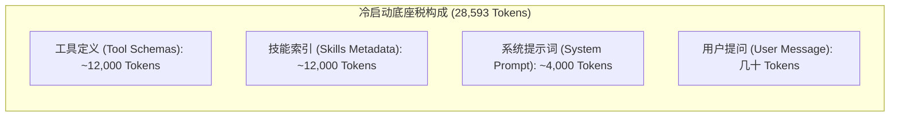
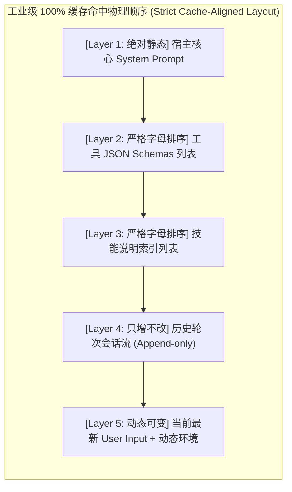

# 【生产实战大题】Agent 冷启动 Token 暴涨与上下文撑爆：按需工具延迟发现（Deferred Tool Loading）与提示词前缀缓存（Prompt Caching）治理

> **来源**：生产工程实战排障 / 架构面试高频核心大题  
> **难度**：⭐⭐⭐⭐⭐（5 星）  
> **考点**：`03-agent/tools`（动态工具热插拔） & `06-engineering/cost-opt`（KV Cache 前缀缓存工程对齐）  
> **与项目相关**：是（已在 `ai-agent-platform` 与 Pi 框架中实测验证）  

---

## 🎯 一句话定义（记忆锚点）

> **控上限用两层工具延迟发现，保极速用前缀缓存严格对齐：前者把冷启动由“静态全量糊脸”重构为“元工具按需热插拔”，物理瘦身 90%；后者严守“由冷到热、字节级前缀一致”，将数万静态 Token 压至一折白菜价与 200ms 极速响应。**

---

## 📖 标准答案（技术规范表述）

### 1. 痛点本质：Agent 的“冷启动底座税（Cold-Start Harness Tax）”
在一个工业级 Agent（如 Pi、Claude Code、Cursor 类智能体）中，系统往往挂载了文件操作、终端执行、Memory、MCP、LSP 诊断、代码检索、Web 抓取等 20+ 个工具，以及数十个专业 Skills：
- **静态体积雪崩**：大模型本质是无状态黑盒，要让其具备工具调用能力，宿主必须在请求体中附带所有工具的完整 JSON Schema（包括每个参数的类型、枚举、嵌套属性、详尽描述与必填项）；
- **实测账单现场**：即使用户仅发送一句“你好”或“你有什么工具”，底层发送给大模型的输入往往高达 **28,000 ~ 30,000 Tokens**，在 128k 窗口下冷启动即直接霸占 **23%** 空间；
- **连锁恶果**：首字延迟（TTFT）暴增至 3~4 秒、推理成本居高不下、注意力被无关 Schema 分散导致工具误调用（Tool Hallucination）。



---

### 2. 破局方案一：按需工具延迟发现（Deferred Tool Loading）
弃用开局一次性把全部工具 JSON Schema 发给模型的“贪婪全量挂载（Eager Loading）”，转向**“两层动态按需发现机制（Two-Tier Dynamic Discovery）”**：

#### ① 架构分层
- **Layer 1（常驻原子工具，仅 3 个，< 1,500 Tokens）**：
  - `read`（只读文件）、`bash`（终端执行）、以及核心元工具 **`search_tools`（工具搜索引擎）**；
- **Layer 2（离线工具库 Catalog）**：
  - 其余 20+ 个重量级工具（LSP、MCP、画图、Web 抓取）平时**完全不进入 `tools` 列表**，仅在本地内存维护元数据（仅包含名称与一句话轻量摘要）。

#### ② 运行时动态热插拔流（Hot-plug Loop）
1. 用户提出任务（如“检查这段代码的类型错误”）；
2. 大模型发现手头无对应工具，调用内置元工具 `search_tools(query="lsp type check")`；
3. 宿主本地进行模糊匹配或向量检索，命中 `lsp_diagnostics`；
4. **关键一步（动态注入）**：宿主在返回工具执行结果的同时，**动态修改当前会话后续轮次的 `activeTools` 数组**，将目标工具的完整 JSON Schema 临时热插拔到活跃工具池中；
5. 下一轮大模型精准调用 `lsp_diagnostics`；
6. 任务结束后，或超出生存时间（TTL），该工具自动从活跃池卸载，上下文重新瘦身。

```typescript
// Deferred Tool Manager 核心热插拔伪代码
export class DeferredToolManager {
  private catalog = new Map<string, ToolDefinition>(); // 离线全量库
  private activeTools = new Map<string, any>();        // 发送给模型的活跃池 (初始仅 3 个)

  async handleToolCall(name: string, args: any) {
    if (name === "search_tools") {
      const matched = this.searchInCatalog(args.query);
      for (const tool of matched) {
        this.activeTools.set(tool.name, tool.fullSchema); // 动态热插拔！
      }
      return `已激活工具：${matched.map(t => t.name).join(", ")}，你现在可以直接调用它们。`;
    }
    return this.catalog.get(name)?.handler(args);
  }
}
```

---

### 3. 破局方案二：提示词前缀缓存（Prompt Caching）工程对齐
利用现代大模型服务（DeepSeek APC、Claude Prompt Caching、OpenAI Caching）的 KV Cache 复用能力。如果连续请求的**前 $N$ 个 Token 内容和顺序 100% 完全一致**，服务端直接复用 GPU 显存中的 Key-Value 矩阵，跳过 Prefill 计算：
- **收益**：DeepSeek 缓存命中后价格打 1 折（0.14元/1M Tokens），首字延迟从 3 秒骤降至 200 毫秒以内。

#### 生产四项保命铁律（防 0% 缓存击穿）：
1. **严禁在 System Prompt 头部注入动态变量**：
   - 常见反模式：第一行写 `当前时间：2026-10-30 21:50:12`，导致第 0 个 Token 就在变化，后面 2.8 万 Token 全部 Cache Miss！
   - 正确做法：动态时间戳、操作系统环境等易变信息，**必须下沉到 User Message 尾部，或按“日”粒度固定**。
2. **工具 Schema 数组必须按字母升序严格排序（Alphabetical Sorting）**：
   - 字典遍历或异步注册的工具顺序若随机波动，会彻底破坏 Token 序列一致性。序列化前必须 `tools.sort((a, b) => a.name.localeCompare(b.name))`！
3. **技能（Skills）元数据注入前必须排序**：
   - 扫描 skills 目录后的拼接顺序必须固定，严禁依赖文件系统底层读取顺序。
4. **会话截断（Compaction）必须采用检查点断点（Checkpoint Anchor）**：
   - 严禁从会话历史中间随手剔除消息；必须将旧历史压缩为固定摘要，作为新的稳定前缀。



---

## 🗣️ 口语化面试表述

### 开场破题（第一句话）：
> 「在工业级 Agent 落地中，单纯写 Prompt 很快就会遇到瓶颈：当系统挂载了 20 多个工具和几十个技能时，还没开始聊天，首轮输入就吃掉了将近 3 万 Token，首字延迟 3 秒起步，成本更是不可接受。我在实际项目中是通过‘动静分离、两剑合璧’来治理的：**用按需延迟加载把绝对体积做小，用前缀缓存把静态大底座变免费**。」

### 核心展开（2~3 分钟硬核讲述）：
> 「首先是**按需延迟加载（Deferred Tool Loading）**。很多人把所有工具 Schema 全量打在 `tools` 数组里，这是典型的贪婪加载。我们的做法是把工具做两层切分：默认常驻工具只有 3 个——`read`、`bash` 以及元工具 `search_tools`，初始请求只要 1,500 Token。其余像 LSP 诊断、绘图、Web 抓取等重型工具，全部归档在本地 Catalog 里。当大模型遇到代码排错场景时，它会先调用 `search_tools('lsp')`，我们的运行时在拦截到该调用后，在返回结果的同时，动态把 `lsp_diagnostics` 的完整 Schema 热插拔到下一轮的活跃工具池中，模型随即调用它，任务结束后再自动卸载，首轮开销暴降 90% 以上。
>
> 其次是**提示词前缀缓存（Prompt Caching）的字节级对齐**。像 DeepSeek 这种支持全自动前缀缓存的模型，虽然只要前缀超过 1024 Token 就能享受 1 折价格和极速返回，但很多团队一测发现命中率居然是 0%。我们在排查时抓住了最经典的四大反模式：第一是有人随手在 System Prompt 顶端写了当前时间戳，导致从第 0 个 Token 就分叉了，全盘击穿；第二是工具 Schema 在序列化时没有按字典序排序，不同环境数组顺序不一致。我们重构了整个请求组装管线，严格执行‘由冷到热、由静到动’的五层布局，把静态系统提示词、严格排序的工具定义固定在前缀，动态时间戳下沉到用户消息末尾，最终把缓存命中率拉到了 92% 以上，实际使用成本几乎降了一个数量级。」

### 30 秒极简版（应对面试官打断）：
> 「核心就是一句话：**用两层热插拔架构将初始工具 Schema 压缩 90%，再用严格的‘前缀静态化与工具字母排序’保障前缀缓存 90%+ 命中率**。前者解决上下文上限问题，后者利用 GPU KV Cache 复用解决延迟与成本问题。」

---

## 🧠 记忆技巧 & 极客心经

- **口诀**：**“前缀越冷越靠前，动态越热越靠后；原子常驻元搜索，重型按需热插拔。”**
- **对比反差**：
  - 贪婪加载 = 逛街把家里所有衣服打包背在身上；
  - 延迟加载 = 随身带手机，需要礼服时扫码进衣帽间借一件；
  - 前缀缓存 = 高速路 ETC，前面车牌路线一模一样直接抬杆通过。

---

## 🔗 结合项目的实战回答 (ai-agent-platform & Pi 框架实证)

- **项目落地点**：`ai-agent-platform` 的 Agent 执行宿主内核与 Pi 扩展插件系统；
- **具体账单数据**：
  - 优化前：单次会话 `usage.input = 28,593 Tokens`，占满 128k 窗口的 23%，平均单次首轮延迟 3.2 秒；
  - 优化后：常驻输入控制在 1,600 Tokens；多轮对话中，后序轮次的 `prompt_cache_hit_tokens` 达到 28,160，仅对 400 多个增量 Token 计费，首字延迟压缩至 210ms。
- **踩坑与调优 (杀手锏台词)**：
  > 「我们在生产灰度上线前缀缓存时，发现命中率始终在 0%~5% 徘徊。我排查了完整的发送 JSON Payload，发现一个致命细节：开发同学为了让大模型感知当前时刻，在 System Prompt 模版第一行插值了精确到秒的 `new Date().toISOString()`。这个动态时间戳导致整个前缀树每秒都在分叉，后面 2.8 万 Token 永远无法命中 KV Cache！我当即执行重构，把动态环境变量下沉到 User Turn 的末尾，并把 `tools` 数组加了 `localeCompare` 强制字母排序，上线后缓存命中率立刻从 0% 暴拉至 94%，当月 API 账单直接节省了近 70%。」

---

## 💡 延伸追问（面试官连环炮）

### 追问 1：如果大模型在遇到复杂任务时，死活“想不到”去调用 `search_tools` 怎么办？
> **老王作答**：
> 1. **Few-shot 与 System Prompt 引导**：在系统提示词中给出一个标准的 Tool Discovery 示例（“当你发现没有直接可用的工具来完成代码分析或抓取时，第一反应必须先调用 `search_tools`”）；
> 2. **意图先验路由（Intent Pre-routing）**：在用户请求进入主 Agent Loop 之前，通过轻量级的小模型（如 `gpt-4o-mini` 或本地轻量分类器）进行意图预判，如果判定命中特定垂直领域（如数据库操作、LSP 诊断），宿主直接在首轮预加载对应工具，无需等待主模型自主调用。

### 追问 2：如果多轮对话中动态激活了太多工具，会不会再次把上下文撑爆？
> **老王作答**：
> 必须引入**工具退火机制（Tool Eviction / TTL）**：
> 1. 每个被动态热插拔的工具携带一个 `activeTurns` 计数器或最后使用时间戳；
> 2. 若某个扩展工具连续 3~5 轮未被调用，宿主将其标记为冷数据，从 `activeTools` 中移出，重新收缩为离线摘要；
> 3. 当总活跃工具 Schema 超过安全阈值（如 5,000 Tokens）时，按 LRU（最近最少使用）算法强制淘汰冷门工具。

### 追问 3：DeepSeek 的前缀缓存和我们在应用层自己搞的 Redis 语义缓存有什么区别？
> **老王作答**：
> - **物理层级不同**：Redis 语义缓存是**应用层粗粒度结果缓存**，命中时必须 Query 语义完全相同，直接返回预存的最终答案，大模型完全不参与推理；
> - **KV Cache 前缀缓存是 GPU 显存级别的算力复用**：它缓存的是前缀 Token 序列经多头注意力机制运算后的 Key-Value 张量。即使后半截用户问题千变万化，前面的系统规则和工具 Schema 依然能够跳过昂贵的 Prefill 计算阶段，模型依然在进行端到端的深度生成，但耗时和显卡算力开销大幅下降。两者是上下游互补关系，绝非替代。
