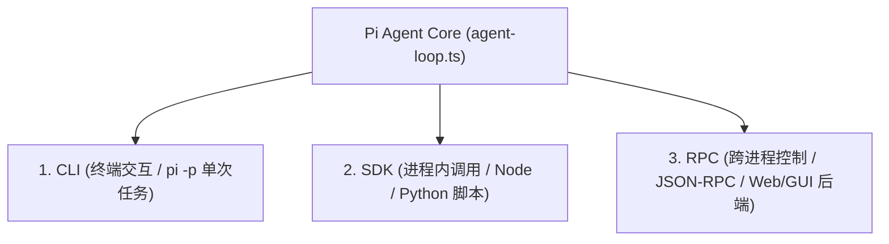

# Part 1 核心概念深潜：Pi Agent 架构原理与运行底座

> **对应课件**：第一节课-上手Pi-Agent：原理架构、安装配置与能力扩展  
> **源码对齐**：`earendil-works/pi` (commit `71dca871b`) / `@earendil-works/pi-coding-agent`

---

## 💡 一、人话动机：为什么会出现 Pi Agent？

### 1. 传统框架犯了什么病？
在 Pi 出现之前，很多人用 LangChain 或早期 AutoGPT 做 Agent。但真实工业落地时被坑惨了：
- **过度抽象与黑盒嵌套**：一个简单的 Prompt 被包装成了八层 Class，报个错调用栈有 30 层深，排障全靠猜；
- **自作聪明的状态流**：框架在中间做了各种自以为是的“预处理”和“后处理”，模型本来输出正确的 JSON，被框架转义一遍反而坏了；
- **死循环与资源爆炸**：一旦模型进入循环调用，缺乏底层的硬限制和精确拦截。

### 2. Pi 的极简哲学：六项核心取舍
Pi 诞生时确立了六项极其硬核的极简原则：
1. **模型决定下一步，Pi 只负责把执行结果老老实实喂回去**：绝不擅自修改模型的意图。
2. **工具只做原子操作**：不搞花里胡哨的复合工具，就给模型最基础的眼睛和手（`read/write/edit/bash`）。
3. **会话持久化回归文件**：不引入 Redis/Postgres 等笨重外部依赖，直接纯文本追加存盘（`~/.pi/agent/sessions/`），按目录隔离，支持像 Git 一样随时分支与回滚。
4. **统一双层架构**：内核只管 Loop（`@mariozechner/pi-agent`），外层负责交互与终端能力（`pi-coding-agent`）。
5. **单轮支持多工具并发**：一次 LLM 输出可以下发多个工具调用，不必每调一个工具就强制让模型重新思索一轮，大幅降低延迟和 Token。
6. **资源加载严格显式化**：通过 `DefaultResourceLoader` 精确控制加载哪些扩展、提示词和技能，杜绝隐式魔法。

---

## 🛠️ 二、四大内置工具的物理边界（为什么这么设计？）

| 工具名 | 核心职责 | 为什么这么设计？（底层防坑机制） | 源码位置 |
|---|---|---|---|
| `read` | 读取文件内容 | **防窗口撑爆**：大文件强制按行分页或截断，杜绝几万行代码瞬间把 LLM 上下文吃满。 | `core/tools/read.ts` |
| `write` | 全量写入/覆盖 | 写入前强制校验，若目标文件已存在必须显式覆盖，防无意识丢代码。 | `core/tools/write.ts` |
| `edit` | 精准局部修改 | **拒绝模糊替换**！必须提供 `edits[].oldText` 与 `newText`。`oldText` 必须在文件中唯一定位，多处匹配或找不到直接抛错，逼模型先 `read` 再 `edit`。 | `core/tools/edit.ts#L21` |
| `bash` | 终端命令执行 | 真实系统的执行触手，但有超时机制、环境隔离与退出码捕获。 | `core/tools/bash.ts` |

---

## 🔌 三、三大调用入口的本质区别



1. **CLI（人类交互入口）**：直接在终端打字，支持富文本 TUI 界面与 `/` 斜杠指令，也支持 `pi -p "xxx"` 批处理单次跑完退出。
2. **SDK（同进程集成入口）**：通过 Node 或 Python 代码直接 `import { createAgentSession }`，在自己的应用进程内部像调用普通函数一样驱动 Agent，适合将 Agent 深度嵌入自身服务。
3. **RPC（跨进程守护进程入口）**：Pi 作为一个常驻后台进程运行，前端或外部后端通过标准输入输出（stdin/stdout）或网络套接字发送 JSON-RPC 消息，解耦进程生命周期。

---

## 📋 四、全量技术事实核对表 (Lossless Fact Matrix)

| 事实项 | 规范值 / 路径 | 说明 / 边界条件 | 掌握点验 |
|---|---|---|---|
| **核心源码库** | `earendil-works/pi` | 早期版本叫 `badlogic/pi-mono`，切勿混淆安装 | ✅ |
| **Agent 循环源码** | `packages/agent/src/agent-loop.ts:156` | 模型调用 ➔ 工具分发 ➔ 结果聚合的主循环 | ✅ |
| **`edit` 参数签名** | `edits: Array<{oldText: string, newText: string}>` | `oldText` 重复出现会报错，多个编辑块不可重叠 | ✅ |
| **默认会话存储** | `~/.pi/agent/sessions/` | 按当前工作目录绝对路径哈希隔离，追加式 JSON Lines 格式 | ✅ |
| **配置与模型定义** | `~/.pi/agent/models.json` | 自定义 OpenAI 兼容代理、第三方中转模型的定义中枢 | ✅ |

---

## 💡 五、第一课实战疑难与架构深潜 (Q&A 精解)

### Q1：如何接入第三方中转模型（如 XIAOK_PROXY / OpenAI-compatible 代理），而不是官方直连？
- **底层机制**：Pi Agent 原生提供统一的模型配置规范 `models.json`。无论是中转站、代理池、还是本地 vLLM/Ollama，都可以通过声明一个 `provider` 挂载。
- **配置标准**（位于 `~/.pi/agent/models.json` 或项目级 `models.json`）：
  ```json
  {
    "providers": {
      "xiaok": {
        "baseUrl": "https://xiaok.lol/v1",
        "api": "openai-completions",
        "apiKey": "$XIAOK_PROXY_API_KEY",
        "compat": {
          "supportsDeveloperRole": false,
          "supportsReasoningEffort": false
        },
        "models": [
          {
            "id": "deepseek-v4.1-flash",
            "name": "DeepSeek V4.1 Flash (XiaoK)",
            "input": ["text"],
            "contextWindow": 128000,
            "maxTokens": 8192
          }
        ]
      }
    }
  }
  ```
- **参数避坑要点**：
  - `apiKey: "$XIAOK_PROXY_API_KEY"`：支持直接引用环境变量，避免明文写死密钥；
  - `compat.supportsDeveloperRole: false`：许多第三方中转网关不识别 OpenAI 最新的 `developer` 角色，设为 `false` 可让 Pi 将系统提示词降级为标准的 `system` 角色，防止报 400 Bad Request；
  - `compat.supportsReasoningEffort: false`：针对非 o1/o3 模型关闭思考力度参数，防止代理网关转发报错。

---

### Q2：`npm install --ignore-scripts` 背后到底执行了什么？
- **命令本质**：
  ```bash
  npm --prefix "02-labs/milestones/part1-basics/sdk-demo" install --ignore-scripts
  ```
- **核心逻辑**：
  1. `--prefix <dir>`：实现**目录级环境物理隔离**，仅在 `sdk-demo` 局部安装，绝不污染外层研学主工程；
  2. `--ignore-scripts`：**工业级安全红线**。禁止下载的第三方 npm 包在安装阶段私自运行 `preinstall/postinstall` 脚本，杜绝恶意代码利用本地提权；
  3. 它根据 `package.json` 中的声明：
     ```json
     "dependencies": {
       "@earendil-works/pi-coding-agent": "0.85.1"
     }
     ```
     精确拉取 Pi Agent 0.85.1 完整运行时及其 132 个依赖模块（包含核心状态循环、TUI 渲染、工具集合与模型运行时）。

---

### Q3：如果想查阅 Pi 的官方一手文档，应该看哪里？
1. **线上核心入口**：
   - GitHub 官方主仓库：[https://github.com/earendil-works/pi](https://github.com/earendil-works/pi)
   - npm 官方发布页：[https://www.npmjs.com/package/@earendil-works/pi-coding-agent](https://www.npmjs.com/package/@earendil-works/pi-coding-agent)
2. **本地全量 100% 官方离线 Markdown 文档（无须翻墙，就在本仓库）**：
   - 📘 自定义模型手册：`02-labs/milestones/part2-harness/.../docs/models.md`
   - 🔑 40+ 提供商鉴权指南：`02-labs/milestones/part2-harness/.../docs/providers.md`
   - 💻 SDK 官方开发手册：`02-labs/milestones/part2-harness/.../examples/sdk/README.md`
   - 🧩 扩展机制开发：`02-labs/milestones/part2-harness/.../docs/extensions.md`

---

### Q4：.mjs 语法看不懂？现代 JavaScript 核心机制人话速查
| 语法特性 | 实际代码示例 | 为什么要这么写？（比传统 JS 强在哪） |
|---|---|---|
| **ESM 原生模块** | `import { ModelRuntime } from "..."` | 现代标准，静态分析编译，支持 Tree-shaking 剔除死代码。 |
| **顶层 await** | `const rt = await ModelRuntime.create();` | 告别 `(async () => { ... })()` 包皮自执行函数，文件最外层直接异步等待。 |
| **属性简写** | `{ modelRuntime, model }` | 变量名与属性名同名时无需重复写 `key: value`。 |
| **箭头函数** | `session.subscribe((event) => { ... })` | 语法精炼，且**不篡改 `this` 作用域绑定**，规避上下文迷失 bug。 |
| **尾部取值 `.at(-1)`** | `messages.filter(...).at(-1)` | ES2022 原生特性，对标 Python 的 `[-1]`，比 `messages[len - 1]` 优雅得多。 |
| **原生读环境变量** | `process.loadEnvFile(path)` | Node.js 22 内置能力，告别笨重第三方 `dotenv` 库。 |

---

### Q5：LangChain 有官方远程文档 MCP (`docs.langchain.com/mcp`)，Pi 有吗？
- **事实结论**：Pi 官方**没有**搭建类似公网 HTTP 文档 MCP。
- **哲学对决**：
  - **LangChain**：由于抽象层级深达七八层、API 频繁破坏性升级，模型极易产生幻觉，官方不得不搭建云端 MCP 让 AI 在写代码前“现背八股”；
  - **Pi Agent**：贯彻 KISS 原则（Keep It Simple, Stupid），核心 Loop 只有几百行代码，四大原子工具设计清晰，**“代码与类型声明本身就是最好的文档”**。
- **Pi 的杀手锏 —— Codemode (`@earendil-works/pi-codemode`)**：
  - 传统框架挂载 10 个 MCP 时，几百个 JSON Schema 会把 LLM 上下文直接撑爆（Context Rot）；
  - Pi 的解法是：**模型在沙盒内写一小段 JavaScript 脚本来动态编排和过滤 MCP 工具的输出**，最后只把精简结果返回给对话上下文，省 Token 且防污染。
- **Vibe Coding 最佳配置**：
  若在 Cursor / Claude Desktop / IDE 中需要最强 Pi 知识外脑，推荐直接通过 `@modelcontextprotocol/server-filesystem` 本地挂载本仓库自带的 `sources/.../docs` 目录，0 延迟、防版本幻觉。
