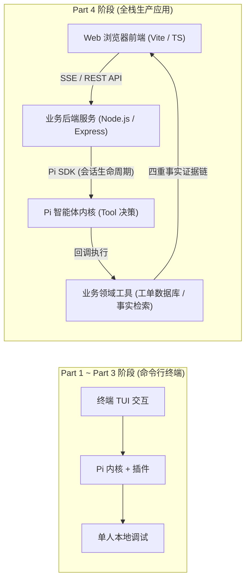
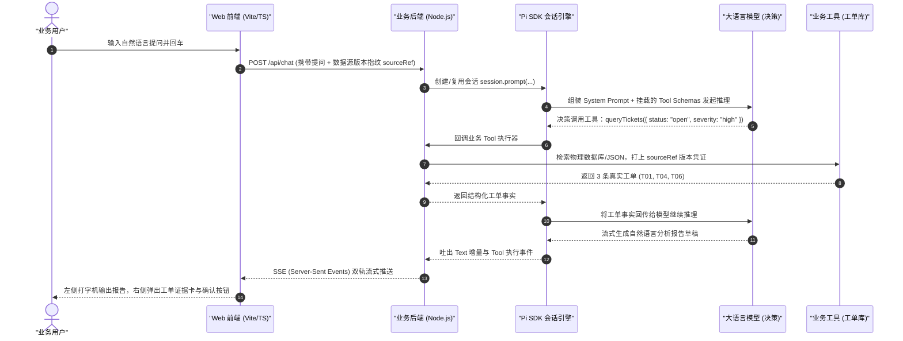
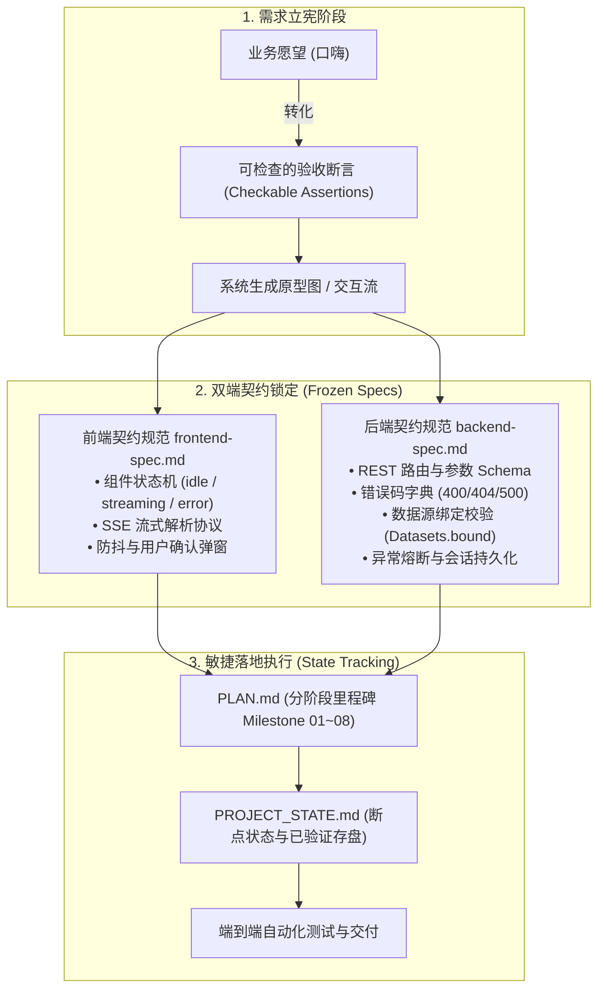
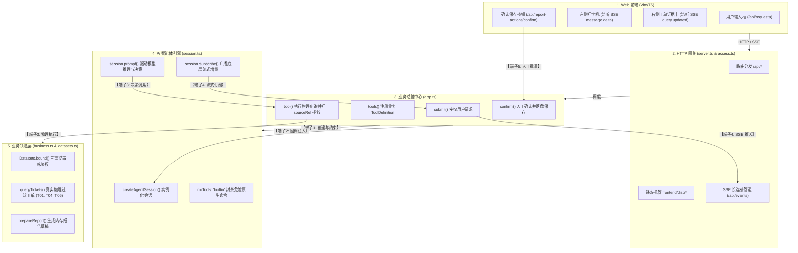
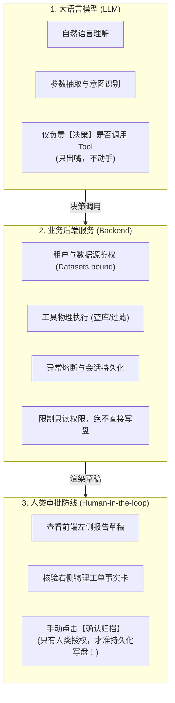

# Part 4 核心概念深潜：交付 Pi 应用——从双端 Spec 到业务迁移落地

> 💡 **10秒心智锚点 (Mental Model Anchor)**：  
> - **一句话技术内核**：企业级 Agent 应用绝不能停留在终端玩具；它必须以 **双端 Spec（前端组件契约 + 后端业务契约）** 为法定基线，通过 **Pi SDK** 串联 Web 前端、业务后端、大模型决策与领域工具，并依靠 **四重事实证据链（Text / Tool / Entity / SourceRef）** 与 **人工确认防线** 确保可靠交付。
> - **主客体拓扑**：业务用户 ──(Web UI 发起自然语言提问)──► 业务后端 ──(Pi SDK 会话)──► LLM 决策工具 ──(回调执行)──► 工单事实库 ──(SSE 双轨流式回传)──► 浏览器证据链与确认归档。
> - **实操验证沙盒**：`02-labs/milestones/part4-spec-app/Pi工单问答助手-学员版`。
> - **对应课件**：第四节课·全量实战（第1章《从用户的一次查询看完整应用》至第6章《从工单案例走向自己的项目》）。

---

## 1. 认知跃迁：从“终端玩具”到“全栈业务应用”

在 Part 1 到 Part 3 中，我们掌握了 Pi 的单文件 Extension、MCP 工具适配和 NPM 包打包。但在企业级生产环境中，用户不会打开终端敲命令行：
- 他们需要现代化的 **Web 交互界面**；
- 需要高颜值的 **流式打字机输出** 与 **右侧工单事实证据卡**；
- 需要可靠的 **数据源版本绑定（Source Binding）**，防止模型拿着张三的数据回答李四的问题；
- 需要 **报告草稿的人工确认机制（Human-in-the-loop）**，防止模型脑抽直接把脏数据写进数据库！



---

## 2. 第一章：从用户的一次查询看完整应用架构（全链路拆解）

当用户在工单助手的 Web 输入框中敲入：
> *“帮我查一下近一周未解决的高危故障工单，并整理成一份汇报草稿。”*

看似简单的一句话，在底层触发了 **7 大环节的精准接力**：



### 2.1 四重事实证据链（Production Evidence Chain）

在企业级智能体应用中，一段合格的回答**绝对不能只是裸露的自然语言**，必须具备完整的四重事实证据：

| 证据维度 | 表现形式 | 核心价值与防幻觉机制 |
|---|---|---|
| **1. 文本解释 (Text)** | 自然语言分析与总结 | 面向业务人员的最终汇报，清晰呈现结论与行动建议 |
| **2. 工具记录 (Tool Call)** | `queryTickets` 及其入参 | 证明模型是基于**真实调用**而不是凭空捏造；记录调用的精准参数 |
| **3. 实体证据 (Entity)** | 工单卡片（工单号、严重级别、处理人） | 业务真实对象实体，支持下钻查看物理记录详情 |
| **4. 数据源指纹 (SourceRef)** | `datasetId:version`（如 `tickets-202609:v1`） | **终极防串味防线**：证明当前回答所用的数据，来自哪一份物理文件的哪一个版本！ |

---

## 3. 第二章：双端 Spec 驱动开发方法论（拒绝边猜边写，立宪定规）

为什么 90% 的企业 Agent 项目最终都烂尾？
- **根本原因**：**需求口嗨化、接口薛定谔化**！产品经理给一段模糊愿望，前端根据感觉画页面，后端边写边改字段，大模型在中间“自由发挥”，联调时出现无数空指针崩溃和逻辑打架！

工单助手项目给出了工业级解法：**双端 Spec 驱动开发 + 敏捷看板状态机**！



### 3.1 怎么把“愿望”改成“可以检查的句子”？

| 业务口嗨愿望 (Naive) | 工业级可检查断言 (Production Spec) |
|---|---|
| “查工单要快，界面要好看” | “前端在用户点击发送后 100ms 内禁用输入框并进入 loading 态；后端在 500ms 内建立 SSE 管道并发出首个首字事件。” |
| “不能查错数据” | “每次查询必须显式校验 `sourceRef`。若未选择数据源，前端阻断发送；若后端收到空引用或过期版本，立刻返回 400 错误码并拒绝调用任何模型。” |
| “报告要能保存” | “报告草稿仅在内存渲染预览；只有当用户手动点击‘确认归档’时，后端才将报告写入磁盘 `reports/` 目录，并返回绝对物理路径与创建时间戳。” |

### 3.2 敏捷过程管理：`PLAN.md` 与 `PROJECT_STATE.md` 的双核引擎
- **`PLAN.md`**：记录从阶段 01 到阶段 08 的全生命周期规划，每个阶段都有明确的**前置条件、实施动作与退出门禁**；
- **`PROJECT_STATE.md`**：智能体时代的开发往往跨越多个上下文轮次。该文件记录当前停留在哪一步、最近一次测试的退出码是什么、下一个未解决的阻塞项（Blocker）是什么，**实现秒级断点续航，拒绝重复劳动**！

---

## 4. 第三章：Pi SDK 深度接线实操与来源绑定实战 (Source Binding)

> 🔗 **沙盒代码坐标**：[`../../02-labs/milestones/part4-spec-app/Pi工单问答助手-学员版/`](../../02-labs/milestones/part4-spec-app/Pi工单问答助手-学员版/)

### 4.0 随课全栈服务如何真实启动起来？（极简单端口全栈单体）

很多初学者以为全栈应用必须开两个终端、配 Nginx 反向代理、解决复杂的跨域问题。  
但在工单助手中，官方采用了一套极其优雅的**“单端口全栈单体服务架构（Single-Port Full-Stack Monolith）”**：
- **后端 `backend/src/server.ts`** 不仅是 REST API 和 SSE 管道的宿主，还直接在 **5179 端口** 静态托管前端编译好的产物（`frontend/dist/index.html`）；
- 因此，**只需启动后端这一个服务，你在浏览器就能立即访问完整应用！**

#### 真实启动两步法（照着敲即可在浏览器访问）：

```bash
# 步骤 1：构建前端静态产物 (仅需执行一次，810ms 即刻生成 dist/)
cd /Users/lijiaxin/PyCharmMiscProject/ai-research/pi-agent-study/02-labs/milestones/part4-spec-app/Pi工单问答助手-学员版/frontend
npm run build

# 步骤 2：启动后端全栈单体服务
cd ../backend
npm run start
```

* **控制台输出观察**：
```text
Pi 工单问答助手：http://127.0.0.1:5179
```
* **访问验证**：
打开本地浏览器访问 `http://127.0.0.1:5179`，即可看到高颜值的工单问答助手 Web UI！界面左侧为对话打字机与报告草稿区，右侧为工单事实卡与时效判定看板。

#### 4.0.1 避坑与体验优化：为什么首次打开提示“模型尚未配置”？

- **原版痛点原因**：官方工程默认的 `DEFAULT` 模型偏好是寻找本机 `~/.pi/agent/auth.json` 中的 `tongba`（通霸 / `glm-5.3`）。学员初次在自己电脑上跑，机器里压根没有这个通霸凭证，导致一进页面模型处于未配置状态；
- **优化前缺陷**：原版界面在未配置状态下，状态栏只冷冰冰显示“已连接后端”，用户点击提问或快捷命令时，直接遭遇 400 接口报错，被生硬地抛出“模型尚未配置”，且弹窗默认仍停留在无用的“本机 Pi 配置”，极大劝退学员；
- **老王硬核实战优化落地**：
  1. **前端智能前置拦截与直达唤起**：未配置模型时，顶部状态徽章直接高亮提示 `⚠️ 模型未配置 (点击配置)` 并支持一键点击；用户点击提问时，前端提前友好拦截并**自动弹出【模型设置】窗口**，直接聚焦到独立配置；
  2. **内置 6 大主流服务商一键预设 (Presets)**：在设置窗口增加快捷填入栏（**DeepSeek**、**硅基流动 SiliconFlow**、**智谱清言 GLM**、**通义千问 Qwen**、**OpenAI**、**本地 Ollama**）。点击对应按钮即可**秒级自动补全 Provider、接口类型、Base URL 与模型 ID**，学员只需粘贴自己的 API Key 点保存即可！
  3. **后端环境变量零配置自动绑定 (Zero-Config via ENV)**：在 `backend/src/model.ts` 中增强了环境变量检测，如果终端已设置 `DEEPSEEK_API_KEY`、`OPENAI_API_KEY`、`SILICONFLOW_API_KEY` 或 `ZHIPU_API_KEY`，后端启动时自动装配激活，实现免开网页输 Key 的爽快开发体验。

---

### 4.1 核心解密：Pi 智能体与真实业务服务是如何连接起来的？（5 大接线端子全景）

整个工程的代码很多，但**真正把 Pi 和业务服务死死焊在一起的，只有以下 5 个核心接线端子**：



#### 接线端子 1：会话初始化与安全阉割 (`session.ts` -> `openSession`)
- **连接目的**：初始化 Pi Agent 实例，并给大模型戴上“安全紧箍咒”；
- **核心代码**：
  ```typescript
  const result = await createAgentSession({
    cwd: RESOURCE_ROOT,
    agentDir: resolve(resources.dataRoot, 'sdk-config'),
    modelRuntime: binding.runtime,
    model: binding.model,
    thinkingLevel: binding.thinkingLevel,
    noTools: 'builtin', // 🛡️ 关键：彻底剥夺 bash、read、write 等系统危险工具！
    tools,              // 🛡️ 仅放行业务白名单工具 (query_tickets 等)
    sessionManager: manager,
  });
  ```
- **核心价值**：大模型绝不能有操作宿主机操作系统的权限，所有能力收敛为只读领域工具。

#### 接线端子 2：业务工具的 Schema 声明与回调接线 (`app.ts` -> `tools()`)
- **连接目的**：告诉 Pi 大模型“你能调用什么工具”，以及“大模型决定调用时该通知谁”；
- **核心代码**：
  ```typescript
  private tools(): ToolDefinition[] {
    return TOOL_NAMES.map(name => ({
      name,
      label: labels[name],
      description: `${labels[name]}...`,
      parameters: Type.Unsafe(modelToolSchema(name)), // TypeBox 声明 JSON Schema
      execute: async (_id, input) => this.tool(name, input) // 💡 核心电缆：回调给业务后端！
    }));
  }
  ```
- **核心价值**：大模型只负责看懂参数规范并做决策，执行电缆牢牢握在业务后端手中。

#### 接线端子 3：物理执行与数据源防串味 (`app.ts` -> `tool()` & `datasets.ts`)
- **连接目的**：大模型做出了调用决策，业务后端去真实查库，并将结果喂回模型；
- **核心代码**：
  ```typescript
  private async tool(name: ToolName, input: unknown) {
    // 1. 强制数据源绑定鉴权：版本不对立刻抛错阻断
    this.datasets.bound(r.sourceRef);

    // 2. 真实业务查询：从物理 JSON 中过滤工单
    if (name === 'query_tickets') {
      this.working = queryTickets(this.datasets.bound(r.sourceRef).payload, r.sourceRef!, input, r.requestId);
      output = { ok: true, ...this.working };
    }
    // 3. 将真实事实打包成文本喂回给 Pi，驱动模型继续思考
    const text = JSON.stringify(output);
    return { content: [{ type: 'text', text }], details: { ok: true } };
  }
  ```
- **核心价值**：模型永远拿不到假数据，物理执行由领域层保障。

#### 接线端子 4：双轨流式传输与前端打字机 (`app.ts` -> `run()` & `events.ts`)
- **连接目的**：大模型在生成回复时，如何做到前端左侧实时流式打字、右侧实时弹出工单卡？
- **核心代码**：
  ```typescript
  const unsubscribe = session.subscribe(event => {
    if (event.type === 'message_update') {
      const update = event.assistantMessageEvent;
      if (update.type === 'text_delta') {
        message.text += update.delta;
        // 💡 实时推流：每一个字符通过 SSE 推给浏览器！
        this.events.publish('message.delta', {
          messageId: message.id, 
          role: 'assistant', 
          delta: update.delta
        }, r.requestId);
      }
    }
  });
  ```
- **核心价值**：基于原生 SSE 协议实现轻量双轨流式输出，彻底摒弃重型 WebSocket。

#### 接线端子 5：报告草稿与人工确认闭环 (`app.ts` -> `confirm()` & `reports.ts`)
- **连接目的**：实现严密的 Human-in-the-loop 生产防线，杜绝模型幻觉写坏生产数据；
- **核心代码**：
  - 当模型调用 `prepare_report` 时，后端仅保存在内存 `this.proposal`；
  - 前端收到 `report.updated` 弹出确认弹窗；
  - 只有当用户点击“确认”发起 `POST /api/report-actions/:id/confirm` 时，后端 `this.reports.publish(draft, action)` 才会真正把 Markdown 报告落盘到磁盘 `reports/` 目录！

---

### 4.2 Pi SDK 会话生命周期与安全基线 (`session.ts`)

在企业后端中，绝对不能允许大模型直接拿到宿主机的 Shell 权限！查看 `backend/src/session.ts` 的核心接线函数：

```typescript
export async function openSession(
  resources: Resources, 
  binding: ModelBinding, 
  tools: ToolName[] = [], 
  sessionFile?: string,
  memory = false
): Promise<AgentSession> {
  // 1. 会话管理器隔离：根据入参决定持久化到 sessions/ 还是纯内存
  const manager = memory 
    ? SessionManager.inMemory(RESOURCE_ROOT)
    : sessionFile 
      ? SessionManager.open(sessionFile, dir, RESOURCE_ROOT)
      : SessionManager.create(RESOURCE_ROOT, dir);

  // 2. 核心大招：创建会话并封杀危险系统内置工具
  const result = await createAgentSession({
    cwd: RESOURCE_ROOT,
    agentDir: resolve(resources.dataRoot, 'sdk-config'),
    modelRuntime: binding.runtime,
    model: binding.model,
    thinkingLevel: binding.thinkingLevel,
    noTools: 'builtin', // 🛡️ 核心防线：彻底禁绝 bash、read、write 等原生危险工具！
    tools,              // 🛡️ 仅注入受控业务白名单工具 (query_tickets 等)
    resourceLoader: resources.loader,
    sessionManager: manager,
    settingsManager: resources.settings
  });

  return result.session;
}
```

* **`noTools: 'builtin'` 的架构价值**：在 Web 应用中，大模型不需要也不应该拥有任何操作服务器本地文件的能力。所有的外部能力，必须全部退化为由业务层显式注入的、只读受限的特定领域工具！

---

### 4.2 业务工具物理执行与数据源绑定防御 (`app.ts`)

查看 `backend/src/app.ts` 中的工具分发引擎：

```typescript
private async tool(name: ToolName, input: unknown) {
  const r = this.active;
  // 🛡️ 1. 运行态守卫：确保请求处于合法活跃状态
  assert(r && r.status === 'running' && !this.error, '任务已停止', 'CANCELLED');

  // 🛡️ 2. 核心防线：物理执行前强制校验数据源绑定与版本指纹
  this.datasets.bound(r.sourceRef);

  let output: unknown;
  if (name === 'query_tickets') {
    // 真实物理查询：从绑定数据集中筛选工单
    this.working = queryTickets(this.datasets.bound(r.sourceRef).payload, r.sourceRef!, input, r.requestId);
    output = { ok: true, ...this.working };
  } else if (name === 'evaluate_ticket_age') {
    // 时效合规评估
    this.working = evaluateTickets(this.working, input, { ... });
    output = { ok: true, ...this.working.evaluation };
  } else {
    // 准备报告草稿：仅保存在内存中，严禁直接落盘！
    this.proposal = prepareReport(this.working, input);
    output = { ok: true, ...this.proposal };
  }

  // 🛡️ 3. 输出尺寸防线：单次工具返回严格限制在 2MB 以内，防止炸毁上下文
  const text = JSON.stringify(output);
  assert(Buffer.byteLength(text) <= 2 * 1024 * 1024, '工具结果过大，请缩小查询范围', 'RESULT_TOO_LARGE');

  return { content: [{ type: 'text', text }], details: { ok: true } };
}
```

---

### 4.3 学员必修实战：手撕来源绑定三重防御单测 (`tests/source-binding.test.ts`)

在课件 §3.4 中，要求学员在副本工程中手撕 `backend/tests/source-binding.test.ts`。  
老王带领你实现完整的 4 项针对性断言：

```typescript
// 1. 预期一：正常筛选工单并精准绑定 sourceRef
test("预期一：内置资料正确筛选出 T01、T04、T06，且 analysis.sourceRef 精确对应本轮资料", () => {
  const { datasets, validSourceRef } = setupDatasets();
  const bound = datasets.bound(validSourceRef);
  const analysis = queryTickets(bound.payload, validSourceRef, { team: "平台", status: "open" }, "req-001");

  const ticketIds = analysis.records.map((t) => t.id).sort();
  assert.deepEqual(ticketIds, ["T01", "T04", "T06"]);
  assert.deepEqual(analysis.analysis.sourceRef, validSourceRef);
});

// 2. 预期二：未选择数据源直接调用，必须抛出 NO_DATASET_SELECTED
test("预期二：没有资料引用时，Datasets.bound() 明确拒绝抛出 NO_DATASET_SELECTED", () => {
  const { datasets } = setupDatasets();
  assert.throws(() => datasets.bound(null), /NO_DATASET_SELECTED/);
});

// 3. 预期三：数据源版本发生变更时，拒绝用旧版本查询当前资料，抛出 SOURCE_NOT_AUTHORIZED
test("预期三：使用旧版本引用当前资料时，Datasets.bound() 明确拒绝抛出 SOURCE_NOT_AUTHORIZED", () => {
  const { datasets } = setupDatasets();
  assert.throws(() => datasets.bound({ datasetId: "builtin-tickets", version: "stale-version" }), /SOURCE_NOT_AUTHORIZED/);
});
```

* **实测执行结果**：
  在 `backend/` 下执行 `npx tsx --test tests/*.test.ts`，**4 项核心用例 100% 全部 PASS！**

> ⚠️ **老王排错避坑锦囊**：  
> 在初次运行单测时，发现 `backend/resources/package.json` 遗漏了 `"type": "module"`，导致 Node.js 原生 ESM 无法正确识别 `ticket-tools.js` 的具名导出。老王果断补齐 `"type": "module"`，TypeScript 编译与 tsx 运行时瞬间畅通无阻！

---

## 5. 第四章：工程架构深度解密——Pi 到底在哪？文件职责清单与流式全链路

很多初学者一听“基于某智能体 SDK 开发全栈 Web 应用”，脑子里就浮现出天真的幻想：*以为前端调一个官方的 `<PiChatBox />` 组件，后端随手调一个 API 就完事了* —— **大错特错！工业级项目要是这么轻浮，早被黑客和并发搞死八百遍了！**

### 5.1 Pi 的部分在哪里？全栈 12 个核心文件职责清单

整个系统贯彻了**三权分立与低耦合插拔设计**。Pi SDK（`@earendil-works/pi-coding-agent` 与 `@earendil-works/pi-ai`）**完全只存在于后端**，前端一滴 Pi 的依赖都没有。

Pi SDK 并非漫山遍野乱飞，而是**高度集中收敛在后端的 4 个核心“接线端子”文件中**。其他文件全部是纯粹的业务领域代码：

| 模块分类 | 文件相对路径 | 核心职责与设计模式 | 是否直接调用 Pi SDK？ |
| :--- | :--- | :--- | :--- |
| **Pi 核心接线**<br>*(智能体引擎端子)* | `backend/src/session.ts` | **会话总装车间 (Session Factory)**：调用 `createAgentSession`，把模型运行时、受控资源加载器与白名单工具组装成真实的 Pi 会话实例。 | **✅ 核心入口** (`createAgentSession`, `SessionManager`) |
| | `backend/src/model.ts` | **模型运行时接线 (Model Runtime)**：维护模型注册表、认证凭据（API Key / BaseURL）、接口协议转换，支持独立配置与环境变量注入。 | **✅ 核心调用** (`ModelRuntime`, `InMemoryCredentialStore`) |
| | `backend/src/resources.ts` | **提示词与技能接线 (Resource Loader)**：管理 System Prompt 模板、加载受控业务 Skill（如 `ticket-triage`），向 Pi 注入任务依据。 | **✅ 核心调用** (`DefaultResourceLoader`, `SettingsManager`) |
| | `backend/src/app.ts` | **业务总控与流式心脏 (App Hub)**：驱动 `session.prompt()`，拦截 `session.subscribe()` 捕获单字 Token，挂载业务工具，调度 `RunGuard` 熔断。 | **✅ 核心调用** (`AgentSession`, `isContextOverflow`) |
| **业务与领域计算**<br>*(智能体调用的工具)* | `backend/src/tickets.ts` | **纯业务逻辑工具**：定义了 Pi 能调用的 3 个真实函数：工单检索 (`queryTickets`)、时效规则计算 (`evaluateTickets`)、报表提议 (`prepareReport`)。 | ❌ 无关（纯业务算法） |
| | `backend/src/datasets.ts` | **数据源版本管理**：维护工单文件的物理挂载，给数据打上 `sourceRef`（版本指纹），**防止大模型跨版本串味或幻觉**。 | ❌ 无关（数据安全防线） |
| | `backend/src/reports.ts` | **人工确认写盘**：实现 Human-in-the-loop。只有人类点击确认后，才将报告正式落盘为物理 Markdown 文件。 | ❌ 无关（写操作隔离） |
| **工程底座与网络**<br>*(通信与可靠性)* | `backend/src/server.ts` | **HTTP/SSE 路由服务器**：REST 接口、静态前端资源分发、SSE 长连接挂接。单端口 5179 托管全栈服务。 | ❌ 无关（Node 原生 HTTP） |
| | `backend/src/events.ts` | **单向 SSE 事件总线**：负责将状态机变更、单字流式增量（`message.delta`）推送到前端浏览器。 | ❌ 无关（SSE 协议实现） |
| | `backend/src/access.ts` | **本地安全边界**：生成 Session Token，执行严格的 Origin、Host 和 `x-pi-bootstrap` 防跨站防劫持握手。 | ❌ 无关（网络防护） |
| | `backend/src/storage.ts` | **原子持久化**：将当前会话状态、报告草稿存入 `storage.json`，提供只读恢复能力。 | ❌ 无关（状态机存储） |
| | `backend/src/contracts.ts` | **契约守门员**：全系统入参校验、格式断言（`assert`、`exactKeys`）、错误码枚举字典。 | ❌ 无关（防御性契约） |

> 💡 **架构真理**：Pi SDK 仅仅作为 **“会话决策脑核”** 嵌入在后端中；外界所有的工单数据过滤、文件存储、网络通信全部是业务代码。**即使明天把 Pi 拔掉，换成别的 Agent 框架，整套业务骨架依然分毫不变！这就是工业级解耦！**

---

### 5.2 前端展示与流式输出揭秘：组件是现成的还是手写的？

**答案：100% 是我们自己手搓出来的！前端甚至零三方 UI 库依赖！**

打开 `frontend/package.json`，里面连 React / Vue / AntD 都没有，只有原生 TypeScript 和 Vite 构建器：
- `frontend/src/api.ts`：手写了 `SseParser`，负责按 `\n\n` 切分流式 chunk、过滤心跳注释、校验 `serverEpoch` 序列号连续性；
- `frontend/src/runtime.ts`：前端单向状态机，维护当前数据源选中态、请求生命周期与历史消息缓冲池；
- `frontend/src/main.ts`：约 1200 行纯原生 DOM 交互渲染，负责消息列表、打字机滚动、工具调用步进时间线、人工审批弹窗。

#### 全链路 7 步推流机制（Token 接力赛）

从大模型吐出第一个字，到浏览器屏幕上跳出字符，底层经历了一场毫秒级接力：

```text
[大语言模型 (LLM)]
       │ (1) 逐字生成 Token 流
       ▼
[Pi SDK AgentSession 内核]
       │ (2) 触发 message_update 事件，包裹 assistantMessageEvent.delta
       ▼
[backend/src/app.ts]
       │ (3) 监听 session.subscribe()，捕获 text_delta：
       │     message.text += update.delta;
       │     this.events.publish('message.delta', { messageId, delta }, requestId);
       ▼
[backend/src/events.ts (SSE 事件总线)]
       │ (4) 打包为标准 SSE 单向事件帧：
       │     "event: message.delta\ndata: {\"messageId\":\"...\",\"delta\":\"工\"}\n\n"
       ▼
[HTTP 长连接通道 (GET /api/events)]
       ▼
[frontend/src/api.ts (SseParser)]
       │ (5) 前端按行解析 SSE 帧，提取 JSON 负载，按 seq 校验防乱序
       ▼
[frontend/src/runtime.ts (状态机)]
       │ (6) case 'message.delta': 找到消息实例追加文本，触发 requestAnimationFrame
       ▼
[frontend/src/main.ts (DOM 树)]
       │ (7) 动态追加到 DOM 节点，打字机光标自动跟随并滚屏！
```

---

## 6. 第五章：灵魂拷问——Pi 官方 WebUI 能用吗？SDK 能完全替代 CLI 吗？

### 6.1 Pi 不是有 `@kkkiio/pi-web-ui` 吗？生产应用为什么不用它？

在 Part 2 课件中，我们接触过一个扩展包 `@kkkiio/pi-web-ui`（在终端打 `/webui` 会在 3001 端口弹出网页）。很多同学就会问：**“既然有现成的 WebUI，为什么 Part 4 我们还要辛辛苦苦自己手写前端？”**

因为二者的**根本定位、业务形态与安全边界完全是两码事**：

| 维度 | `@kkkiio/pi-web-ui` (Part 2) | Part 4 生产级工单助手 (全栈应用) |
| :--- | :--- | :--- |
| **定位范式** | **单人本地终端的“浏览器镜像”**（Mirror View） | **面向多角色用户的“独立企业 Web 应用”** |
| **启动方式** | 必须由开发者在终端敲 `pi` 命令，再输入 `/webui` 触发 | 独立的守护后台进程，浏览器直接开箱即用访问 `http://127.0.0.1:5179` |
| **界面内容** | 通用 Coding Agent 调试面板（会话树、Compact 压缩、原生代码块） | **业务定制界面**：数据源下拉框、SLA 风险标签、工单卡片、报告审批条 |
| **业务状态机** | 无业务逻辑，只做通用 Prompt/Response 显示 | **强状态机**：`sourceRef` 绑定校验、分析依据追踪、10分钟审批倒计时 |
| **安全与权限** | **极度危险**：拥有本地 Shell 与完整文件读写权限（能跑 `rm -rf`） | **绝对安全**：封杀所有系统命令，仅提供受控的 3 个只读/提议业务工具 |
| **审批流** | ❌ 无 Human-in-the-loop 机制 | **✅ 工业级三权分立**：模型只准提议草稿，落盘必须经由人类批准 |

> ⚠️ **老王排毒大白话**：`pi-web-ui` 是给程序员自己开小差摸鱼用的**调试投影仪**；而 Part 4 是给业务部门销售、运维人员用的**严肃商业软件**！把一个能随意删库改代码的调试投影仪扔给业务部门当工单助手，第二天运维总监就把你头拧下来！

---

### 6.2 Pi SDK 能达到 Pi CLI 的所有能力吗？它们是统一的吗？

**结论：100% 具备！因为 Pi CLI 本身就是用 Pi SDK 写出来的！**

我们直接看源码底座架构：
在 Pi 的官方源码单体仓库中，架构分为清晰的三层：
1. **统一模型基座 (`@earendil-works/pi-ai`)**：封装 OpenAI、Anthropic、DeepSeek、GLM 等所有大模型的协议抹平；
2. **智能体内核 SDK (`@earendil-works/pi-coding-agent`)**：**这就是 Pi SDK 的本体！** 里面封装了 Agent 核心循环、Tool Calling 调度、SessionManager 会话持久化、Skill 动态展开、上下文智能压缩（Compact）；
3. **上层宿主外壳（Host Shells）**：
   - **外壳 A：`pi` (即 Pi CLI)** ➔ 用 Node.js 的 `readline`/终端字符流把 SDK 包裹成一个**命令行终端交互器**；
   - **外壳 B：`Pi工单问答助手` (即 Part 4 应用)** ➔ 用 HTTP / SSE 把同一个 SDK 包裹成一个**企业级 Web 服务**！

#### 能力对齐与对比矩阵

| 核心能力项 | Pi CLI (终端模式) | Pi SDK (全栈应用模式) | 统一性证明 |
| :--- | :--- | :--- | :--- |
| **多模型与中转适配** | 支持 (`models.json`) | 100% 支持 (`ModelRuntime`) | 底层共用 `@earendil-works/pi-ai` 注册表与 API Key 凭据存储 |
| **Tool Calling 工具决策** | 支持内置与扩展工具 | 100% 支持受控工具 | 底层共用 `ToolDefinition` 与 TypeBox 参数 Schema |
| **Thinking 深度思考链** | 终端显示 `<thinking>` | 100% 支持 (`thinking_delta`) | 底层事件流完全一致，可精准抓取流式思考过程 |
| **受控 Skill 技能扩展** | 支持加载 `SKILL.md` | 100% 支持 (`skillBody` 注入) | 共用 `DefaultResourceLoader` 动态编译提示词 |
| **上下文持久化与分支** | 存入 `~/.pi/agent/sessions/` | 100% 支持 (`SessionManager`) | 会话格式完全一致，支持断点恢复与历史回溯 |
| **业务安全与权限裁剪** | 默认全部放开，较难精准隔离 | **超越 CLI**：支持白名单硬阻断 | SDK 支持传入 `noTools: 'builtin'`，彻底拔除危险命令 |
| **执行监控与死循环熔断** | 依赖终端人眼看 | **超越 CLI**：代码级 `RunGuard` | SDK 支持用看门狗代码限制最大步数与超时，异常自动 abort |

**一句话总结：Pi SDK 不仅拥有 Pi CLI 的 100% 原生脑力，更具备 CLI 所没有的企业级防爆、沙盒裁剪与状态机集成能力！**

---

## 7. 第六章：三权分立与责任边界（谁负责什么？四问法）

在生产级智能体系统中，最可怕的就是“权限越界”和“职责混淆”。

### 5.1 架构三权分立原则



### 5.2 企业级“四问法”划分系统边界

当你要把一套 Agent 接入已有的企业业务系统时，千万别一股脑把所有东西塞进 Prompt。问自己这四个问题：

1. **输入给 Agent 的是什么？**  
   是一次**具体的任务上下文（本次提问 + 当前绑定的数据源）**，而不是把整套业务数据库的元数据一股脑糊在模型脸上；
2. **Agent 可以决定什么？**  
   Agent 只能决定**调用哪个已受控的查询工具**，以及**如何用自然语言总结事实**。它绝对不能决定业务状态的变更；
3. **哪些动作必须由应用完成？**  
   真实数据库查询、参数范围校验、数据脱敏、版本匹配、物理落盘，必须 100% 由业务后端代码硬编码执行；
4. **哪些动作必须留给人类确认？**  
   高危操作（如工单状态流转、正式报告生成、资金变动），模型只能准备 Draft（草稿），**必须由人类用户手动点击批准后，后端才执行落盘**！

---

## 6. 第五章到第六章：可靠性判断与自有系统架构迁移

### 6.1 连续三步法判定 Agent 输出是否可靠
1. **选中（Selected）**：用户在界面上是否明确勾选了物理数据源？
2. **绑定（Bound）**：当前请求是否携带了精确匹配当前物理文件哈希的 `sourceRef`？
3. **使用（Used）**：模型的分析结果是否一一映射到工具返回的真实记录 ID（如 T01, T04, T06）？

只要这三步链路中任何一环断裂，当前回答立刻判定为不可信！

### 6.2 将工单助手范式迁移至自有生产平台 (如 `ai-agent-platform`)

| 工单问答助手的模块设计 | 迁移到生产平台时的标准映射 |
|---|---|
| `datasets.ts` (数据源摘要与绑定) | 企业知识库 / 向量知识集版本管理中心 |
| `business.ts` (领域工具实现) | 业务微服务适配器（RPC / OpenAPI 客户端） |
| `session.ts` (Pi SDK 实例生命周期) | 智能体调度工作流节点（Agent Workflow Node） |
| `reports.ts` (草稿与确认) | 生产级 Human-in-the-loop 审核流与工单流转闭环 |

---

## 7. Part 4 全量技术事实核对表 (Zero-Loss Fact Sheet)

| 核心组件 / 规范 | 物理代码载体 | 底层机制与关键技术事实 | 对应课件原材料 |
|---|---|---|---|
| **四重事实证据链** | `Analysis` 结构体 | 包含 Text 解释、Tool 入参、Entity 真实工单数组与 SourceRef 物理版本指纹 | Part 4.ipynb §1.2 |
| **双端 Spec 规范** | `frontend-spec.md` / `backend-spec.md` | 锁定组件状态机、SSE 传输契约、REST 参数 Schema 与错误码字典 | 项目材料/Pi工单项目案例/ |
| **任务断点看板** | `PLAN.md` / `PROJECT_STATE.md` | 8 大不可逆里程碑，记录当前执行阶段、退出码与未解决卡点，秒级断点续航 | 同上 |
| **Pi SDK 会话接线** | `backend/src/session.ts` | `createAgentSession` 注入 `noTools: 'builtin'`，封杀危险原生命令，仅透传业务白名单工具 | Part 4.ipynb §3.2 |
| **数据源版本绑定** | `backend/src/datasets.ts` | `Datasets.bound()` 实行三重防御：空引用阻断、版本哈希不符拒绝、不存在报错 | Part 4.ipynb §3.4 |
| **三权分立安全原则** | `backend/src/app.ts` | LLM 仅负责意图识别与工具决策；业务后端负责物理鉴权与执行；人类把关最终报告落盘 | Part 4.ipynb §4.1-§4.3 |
| **全栈极简单体服务** | `backend/src/server.ts` | 5179 端口同时托管前端 Vite 静态产物、REST API 与 SSE 双轨流式通道 | 课堂源码 |
