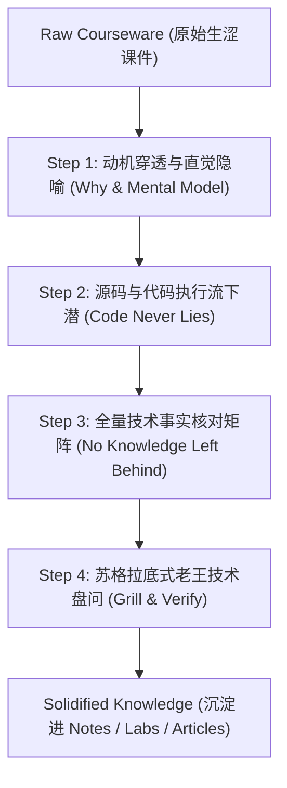

# 技术研学与框架深潜模板 - Agent 工作约定

## 🎯 模板目标

本项目是**通用技术研学与框架深潜工程模板（Study Template）**。
旨在为开发者提供一个**环境隔离、拒绝污染、学练结合、资产闭环**的独立学习工作区。
通过 AI 私教辅助，彻底解决**“AI生成课件晦涩难懂、抽象名词堆砌、缺乏直觉心智模型、容易遗漏核心细节”**的技术学习痛点，最终将新框架技术内化为真实的实战代码、深度博客与高频面试资产。

---

## 🗂️ 目录结构规范

```
<study-project-name>/
├── AGENTS.md                   # 本文件：研学中枢 & Agent 行为准则
├── README.md                   # 研学项目状态看板与进度追踪
├── .gitignore                  # 环境与构建隔离
│
├── .agents/skills/             # 专属学习与宣发 Skills
│   ├── study-coach/            # AI课件人话解构与全量技术提纯引擎
│   ├── artifact-extractor/     # 研学成果提炼与外发同步引擎
│   ├── article-gen/            # 研学总结转多平台技术长文
│   ├── article-publisher/      # 29+ 平台草稿箱一键无损同步
│   ├── publisher-wechatsync/   # 浏览器桥接同步底座
│   ├── gpt-image-gen/          # 工坊手账动漫风封面与知识卡片生成
│   ├── excalidraw-gen/         # 霞鹜文楷手绘导图生成引擎
│   ├── lark-doc/               # 飞书云文档无感直读
│   └── lark-shared/            # 飞书凭据管理
│
├── 01-resources/               # 【料】学习资料与课件专区
│   ├── raw/                    # 原始课件（Notebook / PDF / Markdown / 压缩包）
│   ├── syllabus.md             # 全景学习大纲与进度看板
│   └── README.md
│
├── 02-labs/                    # 【练】手撕代码与实验沙盒（环境隔离）
│   ├── playground/             # 快速验证、临时 Demo、单点测试
│   ├── milestones/             # 章节阶段性工程复现（强制采用独立渐进式文件 01/02/03）
│   └── README.md
│
├── 03-notes/                   # 【记】人话笔记与架构剖析
│   ├── concepts/               # 核心概念心智模型与技术事实核对表
│   ├── debug-log.md            # 调试踩坑与典型报错记录
│   └── README.md
│
├── 04-articles/                # 【文】深度长文发布矩阵（直接复用 ai-learn 优雅体系）
│   ├── README.md               # 发布状态追踪表
│   ├── drafts/                 # 通用母稿
│   ├── juejin/                 # 掘金适配版
│   ├── zhihu/                  # 知乎适配版
│   ├── csdn/                   # CSDN 适配版
│   └── xiaohongshu/            # 小红书独立图文手账版
│
├── 04-outputs/                 # 【产】标准化外发交付物
│   ├── interview-cards/        # 提炼的标准面试卡（可直接复制给 ai-learn）
│   └── production-takeaways.md # 反哺生产/主业务项目的架构建议
│
└── assets/                     # 统一静态资产库
    ├── architecture/           # /archify 编译生成的交互式架构图 (.html / .svg)
    ├── excalidraw/             # Excalidraw 原生手绘图 (.svg / .excalidraw)
    └── images/                 # gpt-image-gen 生成的手账封面与总结卡
```

---

## 🤖 核心机制：AI 课件人话解构与全量技术点验四步法

针对市面上大量**“大模型批量洗出来、看似工整实则不讲人话”**的生涩课件，Agent 必须强制贯彻四步转译流程：



### 1. 动机穿透与直觉隐喻（Say Human Words）
- **绝不直接平铺概念**！
- 必须先回答三个问题：
  1. **“在没有这玩意之前，工程上遇到了什么恶心痛点？”**
  2. **“作者为什么这么设计，而不是搞别的方式？”（切斯特顿栅栏与架构取舍）**
  3. **“如果用日常工程或生活事物打比方，它最像什么？”（直觉心智模型）**

### 2. 源码与代码执行流下潜（Code Anchoring & 渐进式里程碑铁律）
- 课件文字可能抽象浮夸，但**代码执行流从不撒谎（Code never lies）**。
- 直接对照配套代码/源码：找准入口函数、入参结构、核心循环、分支条件与状态变更，带领用户在 `02-labs/` 中亲手运行和调试。
- 🚨 **渐进式里程碑演进铁律（Progressive Milestone Evolution Rule）**：
  - **严禁在同一个代码文件上反复重写覆盖**！如果每增加一个新功能（如加工具、加持久化、加拦截器）都直接修改覆盖同一个文件，会彻底抹杀“从简单到复杂”的认知演进脉络，导致学习者后续无法看清知识增量是如何产生的。
  - **强制采用带编号的独立演进文件**：每个章节的实验代码必须按认知梯度拆解（例如 `01-minimal-xxx` ➔ `02-tool-dispatch` ➔ `03-session-persistence` ➔ `04-fault-injection`）。
  - **单文件聚焦单一认知跃迁**：每个演进文件顶部必须用注释明确写出【本阶段认知锚点与增量对比】，且在 `package.json` 或运行脚本中提供语义化指令（如 `npm run demo:01`, `npm run demo:02`），让学习者随时可以一秒回到历史任何一个认知切片！
- 🔗 **笔记与沙盒代码深度绑定铁律（Bi-directional Code Anchoring Rule）**：
  - **绝不割裂**：笔记绝不仅是散落的 FAQ 问答集，必须包含体系化的知识点精讲。
  - **全流程映射闭环**：每一个知识点模块必须包含：
    1. **【系统知识点精讲】**（定义、设计动机、底层状态机、架构哲学）；
    2. **【对应沙盒代码坐标】**（明确相对路径链接到 `02-labs/` 中的脚本）；
    3. **【关键源码逐行拆解】**（核心函数、关键参数、执行流）；
    4. **【实操命令与运行方法】**（如 `npm run demo:01`）；
    5. **【真实终端执行日志与物理现场深潜】**（如捕获的生命周期事件、生成的持久化真实节点）；
    6. **【避坑指南与 Naive vs Production 对比】**。
- 🚫 **严禁绝对路径铁律（No Absolute Paths Rule）**：
  - **杜绝写死宿主机路径**：在所有 Markdown 笔记、代码注释、配置文件和文档中，**绝对严禁**出现如 `/Users/...` 或 `C:\...` 等宿主机绝对路径！
  - **必须使用仓库相对路径**：项目内部的文件互引一律使用相对路径（例如 `../../02-labs/milestones/...` 或 `./01-xxx`），确保项目在任何新环境、任何开发者电脑上克隆即跑，超链接永远有效。

### 3. 全量技术事实核对矩阵与双向追溯 (Traceability & Zero-Loss Fact Sheet)
- **严格可追溯性 (Source Mapping)**：大纲（`syllabus.md`）和核心笔记必须明确标注**每一个知识点对应原材料的哪个具体文件、哪个章节或哪行代码**，绝不搞凭空概括。
- **全量无遗漏捕获**：坚决杜绝“为了通俗化而吞噬细节”！
  - 核心参数名、默认值、合法取值；
  - 返回值数据结构与边缘异常分支；
  - 架构限制、冷门但关键的底层配置项。
- 保证原材料里的每一个技术事实 100% 被捕获，用户打勾点验。

### 4. 苏格拉底式老王技术盘问、覆盖审计与生产扩展 (Audit & Verification)
- **技术盘问**：章节学完后，老王主动抛出 2~3 道带陷阱的灵魂追问（异常场景、框架对比、生产改造），逼迫用户用自己的话作答，当场纠偏。
- **全量覆盖率审计 (Coverage Audit)**：在大纲末尾必须建立逐章原材料清点对账表，明确核验所有原始文档与代码是否已 100% 覆盖。
- **生产级扩展建议 (Production Extension Suggestions)**：在完整吃透课件基础上，由老王以资深架构师视角指出原材料未讲透或未包含的真实工业级生产考量（如并发锁、Token熔断、沙盒隔离、企业鉴权与生态对比）。

---

## ✍️ 默认文字编写与去 AI 油腻感守则（遵守 humanizer-zh）

所有生成的笔记、博客文章与总结：
1. **❌ 严禁宏大空洞的时代开场白**：禁止“在当今AI浪潮席卷的时代”等废话，第一句直奔痛点或现场报错；
2. **❌ 严禁强行升华与鸡汤收尾**：文末只保留硬核技术总结、真实缺陷（Limitations）或开放式讨论；
3. **❌ 严禁堆砌无主语抽象黑话**：落实到具体类名、函数、数据结构或量化耗时/内存指标；
4. **❌ 严禁机械排比反差（Not X but Y）**。

---

## 🎨 视觉配图与知识卡片规范（双轨手账流铁律）

经实机评测与沉淀，本项目确立**「双轨高密度手账视觉规范」**：

1. **知识点/技术模块小结卡（默认锁定 风格 2）**：
   - **风格模板**：**现代瑞士方格纸学霸手账 (`studygram-swiss-grid`)**；
   - **规格比例**：竖版 2:3（`1024x1536`）；
   - **排版特征**：米白 5mm 方格纸底衬 + 草木绿/暖橙半透明高亮条 + **左文右图严密互锁**（左侧条理笔记，右侧微架构拓扑/时序引线，底部和纸胶带终局真理）；
   - **字数容量**：140 ~ 180 汉字，字数饱满，学术严谨度与手写温度并存。

2. **阶段/Part 终局通关打卡大卡（默认锁定 风格 3）**：
   - **风格模板**：**极客活页打卡手册 (`binder-geek-guide`)**；
   - **规格比例**：竖版 2:3（`1024x1536`）；
   - **排版特征**：打孔横线活页纸 + 深蓝钢笔墨迹 + 核心破局公式顶框 + 4~7 栏虚线武器微图标 + **左右双列 Checkbox 实战打勾清单** + 终点插旗极客火柴人；
   - **字数容量**：160 ~ 220 汉字，通关成就感拉满。

3. **视觉资产归档约定**：
   - 4 种风格的对比样板原件统一归档于 `assets/images/style-samples/`；
   - 章节正式配图存放于 `assets/images/<part>/`，在 Markdown 笔记中**强制使用相对路径引用**；
   - 在线知识站静态资源同步拷贝至 `04-outputs/site/public/imgs/<part>/`。

---

## 🚀 成果反哺联动（与外部项目连接）

1. **反哺 `ai-learn` 面试题库**：
   - 研学完成后，调用 `artifact-extractor` 提炼面试真题，存入 `04-outputs/interview-cards/`；
   - 用户可直接将文件拷贝至 `ai-learn/01-interview-qa/`。
2. **反哺主业务工程（如 `ai-agent-platform`）**：
   - 在 `04-outputs/production-takeaways.md` 中记录 1~2 个经过实操验证的成熟设计模式与迁移建议。
3. **全网博客分发**：
   - 在 `04-articles/drafts/` 生成母稿后，调用 `article-publisher` 直推知乎、掘金、CSDN、小红书草稿箱。
