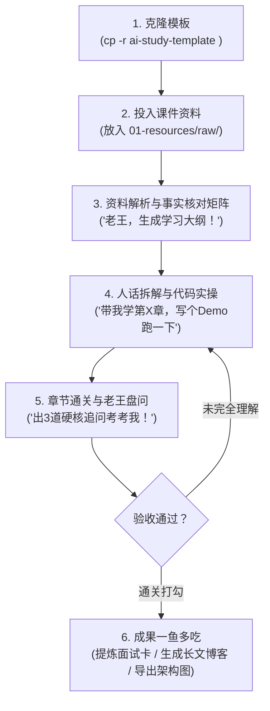

# 📖 研学模板完全使用指南 (User Handbook)

> 欢迎使用 **通用技术研学与框架深潜模板**！  
> 本手册教你如何从零开始克隆模板、导入资料、让老王私教带学、跑通实操代码、通关技术盘问，并最终一鱼多吃产出博客与面试资产。

---

## 目录索引

- [1. 研学全流程全景图](#1-研学全流程全景图)
- [2. 第一步：创建你的专属研学项目](#2-第一步创建你的专属研学项目)
- [3. 第二步：导入学习资料 (支持多种格式)](#3-第二步导入学习资料-支持多种格式)
- [4. 第三步：开学！常用交互口令 (Prompt 清单)](#4-第三步开学常用交互口令-prompt-清单)
  - [Phase 1: 扫描资料与大纲拆解](#phase-1-扫描资料与大纲拆解)
  - [Phase 2: 动机穿透与人话带学](#phase-2-动机穿透与人话带学)
  - [Phase 3: 实操实验与故障排障](#phase-3-实操实验与故障排障)
  - [Phase 4: 章节验收与老王灵魂盘问](#phase-4-章节验收与老王灵魂盘问)
- [5. 第四步：资产提炼与一鱼多吃](#5-第四步资产提炼与一鱼多吃)
  - [场景 A：一键反哺给 ai-learn 面试题库](#场景-a一键反哺给-ai-learn-面试题库)
  - [场景 B：一键生成全网技术博客并直推草稿箱](#场景-b一键生成全网技术博客并直推草稿箱)
  - [场景 C：编译交互式架构图与手绘图](#场景-c编译交互式架构图与手绘图)
- [6. 核心目录与文件职能速查表](#6-核心目录与文件职能速查表)
- [7. 常见问题解答 (FAQ)](#7-常见问题解答-faq)

---

## 1. 研学全流程全景图



---

## 2. 第一步：创建你的专属研学项目

每次要学一个新框架或新技术（如 Pi Agent、LangGraph、vLLM、Dify、CrewAI），只需在终端复制一份模板并重命名：

```bash
# 进入研学工程所在的父目录
cd /Users/lijiaxin/PyCharmMiscProject/ai-research

# 复制模板并命名为你的新项目，例如 pi-agent-study
cp -r ai-study-template pi-agent-study

# 进入新项目
cd pi-agent-study
```

在你的 IDE（PyCharm / VS Code / Cursor）中打开这个新目录即可。

---

## 3. 第二步：导入学习资料 (支持多种格式)

把你的所有原始材料直接丢进 `01-resources/raw/` 目录：

### 支持的材料类型：
1. **Jupyter Notebook (`.ipynb`)**：如各培训课、教程配套的 ipynb 文件。
2. **源码与 Demo 压缩包 (`.zip` / `.tar.gz`)**：配套实战代码包直接扔进去，Agent 会自动解压到 `02-labs/` 供你实操。
3. **技术文章 / Markdown (`.md` / `.txt`)**：官方文档导出、博客合集。
4. **PDF 课件与电子书 (`.pdf`)**：直接拖入 `raw/` 目录。
5. **飞书云文档**：如果你拿到了飞书或豆包文档链接，直接把 URL 发给 Agent，Agent 内置的 `lark-doc` 会自主拉取并转换为 Markdown 存入 `raw/`。

---

## 4. 第三步：开学！常用交互口令 (Prompt 清单)

直接在对话框中给老王发指令，常用的“黄金口令”如下：

### Phase 1: 扫描资料与大纲拆解
> 💬 **你**：「老王，我已经把课件放进 `01-resources/raw/` 了。帮我通读扫描一遍，提炼出全景学习大纲 `syllabus.md`，把每个章节的核心考点、实战项目和学习时间预估列出来！」

- **Agent 动作**：解析全部课件，生成 `01-resources/syllabus.md`，建立章节打卡任务列表与初始技术事实核对表。

---

### Phase 2: 动机穿透与人话带学（专治生涩 AI 课件）
> 💬 **你**：「老王，开始带我啃第一章！记住：先讲人话和直觉隐喻，告诉我以前遇到了什么痛点为什么要有这玩意，再对照代码看执行流，顺便把核心事实矩阵列出来，千万别漏掉关键参数！」

- **Agent 动作**：
  1. 穿透动机：用大白话讲清楚“为什么作者要这么设计”；
  2. 源码执行流：直接指出代码入口（函数、入参、循环）；
  3. 全量事实核对表：列出该章全部配置项、参数、异常分支，存入 `03-notes/concepts/<topic>.md`。

---

### Phase 3: 实操实验与故障排障
> 💬 **你**：「老王，光看文档没感觉。在 `02-labs/` 里给我写一个本章的最小可运行 Demo，带我亲手跑一下！跑通后故意改错一个参数，考考我怎么看报错排障。」

- **Agent 动作**：
  1. 在 `02-labs/playground/` 或 `milestones/` 搭建隔离可运行脚本；
  2. 引导你在终端执行命令，观察输出；
  3. 故意制造边界报错，带你在 `03-notes/debug-log.md` 记录排障实录。

---

### Phase 4: 章节验收与老王灵魂盘问
> 💬 **你**：「这一节我看完了，代码也跑通了。老王，扮演严苛面试官，出 3 道带坑的硬核技术追问考考我！」

- **Agent 动作**：
  1. 抛出 3 道考察边界条件、异常流转或架构取舍的灵魂拷问；
  2. 听到你的口语化回答后，指出逻辑漏洞，打磨你的表达，确认通关后在 `syllabus.md` 上打勾。

---

## 5. 第四步：资产提炼与一鱼多吃

学透一个模块或整个框架后，立刻召唤工具提炼高价值资产：

### 场景 A：一键反哺给 `ai-learn` 面试题库
> 💬 **你**：「老王，把这次学完的 Pi Agent 核心考点提炼成 2 道高分面试题卡，格式要对齐 `ai-learn` 的规范！」

- **产出路径**：`04-outputs/interview-cards/`
- **使用方式**：直接复制文件到 `/Users/lijiaxin/PyCharmMiscProject/ai-research/ai-learn/01-interview-qa/03-agent/` 即可入库！

---

### 场景 B：一键生成全网技术博客并直推草稿箱
> 💬 **你**：「老王，把这次的实战和笔记，写成一篇深度技术长文母稿，并帮我同步推送到掘金和知乎草稿箱！」

- **Agent 动作**：
  1. 自动调用 `article-gen` 聚合笔记与实验代码，遵循 `humanizer-zh` 规范生成 `04-articles/drafts/<title>.md`；
  2. 自动调用 `gpt-image-gen` 生成工坊手账风 16:9 封面与 Style 12 正文总结卡；
  3. 调用 `article-publisher` 自动推送到知乎、掘金、CSDN 草稿箱（零封号风险）。

---

### 场景 C：编译交互式架构图与手绘图
> 💬 **你**：「老王，把本框架的执行流和核心架构画出来，我要交互式的矢量图和手绘白板图！」

- **系统拓扑**：调用 `/archify` 生成可缩放、支持暗黑模式的交互式 HTML/SVG，存入 `assets/architecture/`；
- **手绘白板思维导图**：调用 `excalidraw-gen` 输出霞鹜文楷手绘图，存入 `assets/excalidraw/`。

---

### 场景 D：一键发布到 GitHub Pages 在线知识站与演播胶片
> 💬 **你**：「老王，把这次学完的框架内容整理成在线专栏，一键发布到我的 knowledge-notes 和 knowledge-notes-deck，更新我的 github.io！」

- **在线知识库 (Site)**：将提炼好的结构化 Markdown 写入 `04-outputs/site-docs/`，并一键同步到本地 `knowledge-notes/content/`，推送到 GitHub 触发 Astro CI/CD 自动部署至 `https://<user>.github.io/knowledge-notes/`！
- **演示胶片 (Deck)**：生成高交互演播页面写入 `04-outputs/deck-slides/`，同步到 `knowledge-notes-deck/` 部署至 `https://<user>.github.io/knowledge-notes-deck/`！

---

## 6. 核心目录与文件职能速查表

| 目录/文件 | 你的动作 | Agent 动作 |
|---|---|---|
| `01-resources/raw/` | 把课件文件直接丢这里 | 自动扫描、解压并阅读解析 |
| `01-resources/syllabus.md` | 查看学习进度与打卡状态 | 自动生成与更新进度勾选框 |
| `02-labs/` | 运行脚本、敲代码、测试功能 | 编写 Demo、引导运行、注入故障 |
| `03-notes/concepts/` | 复习大白话心智模型与技术事实 | 记录脱水后的人话剖析与参数矩阵 |
| `03-notes/debug-log.md` | 查看踩坑经验与报错原因 | 记录每次报错现场与根因分析 |
| `04-articles/` | 审核博客底稿与封面插图 | 自动生成多平台排版与一键同步 |
| `04-outputs/interview-cards/` | 拷贝进 `ai-learn` 面试题库 | 提炼结构化的高分面试题解 |
| `assets/` | 查看生成的图表与插画 | 自动编译交互式架构图与手账配图 |

---

## 7. 常见问题解答 (FAQ)

### Q1: 课件太大（几个 G 的视频或大模型权重包）怎么办？
- 不要把大体积的视频或几百兆的大模型权重文件塞进 Git！
- 课件只保留代码、Notebook、PDF 与文字说明；大文件配置在 `.gitignore` 中或直接通过绝对路径引用。

### Q2: 课件里讲的代码版本老了，报错怎么办？
- 遇到报错直接把终端报错信息甩给老王（“老王，跑这个脚本报了 `TypeError`，看看咋回事”）；
- 老王暴躁归暴躁，但会查明依赖版本差异，在 `03-notes/debug-log.md` 记录解决办法，并修改为兼容当前版本的正确代码。

### Q3: 为什么不要直接在 `ai-learn` 里做这些实验？
- `ai-learn` 是你的**核心弹药库**（面试八股、标准答卷、全量知识站），保持极度精简和规范；
- 研学项目（如 `pi-agent-study`）是你的**试验场与练兵场**，你可以在里面随意 `npm install`、`pip install`、打断点、删改代码，完全不用担心搞崩主工程！
