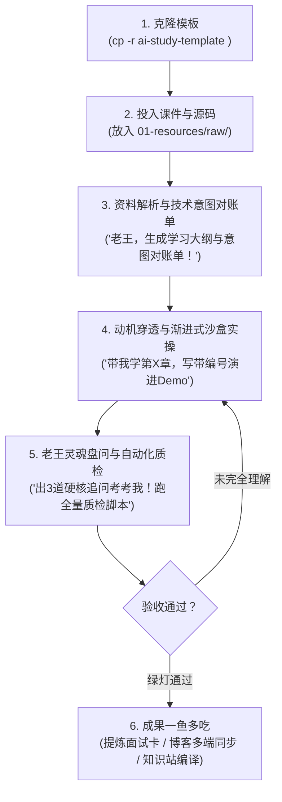

# 📖 通用研学模板完全使用指南 (Universal Study Handbook)

> 欢迎使用 **通用技术研学与框架深潜模板**！  
> 本手册适用于学习**任何 AI 框架、基础设施、大模型工具链或现代复杂软件工程**（例如 LangGraph、vLLM、LlamaIndex、AutoGen、DeepSeek Harness、AgentCore、Kubernetes 等）。  
> 帮助你从零导入资料、由 AI 私教深度拆解、跑通渐进式实操沙盒、通关架构盘问，并一鱼多吃沉淀博客与面试资产。

---

## 目录索引

- [1. 研学全流程全景图](#1-研学全流程全景图)
- [2. 第一步：创建你的专属研学项目](#2-第一步创建你的专属研学项目)
- [3. 第二步：导入学习资料 (支持多种格式)](#3-第二步导入学习资料-支持多种格式)
- [4. 第三步：开学！常用交互口令 (Prompt 清单)](#4-第三步开学常用交互口令-prompt-清单)
  - [Phase 1: 扫描资料与意图对账单](#phase-1-扫描资料与意图对账单)
  - [Phase 2: 动机穿透与执行流深潜](#phase-2-动机穿透与执行流深潜)
  - [Phase 3: 渐进式实操与故障排障](#phase-3-渐进式实操与故障排障)
  - [Phase 4: 老王灵魂盘问与质检交付](#phase-4-老王灵魂盘问与质检交付)
- [5. 第四步：资产提炼与一鱼多吃](#5-第四步资产提炼与一鱼多吃)
  - [场景 A：一键反哺给 ai-learn 面试题库](#场景-a一键反哺给-ai-learn-面试题库)
  - [场景 B：一键生成全网技术博客并直推草稿箱](#场景-b一键生成全网技术博客并直推草稿箱)
  - [场景 C：编译交互式架构图与手绘图](#场景-c编译交互式架构图与手绘图)
- [6. 核心目录与文件职能速查表](#6-核心目录与文件职能速查表)
- [7. 常见问题解答 (FAQ)](#7-常见问题解答-faq)

---

## 1. 研学全流程全景图



---

## 2. 第一步：创建你的专属研学项目

每次要研学一个新技术或新框架（如 `langgraph-study`, `vllm-study`, `llamaindex-study`），只需在父工作目录下复制一份模板并重命名：

```bash
# 复制模板并命名为你的新项目
cp -r ai-study-template <new-project-name>

# 进入新项目
cd <new-project-name>
```

在你的 IDE（PyCharm / VS Code / Cursor）中打开这个新目录即可开始。

---

## 3. 第二步：导入学习资料 (支持多种格式)

把你的所有原始材料直接丢进 `01-resources/raw/` 目录：

### 支持的材料类型：
1. **Jupyter Notebook (`.ipynb`)**：各官方教程、实验配套的 ipynb 文件。
2. **源码与 Demo 压缩包 (`.zip` / `.tar.gz`)**：源码包直接放进去，Agent 会自动解压到 `02-labs/` 供你实操。
3. **技术文章 / 官方文档导出 (`.md` / `.txt` / `.html`)**。
4. **PDF 课件与电子书 (`.pdf`)**。
5. **飞书/豆包云文档**：把云文档 URL 发给 Agent，内置的 `lark-doc` 技能会自动抓取并转为 Markdown 存入 `raw/`。

---

## 4. 第三步：开学！常用交互口令 (Prompt 清单)

直接在对话框中给私教发指令，常用的“黄金口令”如下：

### Phase 1: 扫描资料、建立大纲与全量点验台账（建立防偏航 SSOT）
> 💬 **你**：「老王，我已经把材料放进 `01-resources/raw/` 了。帮我通读扫描一遍，提炼全景学习大纲 `syllabus.md`，建立《全量知识点验台账 `knowledge-ledger.md`》与《技术意图对账单 `intent-manifest.md`》，100% 覆盖所有小节和命令，严禁跳讲漏讲！」

- **Agent 动作**：
  1. 扫描全部资料，生成 `syllabus.md` 进度看板；
  2. 生成 `01-resources/knowledge-ledger.md`，逐行点验官方课件的每一个小节、运行形态与依赖；
  3. 生成 `01-resources/intent-manifest.md`，锁定每一章的技术内核与主客体拓扑，彻底杜绝后续长对话中把“被测靶场当主角”的走形乌龙。

---

### Phase 2: 动机穿透与执行流深潜（零打扰·直击本质·零断层）
> 💬 **你**：「老王，开啃第 X 章！讲人话，先说痛点和生活比方，若有形态切换先讲过渡，若有命令先解密来源，对照源码看核心执行流，别整无意义的业务废话！」

- **Agent 动作**：
  1. **后台静默自检**：完成剥离玩具外衣、界定主客体关系、溯源官方验收指标；
  2. **形态跃迁与命令溯源**：若从 SDK 切换到 CLI，自动输出过渡篇；若出现斜杠命令，白纸黑字交代注册来源与执行时序；
  3. **输出 10 秒心智锚点**：在笔记开头明确指出本节技术内核、主控引擎与被测客体，**无需你回复确认，直接顺畅学习**；
  4. **深入剖析**：动机穿透、核心调度循环流程图、全量配置核对表。

---

### Phase 3: 渐进式实操与故障排障（拒绝一锅端）
> 💬 **你**：「老王，在 `02-labs/milestones/` 给我复现这章的渐进式代码，按 01-最简启动、02-核心机制、03-高阶演进拆分，告诉我终端敲什么命令跑起来！」

- **Agent 动作**：
  1. 在沙盒中创建带编号的独立演进文件（`01-minimal-...`, `02-...`）；
  2. 每一阶段顶部明确标注认知增量与终端运行命令；
  3. 提供可观察的终端日志和生命周期证据。

---

### Phase 4: 老王灵魂盘问与质检交付（闭卷检验·零报错门禁）
> 💬 **你**：「这章我敲完了，出 3 道带陷阱的硬核问题考考我！顺便跑一下全量自动化质检脚本！」

- **Agent 动作**：
  1. 抛出 3 道涵盖边界条件、架构权衡、生产改造的硬核技术连环炮；
  2. 在后台自动运行 `bash scripts/verify-all.sh`，确保所有图表合法、链接无死链、静态站构建 0 报错；
  3. 质检绿灯后，就地嵌入本章的 Style 2 瑞士方格手账卡。

---

## 5. 第四步：资产提炼与一鱼多吃

学透一个技术后，一键将其转化为外部资产：

### 场景 A：一键反哺给 `ai-learn` 面试题库
> 💬 **你**：「老王，根据我们刚学透的这个核心机制，提炼 2 道大厂高频面试题，严格按照 ai-learn 模板生成面试卡片！」
- 成果沉淀至 `04-outputs/interview-cards/`，可无缝拷入 `ai-learn/01-interview-qa/`。

### 场景 B：一键生成全网技术博客并直推草稿箱
> 💬 **你**：「老王，把这一章的深度剖析整理成一篇高质量技术博客，去 AI 油腻感，生成知乎/掘金/CSDN/小红书版本，并推送到平台草稿箱！」
- 成果存入 `04-articles/`，调用 `article-publisher` 直推各大平台。

### 场景 C：在线知识站全量预览
```bash
cd 04-outputs/site
npm run dev
# 浏览器打开 http://localhost:4321 即可查看现代化的研学全景知识库
```

---

## 6. 核心目录与文件职能速查表

| 目录/文件 | 职能定义 | 是否进入 Git 追踪 |
|---|---|---|
| `AGENTS.md` | 研学中枢协议与行为铁律 (SSOT) | ✅ 必须追踪 |
| `01-resources/raw/` | 原始资料存放地 | ❌ `.gitignore` 忽略体积大的压缩包/PDF |
| `01-resources/intent-manifest.md` | 技术意图与角色对账单 (防走形定海神针) | ✅ 必须追踪 |
| `02-labs/milestones/` | 渐进式实操沙盒代码 | ✅ 必须追踪 |
| `03-notes/concepts/` | 核心概念精讲与全量技术事实核对表 | ✅ 必须追踪 |
| `04-outputs/site/` | Astro 静态知识站 | ✅ 必须追踪 |
| `scripts/verify-all.sh` | 自动化质检脚本 | ✅ 必须追踪 |
| `assets/images/` | 高清手账总结图原件 | ✅ 必须追踪 |

---

## 7. 常见问题解答 (FAQ)

**Q1：如何防止长对话中 Agent 出现幻觉或抓着无关业务代码自嗨？**  
A：检查 `01-resources/intent-manifest.md` 是否已正确生成。该文件明确规定了每一章的“宿主引擎”与“被测客体”。如果 Agent 出现偏移，只需提醒一句：“对照 intent-manifest，聚焦技术内核，剥离业务外皮”。

**Q2：为什么强调实操代码要带编号渐进式编写？**  
A：若在同一文件上反复覆盖修改，会导致学习者后续无法回溯“从 0 到 1”的技术增量。带编号的独立切片能让你随时回溯任何一个历史认知切片。

**Q3：如何保证交付的 Markdown 文档没有语法报错或死链？**  
A：Agent 交付前必须在后台执行 `bash scripts/verify-all.sh`，该脚本会自动扫描 Mermaid 保留字冲突、本地相对路径有效性并校验静态站构建。
